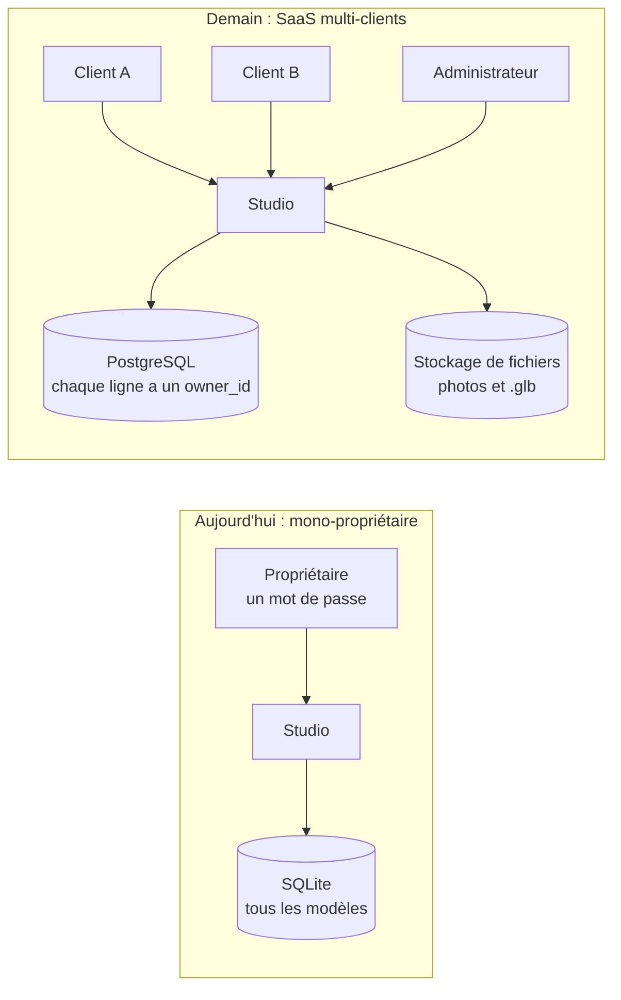
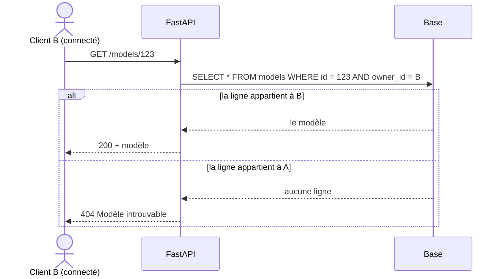
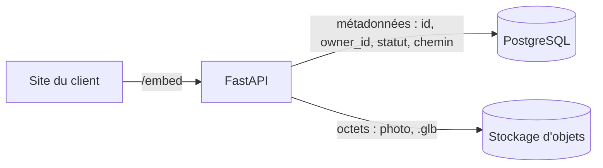
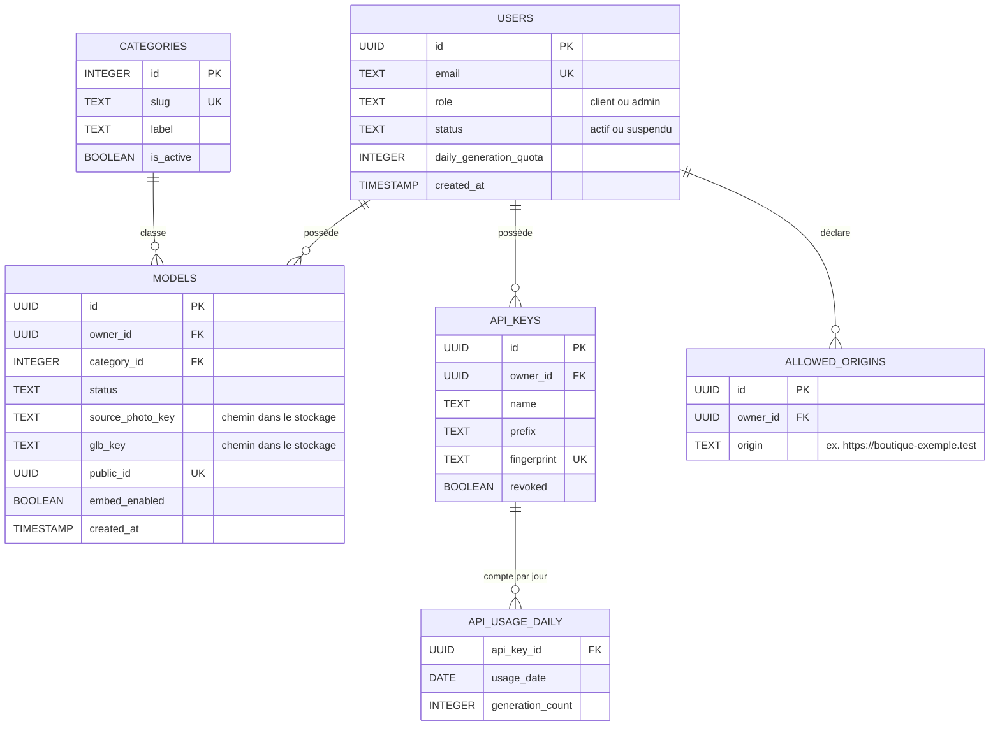
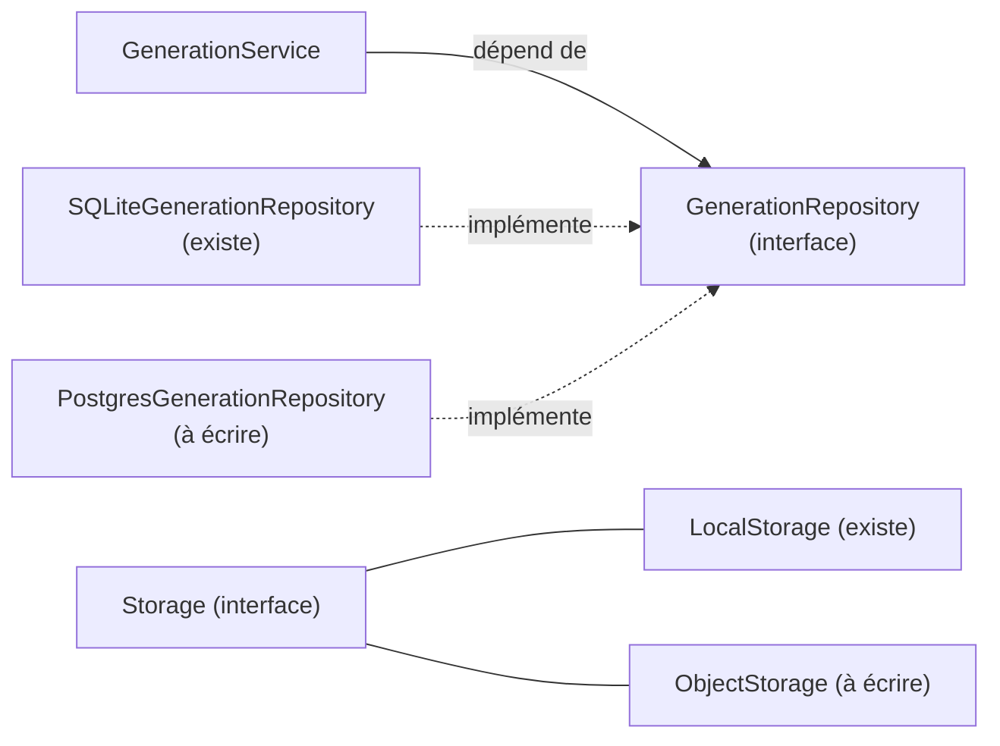

# Architecture cible — du Studio privé au SaaS multi-clients

> **Statut : document de conception, rien n'est codé.**
> Décision de l'étudiante (option C) : pour la soutenance, Forma3D reste une **console privée mono-propriétaire**. Ce document décrit ce qu'il faudrait construire pour en faire un **SaaS multi-clients**, et pourquoi ce n'est pas fait maintenant.
> Les limites des offres gratuites citées ici changent souvent : elles sont marquées **« à vérifier sur le site officiel »**, avec le lien à consulter.

Sommaire :

1. Aujourd'hui contre demain
2. Les trois rôles
3. L'isolation des données (multi-tenant)
4. Base de données et fichiers à l'hébergement
5. Les trois options (A, B, C)
6. Schéma cible des tables
7. Le vrai goulot : le GPU gratuit
8. RGPD et données personnelles
9. Comment le code actuel prépare la migration
10. Plan d'une première version
11. Ce que je dis à ma professeure

---

## 1. Aujourd'hui contre demain

**En une phrase :** aujourd'hui une seule personne utilise le Studio ; demain, chaque client aurait son compte et ne verrait que ses propres modèles.



| | Aujourd'hui (code actuel) | Demain (architecture cible) |
|---|---|---|
| Qui se connecte | La propriétaire seule (`FORMA3D_OWNER_PASSWORD`) | Des clients inscrits + un administrateur |
| Inscription | Aucune | Courriel + mot de passe, confirmation, mot de passe oublié |
| Données | Toutes visibles par la propriétaire | Chaque client voit **seulement les siennes** |
| Base | SQLite, un fichier local | PostgreSQL hébergé |
| Fichiers `.glb` et photos | Disque local `backend/storage/` | Stockage de fichiers séparé (« object storage ») |
| Hébergement | PC de l'étudiante, `127.0.0.1` | Serveur public en HTTPS |
| Génération 3D | Space TRELLIS gratuit, jeton de la propriétaire | Même goulot, partagé par tous les clients (section 7) |

---

## 2. Les trois rôles

**En une phrase :** le visiteur regarde, le client gère ses modèles, l'administrateur gère la plateforme.

| Action | Visiteur (anonyme) | Client inscrit | Administrateur |
|---|---|---|---|
| Voir un modèle intégré sur un site | ✅ si le modèle est activé et le site autorisé | ✅ | ✅ |
| S'inscrire, se connecter | — | ✅ | ✅ |
| Créer un modèle à partir d'une photo | ❌ | ✅ ses modèles, dans son quota | ✅ |
| Voir la liste des modèles | ❌ | ✅ **seulement les siens** | ✅ tous |
| Activer l'intégration, copier le code | ❌ | ✅ ses modèles | ✅ |
| Créer / révoquer des clés API | ❌ | ✅ ses clés | ✅ toutes |
| Déclarer ses sites autorisés (iframe) | ❌ | ✅ ses sites | ✅ |
| Supprimer un modèle | ❌ | ✅ les siens | ✅ tous |
| Gérer les catégories partagées | ❌ | ❌ | ✅ |
| Voir, suspendre un client, changer son quota | ❌ | ❌ | ✅ |
| Voir les statistiques globales | ❌ | ❌ | ✅ |

🔁 **Analogie Keycloak / Spring Security** : ce sont des **rôles** (`ROLE_CLIENT`, `ROLE_ADMIN`). Le rôle dit **ce qu'on a le droit de faire** ; l'`owner_id` (section 3) dit **sur quelles données**.

---

## 3. L'isolation des données (multi-tenant)

**En une phrase :** chaque ligne appartient à un client (`owner_id`), et chaque requête vérifie que la ressource demandée appartient bien à la personne connectée.

### 3.1 Le principe

- **Multi-tenant** : une seule application et une seule base servent plusieurs clients (« locataires »), dont les données sont séparées logiquement.
- Chaque table « privée » reçoit une colonne **`owner_id`** : `models`, `api_keys`, `allowed_origins`.
- **La règle d'or** : *chaque requête vérifie que la ressource appartient à la personne connectée.* Il ne suffit pas d'être connecté ; il faut être **le propriétaire de cette ligne-là**.



On répond **404** plutôt que 403 : on ne révèle même pas que le modèle 123 existe.

### 3.2 Exemple concret de faille si on l'oublie

Imaginons la route de suppression écrite ainsi :

```sql
DELETE FROM models WHERE id = :id          -- ❌ oubli de owner_id
```

1. La cliente A crée un modèle ; son identifiant apparaît dans l'adresse : `#/modeles/123`.
2. Le client B, connecté avec **son** compte, envoie `DELETE /models/123`.
3. Le serveur vérifie seulement « B est connecté » → le modèle **de A** est supprimé.

C'est la faille n° 1 des API : **IDOR** (*Insecure Direct Object Reference*, ou « contrôle d'accès défaillant », en tête du classement OWASP). La bonne requête :

```sql
DELETE FROM models WHERE id = :id AND owner_id = :utilisateur_connecte   -- ✅
```

Les UUID (impossibles à deviner) **réduisent** le risque mais **ne le suppriment pas** : un identifiant peut fuiter (capture d'écran, journal, lien partagé).

### 3.3 Deux niveaux de défense

| Niveau | Comment | Option |
|---|---|---|
| Dans le code | Chaque méthode du dépôt reçoit `owner_id` et l'ajoute dans le `WHERE` | A et B |
| Dans la base | **RLS** (*Row Level Security*) : PostgreSQL refuse lui-même les lignes d'un autre, même si le code oublie le filtre | A (Supabase l'active facilement) ; possible en B |

Et dans les deux cas : des **tests d'isolation** (« B ne voit pas, ne modifie pas, ne supprime pas les modèles de A »).

---

## 4. Base de données et fichiers à l'hébergement

### 4.1 SQLite est une vraie base…

SQLite est un vrai moteur SQL (transactions, clés étrangères, contraintes `CHECK`) utilisé dans les téléphones, les navigateurs et de nombreux logiciels. Pour un prototype local mono-utilisateur, c'est le bon choix (voir `docs/STOCKAGE.md`).

### 4.2 … mais pose problème une fois hébergée

| Problème | Explication |
|---|---|
| **Disque éphémère** | Beaucoup d'hébergeurs gratuits recréent la machine à chaque redémarrage ou déploiement : le fichier `forma3d.sqlite3` et le dossier `backend/storage/` sont **effacés**. |
| **Plusieurs serveurs** | Pour tenir la charge, on lance plusieurs copies du serveur. Chacune aurait **son propre fichier** SQLite : les données divergent. |
| **Un seul écrivain à la fois** | SQLite verrouille le fichier pendant une écriture ; avec beaucoup de clients simultanés, cela devient un goulot. |
| **Sauvegardes** | Il faut organiser soi-même la copie du fichier. |

### 4.3 Il faut aussi un stockage de fichiers séparé

On oublie souvent ce point : **les photos et les `.glb` sont bien plus lourds que la base** (environ 1,5 Mo par GLB TRELLIS mesuré). Ils ne vont pas dans PostgreSQL ; ils vont dans un **stockage d'objets** (*object storage* : Supabase Storage, ou équivalent compatible S3). La base garde seulement le **chemin** du fichier et son `owner_id`.



---

## 5. Les trois options

| Critère | **A. Supabase** | **B. PostgreSQL + auth maison** | **C. Rester mono-propriétaire** |
|---|---|---|---|
| Base | PostgreSQL géré par Supabase | PostgreSQL hébergé (par exemple Neon) | SQLite actuel |
| Inscription / connexion | **Supabase Auth** fourni : courriel, confirmation, mot de passe oublié | Tout à écrire dans FastAPI : hachage des mots de passe, sessions, réinitialisation, envoi de courriels | Mot de passe unique actuel |
| Isolation | `owner_id` + **RLS** activée dans la base | `owner_id` vérifié dans chaque route (RLS possible mais à configurer soi-même) | Sans objet |
| Fichiers | **Supabase Storage** | Un autre service à choisir | Disque local |
| Travail estimé | Moyen (1 à 2 semaines pour une V1) | Élevé (2 à 4 semaines) | Nul |
| Risque | Dépendance à un service externe ; projet gratuit mis en pause en cas d'inactivité (**à vérifier**) | Fort : l'authentification écrite à la main est facile à mal faire | Faible ; limite assumée |
| Ce que je dirais au jury | « J'ai délégué l'authentification à un service éprouvé et protégé les données dans la base avec RLS. » | « J'ai tout écrit, donc tout ce code de sécurité est à défendre ligne par ligne. » | « Le produit est stable ; la suite est conçue et documentée. » |

**Limites des offres gratuites — à vérifier sur le site officiel avant toute décision :**

| Service | Ce qu'il faut vérifier | Lien officiel |
|---|---|---|
| Supabase | Taille de base, taille du stockage, nombre d'utilisateurs Auth, **mise en pause après inactivité**, nombre de projets gratuits | https://supabase.com/pricing |
| Supabase RLS | Fonctionnement des politiques | https://supabase.com/docs/guides/database/postgres/row-level-security |
| Supabase Auth | Inscription, confirmation, réinitialisation | https://supabase.com/docs/guides/auth |
| Supabase Storage | Stockage des fichiers et règles d'accès | https://supabase.com/docs/guides/storage |
| Neon (exemple pour l'option B) | Taille, mise en veille, heures de calcul | https://neon.tech/pricing |
| Hugging Face ZeroGPU | Quota GPU par compte gratuit et sans compte | https://huggingface.co/docs/hub/spaces-zerogpu |

D'après mes connaissances, l'offre gratuite de Supabase tournait autour de 500 Mo de base et 1 Go de fichiers, avec une mise en pause après environ une semaine sans activité : **à vérifier**, ces chiffres changent.

**Recommandation** : C pour la soutenance (décision prise), A si le projet continue après.

---

## 6. Schéma cible des tables

**En une phrase :** une table `users` est ajoutée, et chaque donnée privée pointe vers son propriétaire.



Différences avec le schéma actuel (`docs/STOCKAGE.md`, `docs/COMPRENDRE-FORMA3D.md` section 6) :

| Aujourd'hui | Demain | Pourquoi |
|---|---|---|
| Pas de `users` | `users` (avec Supabase : liée à `auth.users`, le mot de passe n'est jamais dans nos tables) | Comptes et rôles |
| `generations` sans propriétaire | `models.owner_id` | Isolation |
| `api_keys` sans propriétaire | `api_keys.owner_id` | Une clé appartient à un client et n'accède qu'à ses modèles |
| `EMBED_ALLOWED_ORIGINS` dans `.env`, commun à tous | Table `allowed_origins` par client | Chaque client déclare ses propres sites |
| `source_photo_path`, `glb_path` (chemins disque) | `source_photo_key`, `glb_key` (clés dans le stockage d'objets) | Les fichiers quittent le disque local |
| Catégories partagées | Inchangé, gérées par l'administrateur | Simplicité |

---

## 7. Le vrai goulot : le GPU gratuit

**En une phrase :** un SaaS gratuit bute sur la génération 3D bien avant la base de données.

| Problème | Explication | Observé dans le projet |
|---|---|---|
| **Quota partagé** | La génération passe par le Space TRELLIS avec **le jeton de la propriétaire**. Tous les clients consommeraient **le même quota GPU quotidien** (ZeroGPU). | Quota épuisé plusieurs fois pendant les essais |
| **Ordre de grandeur** | Une génération TRELLIS a duré environ 1 min 30 à 2 min. Le quota journalier gratuit serait d'environ 2 minutes de GPU sans compte et 5 minutes avec un compte gratuit : **à vérifier** sur https://huggingface.co/docs/hub/spaces-zerogpu. Avec ces chiffres, quelques générations par jour pour **toute** la plateforme. | — |
| **Lenteur, indisponibilité** | Space public partagé : file d'attente, mise en veille, pannes. | Le 15 novembre 2026, la connexion seule au Space a pris 26 s ; un délai HTTP de 5 s provoquait des échecs (corrigé : 120 s) |
| **Contournement interdit** | Multiplier les comptes ou les jetons pour obtenir plus de quota viole les conditions d'utilisation et la règle du projet. | Décision de l'étudiante |
| **Conditions et licences** | Utiliser un Space public comme moteur d'un service commercial pose une question de conditions d'utilisation ; TRELLIS (code et poids) est sous licence MIT, mais l'usage commercial des modèles produits via le Space reste **à vérifier**. | `docs/ALTERNATIVES-3D.md`, `docs/QUALITE-3D.md` |

**Perspectives honnêtes** (aucune n'est gratuite et illimitée) :

- un GPU loué à l'heure ou un service d'inférence payant (exclu par la règle « 100 % gratuit ») ;
- faire tourner TRELLIS sur son propre serveur GPU ;
- garder un quota **par client** côté Forma3D pour répartir équitablement une ressource rare.

---

## 8. RGPD et données personnelles

**En une phrase :** dès qu'il y a des inscriptions, on stocke des données personnelles, et la loi impose des obligations.

| Obligation | Ce qu'il faudrait faire dans Forma3D |
|---|---|
| **Minimisation** | Ne demander que le courriel (et le nom de la boutique si utile) |
| **Information et consentement** | Page « Politique de confidentialité » ; case à cocher non pré-cochée à l'inscription ; pas de traceur publicitaire |
| **Droit d'accès et d'export** | Bouton « Télécharger mes données » (modèles, clés, sites) |
| **Droit à l'effacement** | Bouton « Supprimer mon compte » : supprime le compte, ses modèles, ses fichiers, ses clés |
| **Sécurité** | HTTPS, mots de passe hachés (fait par Supabase Auth en option A), sauvegardes, accès administrateur limité |
| **Sous-traitants** | Déclarer les services utilisés (Supabase, Hugging Face) ; les photos envoyées au Space quittent la plateforme |
| **Photos** | Interdire les photos de personnes (règle déjà affichée dans le Studio : « N'envoyez pas de visages ni de données personnelles ») |
| **Durée de conservation** | Supprimer les comptes inactifs après une durée annoncée |

⚠️ Le RGPD s'applique aux personnes situées dans l'Union européenne. En Tunisie, la protection des données personnelles relève de la loi organique n° 2004-63 et de l'INPDP (https://www.inpdp.tn) : **à vérifier** selon où sont les clients. Références : CNIL https://www.cnil.fr/fr/reglement-europeen-protection-donnees.

---

## 9. Comment le code actuel prépare la migration

**En une phrase :** le service de génération ne connaît pas SQLite ; il dépend d'une **interface**, donc on peut changer de base sans le réécrire.

### 9.1 L'interface (le contrat)

Extrait réel de `backend/app/repositories/base.py` :

```python
class GenerationRepository(Protocol):
    """Contrat minimal pour les générations visibles dans l'application."""

    def save_generation(self, record: GenerationRecord) -> None: ...
    def get_generation(self, generation_id: str) -> GenerationRecord | None: ...
    def get_generation_by_public_id(self, public_id: str) -> GenerationRecord | None: ...
    def set_embed_enabled(self, generation_id: str, enabled: bool) -> GenerationRecord | None: ...
    def delete_generation(self, generation_id: str) -> bool: ...
    def list_completed_generations(self) -> list[GenerationRecord]: ...
    # … catégories, clés API, quotas
```

### 9.2 Le service dépend du contrat, pas de SQLite

Extrait réel de `backend/app/services/generation_service.py` :

```python
class GenerationService:
    def __init__(self, provider: Image3DProvider, storage: Storage,
                 repository: GenerationRepository, ...) -> None:
        self._repository = repository
```

### 9.3 Le seul endroit qui choisit SQLite

Extrait réel de `backend/app/main.py` :

```python
generation_repository = SQLiteGenerationRepository(
    _PROJECT_ROOT / "backend" / "data" / "forma3d.sqlite3"
)
```



🔁 **Analogie Spring** : `GenerationRepository` est une interface Java ; `SQLiteGenerationRepository` est une implémentation ; `main.py` joue le rôle de la configuration qui injecte le bean. Écrire `PostgresGenerationRepository` et changer **une ligne** dans `main.py` suffit pour les routes et le service. Il en va de même pour `Storage` (`backend/app/storage/base.py`) et le stockage des fichiers.

⚠️ **Ce que l'interface ne fait pas toute seule** : pour le multi-tenant, les méthodes devront **recevoir l'`owner_id`** (`get_generation(generation_id, owner_id)`). Le contrat changera donc un peu, et les routes devront transmettre l'utilisateur connecté. C'est le vrai travail de la migration.

---

## 10. Plan d'une première version (option A)

| Étape | Contenu | Livrable vérifiable |
|---|---|---|
| 1 | Créer un projet Supabase, écrire le schéma (section 6), activer RLS | Requêtes SQL d'un client B refusées sur les lignes de A |
| 2 | `PostgresGenerationRepository` derrière l'interface existante | Toute la suite pytest passe avec PostgreSQL |
| 3 | Supabase Auth : inscription, connexion ; FastAPI vérifie le jeton envoyé | Un client inscrit accède au Studio, un anonyme reçoit 401 |
| 4 | `owner_id` partout + tests d'isolation | « B ne voit, ne modifie, ne supprime rien de A » |
| 5 | Rôle administrateur, quotas par client | Un administrateur suspend un client ; le quota bloque la 6e création |
| 6 | Photos et `.glb` dans Supabase Storage | Un redémarrage du serveur ne perd aucun fichier |
| 7 | RGPD : politique, export, suppression de compte | Un compte supprimé ne laisse ni ligne ni fichier |
| 8 | Déploiement HTTPS | Le widget fonctionne depuis un vrai site en ligne |

**À éviter juste avant la soutenance :**

- ❌ commencer une migration de base de données moins d'une semaine avant ;
- ❌ écrire une authentification maison « vite fait » ;
- ❌ héberger publiquement le Studio actuel : il n'a qu'un mot de passe et tourne en HTTP ;
- ❌ dépendre d'une génération en direct pour la démo : générer les modèles **à l'avance**.

---

## 11. Ce que je dis à ma professeure

Dix phrases prêtes à dire à l'oral :

1. « Pour la soutenance, j'ai volontairement gardé une console privée mono-propriétaire : le produit est stable et chaque partie est testée. »
2. « La suite logique est un SaaS multi-clients avec trois rôles : visiteur, client inscrit et administrateur. »
3. « La règle de sécurité la plus importante est l'isolation : chaque ligne a un `owner_id`, et chaque requête vérifie que la ressource appartient à la personne connectée. »
4. « Si on oublie ce filtre, un client peut supprimer le modèle d'un autre en changeant un identifiant : c'est la faille IDOR, la première du classement OWASP. »
5. « SQLite est une vraie base, mais un hébergeur gratuit efface souvent le disque, et plusieurs serveurs ne peuvent pas partager un fichier ; il faudrait PostgreSQL et un stockage de fichiers séparé. »
6. « J'ai comparé trois options et je recommande Supabase : authentification éprouvée, isolation garantie par la base avec Row Level Security, et stockage de fichiers inclus. »
7. « Mon code est déjà prêt pour ce changement : le service dépend de l'interface `GenerationRepository`, pas de SQLite, comme une interface et ses implémentations en Spring. »
8. « Le vrai goulot n'est pas la base mais le GPU : le quota gratuit de Hugging Face serait partagé par tous les clients, et le Space public peut être lent ou indisponible. »
9. « Dès qu'il y a des inscriptions, il y a des données personnelles : il faudrait une politique de confidentialité, un export et une suppression de compte, conformément au RGPD. »
10. « Je n'ai pas contourné les quotas gratuits et je présente honnêtement ces limites : c'est un prototype de démonstration, pas un service de production. »
