# Comprendre Forma3D Studio — le guide complet

> **Mise à jour du 16 novembre 2026 (projet DevOps) :** SQLite a été retiré du code. PostgreSQL est désormais la seule base (`backend/app/repositories/postgres_repository.py`, variable `DATABASE_URL` obligatoire). Les sections 3 à 6, 20 et 22 ont été mises à jour ; les données ont été migrées (`docs/devops/phase-03d.md`).

> Document pédagogique pour comprendre **tout** le projet et l'expliquer à un jury.
> Il décrit uniquement ce qui existe dans le dépôt au 15 novembre 2026 (dernier commit lu : `95f2d86`, après l'ajout de la suppression des modèles, de la session persistante facultative et de l'architecture cible).
> Quand une information n'a pas pu être vérifiée dans le code, elle est marquée **« à vérifier »**.

---

## 0. Comment lire ce document

**En une phrase :** chaque section commence par un résumé « En une phrase », puis détaille avec des tableaux, des schémas et des exemples.

- **Si vous avez 10 minutes :** lisez les sections 1, 3 et 11 (le projet, l'architecture, les parcours).
- **Pour la soutenance :** ajoutez les sections 10 (le site page par page) et 12 (la sécurité).
- **Pour comprendre le code :** sections 4, 5, 6 et 8.
- **Si le badge « Serveur 3D » est rouge :** section 17.
- **Pour la suite du projet (SaaS) :** section 18 et `docs/ARCHITECTURE-CIBLE.md`.
- **Pour Git, les branches et les pull requests :** section 19.
- **Pour le détail de chaque fichier du backend :** section 20 ; **du frontend, des tests et de la CI :** section 21.
- **Pour comprendre la façon d'écrire le code (techniques Python, JavaScript, CSS, tests) :** section 22.
- Les sections importantes se terminent par trois encadrés : **Un exemple concret**, **Une analogie** et **Ce que je réponds si on me demande pourquoi**.
- Les schémas sont écrits en **Mermaid** (un langage texte que GitHub transforme en dessin). Sur GitHub, ils s'affichent automatiquement.
- Des **analogies** avec ce que vous connaissez déjà (Angular, Spring Boot, Keycloak, Oracle PL/SQL, Symfony) sont signalées par 🔁.

Légende :

| Symbole | Sens |
|---|---|
| 🔁 | Analogie avec une technologie que vous connaissez |
| ⚠️ | Piège, limite ou point temporaire |
| ✅ | Vérifié dans le code ou par un test |
| **à vérifier** | Information non confirmée par le code |

---

## 1. Le projet en 5 minutes

**En une phrase :** Forma3D Studio transforme une photo de petit meuble en modèle 3D, permet de le vérifier, puis de l'afficher sur le site d'une boutique en ligne.

### Le problème

Une boutique en ligne montre ses produits avec des photos plates. Un modèle 3D (que l'on fait tourner à la souris) aide l'acheteur, mais il coûte cher à fabriquer : il faut un logiciel 3D et une personne formée.

### La solution

1. La propriétaire du Studio envoie **une photo** d'un meuble (chaise, tabouret, table d'appoint).
2. Un **modèle d'intelligence artificielle déjà entraîné** (TripoSR ou TRELLIS) fabrique un fichier 3D `.glb`.
3. Le Studio affiche ce modèle, le compare à la photo et permet de le télécharger.
4. La propriétaire **active l'intégration** : un site partenaire peut alors afficher le modèle avec une simple balise HTML.
5. Un développeur partenaire peut aussi piloter Forma3D par une **API** protégée par une **clé API**.

### Pour qui ?

| Personne | Ce qu'elle fait |
|---|---|
| **La propriétaire** (vous) | Utilise le Studio : crée, importe, vérifie et publie les modèles. Seule personne qui se connecte. |
| **Le développeur d'une boutique** | Utilise une clé API et le code d'intégration (iframe ou widget). |
| **Le visiteur final** | Voit et fait tourner le modèle 3D sur la page produit de la boutique. |
| **Le jury** | Doit comprendre un prototype honnête sur ses limites. |

### Ce que le projet n'est PAS

- ❌ **Aucun entraînement de modèle** : le projet utilise uniquement des modèles **pré-entraînés** (déjà appris par d'autres équipes). Aucun réseau de neurones n'est entraîné ou ajusté.
- ❌ **Aucune API payante** : tout est gratuit. Les services gratuits ont des **quotas** (limites journalières) et peuvent être hors ligne.
- ❌ **Pas un service de production** : c'est un prototype de soutenance, à utiliser en local tant qu'il n'est pas déployé en HTTPS.
- ❌ **Pas de comptes multiples** : un seul mot de passe, celui de la propriétaire. Le passage à un SaaS multi-clients est **conçu mais pas codé** (section 18 et `docs/ARCHITECTURE-CIBLE.md`).
- ❌ **Pas une reconstruction exacte** : une seule photo ne montre pas l'arrière de l'objet ; le modèle est une **estimation**, pas un plan de fabrication.

---

## 2. Le format `.glb`

**En une phrase :** un fichier `.glb` est un objet 3D complet (forme, couleurs, matériaux) rangé dans un seul fichier binaire que les navigateurs savent afficher.

### Ce que c'est

- **glTF** (GL Transmission Format) est le format 3D standard du web, publié par le Khronos Group. On le surnomme « le JPEG de la 3D ».
- **GLB** est la version **binaire** de glTF : tout tient dans **un seul fichier**.
- Un fichier GLB contient deux parties appelées **chunks** (morceaux) :

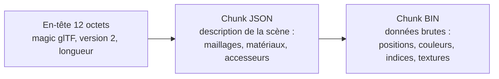

| Partie | Contenu | 🔁 Analogie |
|---|---|---|
| En-tête | Le mot `glTF`, la version `2`, la longueur totale | La signature d'un fichier |
| Chunk JSON | La **description** : quels maillages, quels matériaux, où lire les nombres | Le schéma d'une table Oracle |
| Chunk BIN | Les **nombres** : coordonnées des sommets, triangles, image de texture | Les lignes de la table |

Le code du projet vérifie cette structure dans `DemoGallery.is_valid_glb_2()` (`backend/app/services/demo_gallery.py`) et `HuggingFaceSpaceProvider._read_glb()` (`backend/app/providers/huggingface.py`). ✅

### Vocabulaire de la 3D

| Terme | Définition simple |
|---|---|
| **Sommet** (vertex) | Un point dans l'espace (x, y, z) |
| **Triangle** | Trois sommets reliés ; la surface d'un objet est faite de milliers de triangles |
| **Maillage** (mesh) | L'ensemble des triangles d'un objet |
| **Normale** | Une flèche perpendiculaire à la surface ; elle sert à calculer la lumière |
| **Matériau** | Comment la surface réagit à la lumière : couleur, aspect **métallique**, **rugosité** |
| **Texture** | Une image collée sur la surface (comme un papier peint) |

### Couleurs de sommets contre textures

| | Couleurs de sommets (TripoSR) | Texture (TRELLIS) |
|---|---|---|
| Principe | Chaque sommet porte une couleur ; entre deux sommets, la couleur est mélangée | Une image PNG est plaquée sur la surface grâce à des coordonnées UV |
| Précision | Faible : les détails fins disparaissent | Bonne : motifs, cannage de l'assise visibles |
| Mesuré dans le projet | 20 000 à 65 000 sommets, aucun matériau, aucune normale | Texture PNG d'environ 1 Mo, un matériau, pas de normales |

⚠️ **Piège découvert dans le projet** : quand un GLB n'a pas de matériau, ou qu'il oublie la valeur `metallicFactor`, la norme glTF le considère **100 % métallique**. Le modèle paraît alors presque noir. Le projet corrige cela à deux endroits (voir section 7) : à l'affichage (`frontend/js/views/model-appearance.js`) et dans le fichier lui-même (`backend/app/services/glb_finisher.py`).

### Comment un navigateur l'affiche

Le navigateur utilise **WebGL** (la carte graphique depuis JavaScript). Le projet n'écrit pas de WebGL à la main : il utilise le composant **`<model-viewer>`** de Google, chargé depuis un CDN dans `frontend/index.html`. On écrit simplement :

```html
<model-viewer src="/models/gallery/chair-bentwood" camera-controls auto-rotate></model-viewer>
```

### Où les GLB sont stockés

| Dossier | Contenu | Suivi par Git ? |
|---|---|---|
| `backend/storage/models/` | GLB générés, importés ou copiés depuis les exemples (nommés par un UUID) | ❌ non (ignoré) |
| `backend/storage/images/` | Photos sources envoyées | ❌ non |
| `backend/data/feasibility-results/` | Les 5 GLB du catalogue d'exemples | ❌ non |
| `backend/data/feasibility-results-triposr/` | Sauvegarde des 3 anciens exemples TripoSR remplacés par TRELLIS | ❌ non |
| `backend/data/trials/` | GLB bruts des essais de fournisseurs | ❌ non |

Les fichiers 3D et la base sont **locaux** : ils ne partent jamais sur GitHub.

### Comment un GLB entre dans le projet

1. **Génération** : une photo est envoyée au fournisseur (TripoSR ou TRELLIS), qui renvoie un GLB ; le service le **finit** (matériau, normales) puis l'enregistre.
2. **Import** : la propriétaire importe un `.glb` existant depuis « Mes modèles ».
3. **Copie d'exemple** : un exemple du catalogue est copié dans « Mes modèles ».

### Ouvrir un GLB sur votre PC

- **Windows** : double-cliquez sur le fichier ; il s'ouvre dans la **Visionneuse 3D** de Windows (application « 3D Viewer », à installer depuis le Microsoft Store si elle n'est pas présente — **à vérifier** sur votre version de Windows).
- **Blender** (gratuit) : menu *File → Import → glTF 2.0 (.glb/.gltf)*.
- **Dans le Studio** : page Créer, bouton « Aperçu d'un fichier GLB (sans enregistrer) » ; le fichier est lu par le navigateur et n'est pas envoyé au serveur.

---

## 3. Architecture

**En une phrase :** un navigateur parle à un serveur FastAPI, qui range les informations dans PostgreSQL, les fichiers sur le disque, et demande les modèles 3D à un service d'IA externe.

### 3.1 Les composants

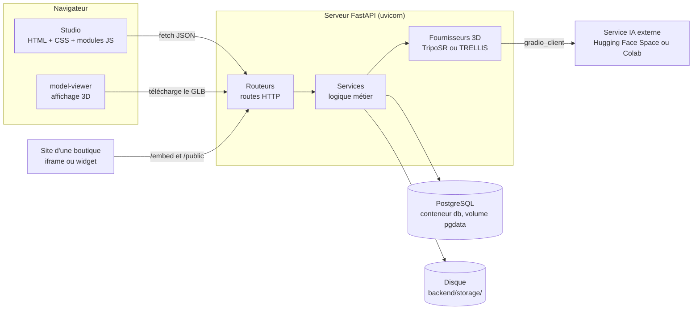

🔁 **Analogie Spring Boot** : les **routeurs** sont les `@RestController`, les **services** sont les `@Service`, les **dépôts** (repositories) sont les `@Repository`. FastAPI joue le rôle de Spring Boot, uvicorn celui de Tomcat.

🔁 **Analogie Angular** : le frontend n'utilise **pas** Angular. C'est du JavaScript « vanille » organisé en modules : `router.js` joue le rôle du `RouterModule`, chaque fichier de `pages/` est comme un composant, `api.js` est comme un `HttpClient` centralisé dans un service.

### 3.2 Le parcours complet d'un modèle

```mermaid
flowchart LR
    A["1. Photo<br/>JPG, PNG ou WebP"] --> B["2. Validation<br/>format, 10 Mo max"]
    B --> C["3. Préparation<br/>carré, marges, 512 px min"]
    C --> D["4. Génération<br/>TripoSR ou TRELLIS"]
    D --> E["5. Finition GLB<br/>matériau mat + normales"]
    E --> F["6. Stockage<br/>disque + PostgreSQL"]
    F --> G["7. Viewer<br/>fiche du modèle"]
    G --> H["8. Activation<br/>de l'intégration"]
    H --> I["9. Site client<br/>iframe ou widget"]
```

### 3.3 Séquence d'une génération

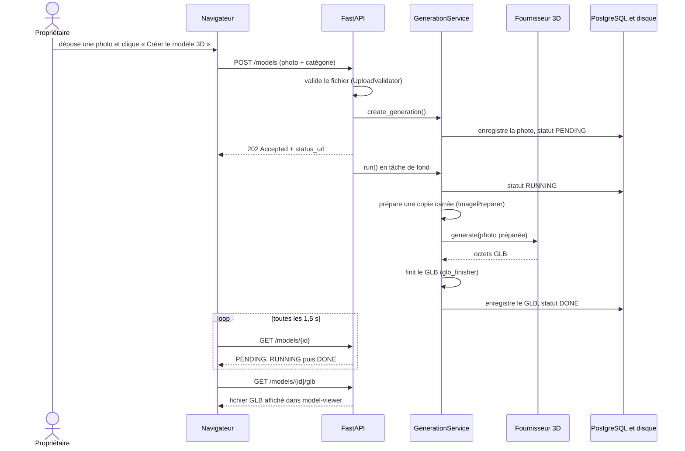

⚠️ Le statut terminé s'appelle **`DONE`** dans le code (pas `COMPLETED`). ✅


### 3.4 Un exemple concret : la photo du fauteuil vert, de bout en bout

Le 15 novembre 2026, la propriétaire a envoyé `fauteuil-retro-sur-fond-blanc….webp` (fauteuil vert, fond blanc uni) dans la catégorie « Chaise ».

| Étape | Ce qui s'est passé réellement | Où dans le code |
|---|---|---|
| 1 | Le navigateur envoie la photo : `POST /models` | `frontend/js/api.js` → `createGeneration()` |
| 2 | Le serveur vérifie extension, type, **signature** (premiers octets) et taille ≤ 10 Mo | `services/upload_validator.py` |
| 3 | La photo est rangée dans `backend/storage/images/{uuid}.webp` ; une ligne `PENDING` est créée dans PostgreSQL | `generation_service.create_generation()` |
| 4 | Réponse immédiate `202 Accepted` ; la génération continue en tâche de fond (`RUNNING`) | `routers/models.py`, `BackgroundTasks` |
| 5 | Une copie carrée à marges est préparée (512 px minimum) | `services/image_preparer.py` |
| 6 | TRELLIS : connexion au Space, `/start_session`, détourage `/preprocess_image`, puis `/generate_and_extract_glb` | `providers/trellis.py` |
| 7 | Le GLB reçu est vérifié, fini (matériau mat, normales) et écrit dans `backend/storage/models/{uuid}.glb` ; statut `DONE` | `glb_finisher.py`, `local_storage.py` |
| 8 | La page, qui interrogeait `GET /models/{id}` toutes les 1,5 s, affiche le modèle | `pages/create.js` |
| 9 | Sur la fiche, l'intégration est activée : le modèle reçoit une adresse publique `/embed/{public_id}` | `PATCH /models/{id}/integration` |
| 10 | Une page servie sur le port 8081 (« site vitrine » de test) affiche le fauteuil grâce au widget | `frontend/widget.js`, `EMBED_ALLOWED_ORIGINS` |

> **Une analogie.** 🔁 C'est une application Spring Boot classique : un `@RestController` reçoit le fichier, un `@Service` orchestre, un `@Repository` écrit en base, et une méthode `@Async` fait le travail long. La différence : le « gros calcul » (l'IA) est délégué à un service externe, comme un microservice appelé par HTTP.

> **Ce que je réponds si on me demande pourquoi.** « J'ai séparé routes, services, dépôts et fournisseurs pour que chaque couche soit testable seule et remplaçable : je peux changer de fournisseur 3D ou de base de données sans réécrire le reste. La génération est asynchrone parce qu'elle dure une à deux minutes : on ne bloque pas la requête HTTP pendant ce temps. »

---

## 4. Technologies

**En une phrase :** le projet utilise volontairement peu de technologies, toutes gratuites, pour rester explicable.

### 4.1 Tableau récapitulatif

| Technologie | Rôle | Pourquoi ce choix | Alternative possible | Où dans le code |
|---|---|---|---|---|
| **Python 3** | Langage du serveur | Écosystème IA (gradio_client) | Java | `backend/` |
| **FastAPI** | Framework web | Simple, rapide, documentation automatique | Spring Boot, Symfony, Flask | `backend/app/main.py`, `routers/` |
| **uvicorn** | Serveur HTTP qui exécute FastAPI | Standard pour FastAPI | Tomcat (Java), gunicorn | commande de lancement |
| **Pydantic** | Validation des données JSON | Intégré à FastAPI | Bean Validation (Java) | `backend/app/schemas.py` |
| **python-multipart** | Lecture des formulaires avec fichier | Nécessaire pour l'upload | — | upload `POST /models` |
| **python-dotenv** | Lecture du fichier `.env` | Garde les secrets hors du code | variables système | `backend/app/config.py` |
| **PostgreSQL 17** (+ pilote `psycopg`) | Base de données | Vrai serveur SQL, conteneur séparé, verrous par ligne | MySQL, Oracle | `repositories/postgres_repository.py` |
| **Pillow** | Traitement d'image | Léger, sans IA | OpenCV | `services/image_preparer.py` |
| **gradio_client** | Appel des services IA Gradio | Bibliothèque officielle | requêtes HTTP à la main | `providers/huggingface.py`, `providers/trellis.py` |
| **httpx2** | Requêtes HTTP (contrôle de santé du fournisseur) | Client HTTP moderne | requests | `providers/huggingface.py`, `providers/trellis.py` |
| **Hugging Face Spaces** | Hébergement gratuit de démonstrations IA | Gratuit avec quota | Replicate (payant) | configuration `TRELLIS_SPACE_ID` |
| **Google Colab** | GPU gratuit temporaire pour TripoSR | Gratuit, sans carte | serveur GPU payant | `tools/colab/triposr_server.ipynb` |
| **TripoSR** | Modèle image→3D (couleurs de sommets) | Premier modèle qui a fonctionné | — | fournisseur par défaut |
| **TRELLIS** | Modèle image→3D (texture) | Meilleures couleurs mesurées | Hunyuan3D (licence exclut l'UE) | `providers/trellis.py` |
| **model-viewer** | Composant web d'affichage 3D | Une balise HTML suffit | Three.js | `frontend/index.html`, `pages/` |
| **Modules ES** | Découpage du JavaScript en fichiers | Natif, sans outil de build | Angular, webpack | `frontend/js/` |
| **Web Components** | Balise HTML personnalisée `<forma3d-viewer>` | Fonctionne sur tout site | iframe seule | `frontend/widget.js` |
| **pytest** | Tests automatiques | Standard Python | JUnit | `backend/tests/` |
| **GitHub Actions** | Intégration continue | Gratuit pour un dépôt GitHub | GitLab CI, Jenkins | `.github/workflows/ci.yml` |

### 4.2 Explications simples

- **FastAPI** : on écrit une fonction Python et on la décore avec `@router.get("/chemin")`. FastAPI la transforme en route HTTP, vérifie les données et génère une documentation interactive sur `/docs`. 🔁 C'est un `@GetMapping` de Spring Boot.
- **uvicorn** : le programme qui écoute sur un port (ex. 8000) et transmet les requêtes à FastAPI. 🔁 Tomcat pour Spring Boot.
- **Pydantic** : des classes qui décrivent la forme d'un JSON (`class LoginRequest(BaseModel): password: str`). Si le JSON reçu ne correspond pas, FastAPI répond 422. 🔁 DTO + `@Valid`.
- **PostgreSQL** : un serveur de base de données SQL, lancé dans son propre conteneur Docker ; `psycopg` est le pilote Python qui lui parle. 🔁 Comme Oracle, avec un utilisateur et une base dédiés. (SQLite, un simple fichier, a servi jusqu'au 16 novembre 2026.)
- **Pillow** : ouvre une image, la redimensionne, ajoute des marges, mesure la netteté.
- **gradio_client** : **Gradio** est une bibliothèque qui crée une page web autour d'un modèle IA. `gradio_client` permet d'appeler cette page **depuis un programme**. Le projet appelle toujours `view_api()` d'abord pour lire les fonctions réellement disponibles (le « contrat »).
- **Hugging Face Spaces** : un site qui héberge gratuitement des démonstrations IA. Le GPU gratuit (**ZeroGPU**) a un **quota par jour**.
- **TripoSR** : modèle de Stability AI et Tripo AI, qui produit une forme fidèle mais des couleurs approximatives.
- **TRELLIS** : modèle de Microsoft, qui produit un maillage avec une **texture** (meilleures couleurs), mais qui peut inventer des parties cachées.
- **model-viewer** : une balise HTML fournie par Google qui affiche un GLB avec rotation, zoom et éclairage.
- **Modules ES** : `import { x } from "./api.js?v=..."`. Le navigateur charge les fichiers à la demande. Le paramètre `?v=20261115-e1` est une **clé de cache** (unique pour tout le frontend, changée le 15 novembre 2026) : on la change quand le code change, pour que le navigateur ne garde pas l'ancienne version.
- **Web Components** : on définit une nouvelle balise (`customElements.define("forma3d-viewer", ...)`) utilisable dans n'importe quelle page HTML, même sans framework.
- **pytest** : chaque fonction `test_...` est exécutée ; si une ligne `assert` échoue, le test échoue.
- **GitHub Actions** : à chaque `git push`, GitHub lance les tests sur une machine virtuelle (voir section 14).

---

## 5. Arborescence et relations entre fichiers

**En une phrase :** le dépôt est découpé en `backend/` (serveur Python), `frontend/` (interface servie par le serveur), `docs/` (documentation) et quelques outils, chaque fichier ayant un seul rôle.

### 5.1 Tous les fichiers suivis par Git

#### Racine

| Fichier | Rôle |
|---|---|
| `.env.example` | Modèle des variables d'environnement, **sans secret** (voir section 9) |
| `.github/workflows/ci.yml` | Intégration continue : tests à chaque push |
| `.gitignore` | Liste de ce que Git ne doit pas suivre (`.env`, base, GLB, photos…) |
| `AGENTS.md` | Règles permanentes du projet pour les assistants IA |
| `DESIGN.md` | Règles visuelles : couleurs, typographie, composants |
| `PRODUCT.md` | Vision produit, utilisateurs, limites |
| `README.md` | Présentation et démarrage du dépôt |

#### Backend — application (`backend/app/`)

| Fichier | Rôle |
|---|---|
| `backend/README.md` | Explications du backend |
| `backend/requirements.txt` | Dépendances Python (FastAPI, uvicorn, Pillow…) |
| `backend/app/__init__.py` | Fait de `app` un paquet Python (vide) |
| `backend/app/main.py` | **Point d'entrée** : crée l'application, choisit le fournisseur, branche les routeurs, sert la page `/` |
| `backend/app/config.py` | Lit les variables d'environnement et les valide (`Settings`) |
| `backend/app/models.py` | Objets métier : `GenerationRecord`, `CategoryRecord`, `APIKeyRecord`, statuts, origines |
| `backend/app/schemas.py` | Formes des réponses et requêtes JSON (Pydantic) |
| `backend/app/providers/__init__.py` | Paquet des fournisseurs (vide) |
| `backend/app/providers/base.py` | Contrat `Image3DProvider` : « une image entre, des octets GLB sortent » |
| `backend/app/providers/huggingface.py` | Fournisseur **TripoSR** (Space Hugging Face ou URL Gradio Colab) |
| `backend/app/providers/trellis.py` | Fournisseur **TRELLIS** (Space public, détourage puis GLB texturé) |
| `backend/app/repositories/__init__.py` | Paquet des dépôts (vide) |
| `backend/app/repositories/base.py` | Contrat `GenerationRepository` : toutes les opérations de base de données |
| `backend/app/repositories/postgres_repository.py` | Implémentation PostgreSQL : tables, migrations, requêtes, verrous |
| `backend/app/repositories/factory.py` | Lit `DATABASE_URL` (obligatoire) et crée le dépôt PostgreSQL |
| `backend/app/routers/__init__.py` | Paquet des routeurs (vide) |
| `backend/app/routers/auth.py` | Connexion : `/auth/login`, `/auth/logout`, `/auth/me`, dépendance `require_owner` |
| `backend/app/routers/models.py` | Modèles du Studio : création, galerie, import, copie, intégration, fichiers ; routes `/public` |
| `backend/app/routers/categories.py` | CRUD des catégories |
| `backend/app/routers/api_keys.py` | Gestion des clés API et dépendance `require_api_key` |
| `backend/app/routers/api_v1.py` | API externe versionnée `/api/v1` (protégée par clé) |
| `backend/app/routers/embed.py` | Page publique `/embed/{public_id}` affichée dans une iframe |
| `backend/app/services/__init__.py` | Paquet des services (vide) |
| `backend/app/services/generation_service.py` | Orchestration : états, préparation, fournisseur, finition, stockage |
| `backend/app/services/upload_validator.py` | Vérifie format et taille de la photo |
| `backend/app/services/image_preparer.py` | Prépare une copie carrée de la photo et signale flou ou petite taille |
| `backend/app/services/glb_finisher.py` | Ajoute matériau mat et normales aux GLB générés |
| `backend/app/services/category_service.py` | Règles métier des catégories |
| `backend/app/services/api_key_service.py` | Création, empreinte, vérification, quotas des clés |
| `backend/app/services/demo_gallery.py` | Liste fixe des 5 exemples du catalogue |
| `backend/app/services/owner_auth.py` | Mot de passe, jetons de session signés, limite de tentatives |
| `backend/app/storage/__init__.py` | Paquet du stockage (vide) |
| `backend/app/storage/base.py` | Contrat `Storage` (enregistrer photo et GLB) |
| `backend/app/storage/local_storage.py` | Stockage sur le disque local, écriture atomique |

#### Backend — tests (`backend/tests/`)

| Fichier | Ce qu'il vérifie |
|---|---|
| `conftest.py` | Ouvre la session propriétaire pour les tests, sauf ceux marqués `real_auth` |
| `test_api_keys.py` | Empreinte seule, secret affiché une fois, révocation, suppression définitive, quotas |
| `test_api_settings.py` | Validation des quotas et des origines CORS/iframe |
| `test_api_v1.py` | API externe : clé, statuts, erreurs, quota |
| `test_auth.py` | Connexion : 401 sans cookie, mot de passe faux, limite, routes publiques ouvertes, clé de session fixe facultative |
| `test_categories_api.py` | Routes des catégories |
| `test_category_repository.py` | Catégories en base PostgreSQL |
| `test_category_service.py` | Règles des catégories |
| `test_demo_gallery.py` | Catalogue d'exemples : seuls les fichiers connus et valides (isolé de la base de travail) |
| `test_embed.py` | Page `/embed` et politique de sécurité CSP |
| `test_frontend.py` | Fichiers du frontend : présence des éléments, `fetch` seulement dans `api.js` |
| `test_generation_repository.py` | Historique des générations en base, redémarrage, migrations |
| `test_postgres_repository.py` | Dépôt PostgreSQL : cas limites, chemins portables, concurrence |
| `pg_support.py` | Outils des tests : base `forma3d_test`, remise à zéro, requêtes |
| `test_generation_service.py` | États PENDING → DONE ou FAILED, photo préparée |
| `test_glb_finisher.py` | Finition des GLB sans modifier la géométrie |
| `test_health.py` | Routes `/health` et `/health/provider` (indépendant de `backend/.env`) |
| `test_huggingface_provider.py` | Fournisseur TripoSR avec client simulé |
| `test_image_preparer.py` | Préparation de la photo |
| `test_local_storage.py` | Écriture des fichiers |
| `test_model_library.py` | Import GLB et copie d'exemple |
| `test_models_api.py` | Routes `/models` |
| `test_model_deletion.py` | Suppression d'un modèle : ligne, GLB et photo effacés ; refus pendant la création, pour un exemple ou sans connexion |
| `test_trellis_provider.py` | Fournisseur TRELLIS avec client simulé |
| `test_trial_tools.py` | Outils d'essai de fournisseurs |
| `test_upload_validator.py` | Validation des photos |

#### Frontend (`frontend/`)

| Fichier | Rôle |
|---|---|
| `frontend/README.md` | Explications du frontend |
| `frontend/index.html` | **Coque** : en-tête, menu, pied de page, point de montage `#app` |
| `frontend/favicon.svg` | Icône d'onglet |
| `frontend/widget.js` | Balise `<forma3d-viewer>` pour les sites partenaires |
| `frontend/css/theme.css` | Couleurs, espacements, animations |
| `frontend/css/components.css` | Styles de tous les composants (14 sections) |
| `frontend/js/main.js` | Démarrage : vérifie la session, lance le routeur, surveille le serveur 3D |
| `frontend/js/router.js` | Routes `#/...`, protection par connexion, changement de page |
| `frontend/js/api.js` | **Seul fichier qui appelle le serveur** (`fetch`) |
| `frontend/js/auth.js` | État de connexion (lu sur `/auth/me`) |
| `frontend/js/state.js` | État temporaire d'une génération en cours |
| `frontend/js/format.js` | Dates relatives, tailles, durées, fournisseur des exemples |
| `frontend/js/pages/login.js` | Page Connexion |
| `frontend/js/pages/dashboard.js` | Page Accueil |
| `frontend/js/pages/create.js` | Page Créer |
| `frontend/js/pages/viewer-markup.js` | HTML du viewer de la page Créer |
| `frontend/js/pages/models.js` | Page Mes modèles |
| `frontend/js/pages/model-detail.js` | Fiche d'un modèle |
| `frontend/js/pages/examples.js` | Page Exemples |
| `frontend/js/pages/categories.js` | Page Catégories |
| `frontend/js/pages/api-keys.js` | Page Clés API |
| `frontend/js/pages/guide.js` | Page Guide d'intégration |
| `frontend/js/views/uploader.js` | Dépôt et validation de la photo |
| `frontend/js/views/progress.js` | Les 5 étapes du suivi de création |
| `frontend/js/views/viewer.js` | Viewer 3D de la page Créer |
| `frontend/js/views/gallery.js` | Cartes de modèles et filtres |
| `frontend/js/views/categories.js` | Gestion des catégories |
| `frontend/js/views/confirm-dialog.js` | Fenêtre de confirmation |
| `frontend/js/views/illustrations.js` | Dessin SVG du cube (états vides) |
| `frontend/js/views/model-appearance.js` | Correction du matériau et recadrage de la caméra |

#### Documentation (`docs/`)

| Fichier | Rôle |
|---|---|
| `docs/COMPRENDRE-FORMA3D.md` | Ce guide |
| `docs/ARCHITECTURE-CIBLE.md` | Conception du futur SaaS multi-clients (rien n'est codé) |
| `docs/ETAT.md` | État d'avancement, étape par étape |
| `docs/STRUCTURE.md` | Rôle de chaque fichier et dossier |
| `docs/STOCKAGE.md` | Persistance (historique SQLite, aujourd'hui PostgreSQL), fichiers, intégration |
| `docs/INTEGRATION.md` | Guide pour le développeur d'une boutique |
| `docs/ALTERNATIVES-3D.md` | Comparaison des fournisseurs 3D gratuits |
| `docs/QUALITE-3D.md` | Grille de qualité et résultats d'essais |
| `docs/etapes/.gitkeep` | Garde le dossier dans Git |
| `docs/etapes/etape-01.md` | Structure et contrôle de santé |
| `docs/etapes/etape-02.md` | Validation de l'upload |
| `docs/etapes/etape-03.md` | Contrat image→3D et fournisseur Hugging Face |
| `docs/etapes/etape-04.md` | Génération, états et stockage local |
| `docs/etapes/etape-05.md` | Interface modulaire et viewer |
| `docs/etapes/etape-06.md` | Essais TripoSR réels |
| `docs/etapes/etape-06-colab.md` | TripoSR, Colab et limites du serveur public |
| `docs/etapes/etape-07.md` | Fiabilité et qualité |
| `docs/etapes/etape-08.md` | Historique persistant (SQLite à l'époque) |
| `docs/etapes/etape-09.md` | CRUD des catégories |
| `docs/etapes/etape-10.md` | Préparation locale de la photo |
| `docs/etapes/etape-11.md` | Refonte de la navigation |
| `docs/etapes/etape-11b.md` | Refonte de la page Créer |
| `docs/etapes/etape-12.md` | Import GLB et bibliothèque unifiée |
| `docs/etapes/etape-13.md` | Identifiant public et activation (Sprint 5a) |
| `docs/etapes/etape-14.md` | Clés API (Sprint 5b) |
| `docs/etapes/etape-15.md` | API versionnée (Sprint 5c) |
| `docs/etapes/etape-16.md` | Intégration dans une boutique (Sprint 5d) |
| `docs/etapes/etape-16b.md` | Refonte visuelle du Studio |
| `docs/etapes/etape-17.md` | Guide intégrateur et preuve sur un autre site (Sprint 5e) |
| `docs/etapes/etape-18.md` | Connexion côté serveur (Sprint 5f) |
| `docs/etapes/etape-19.md` | Rendu fidèle des GLB (sous-étape A) |
| `docs/etapes/etape-20.md` | Finition serveur des GLB (sous-étape B) |
| `docs/etapes/etape-21.md` | Grille de qualité et essais de fournisseurs (sous-étape C) |
| `docs/etapes/etape-22.md` | TRELLIS branché dans Forma3D (sous-étape C3) |
| `docs/etapes/etape-23.md` | Suppression d'un modèle depuis sa fiche |
| `docs/etapes/etape-24.md` | Clé de session fixe facultative (`FORMA3D_SESSION_SECRET`) |
| `docs/archive/v1/AGENTS-ancien.md` | Ancienne version des règles (historique) |
| `docs/archive/v1/PROMPT-1-v1.md` | Ancienne consigne de démarrage (historique) |
| `docs/archive/v1/etapes/etape-01-v1.md` | Ancienne étape 1 (historique) |
| `docs/archive/v1/etapes/etape-02-v1.md` | Ancienne étape 2 (historique) |

#### Outils et exemples

| Fichier | Rôle |
|---|---|
| `examples/integration.html` | Faux « site de boutique » pour tester le widget |
| `scripts/dev.ps1` | Script Windows : crée l'environnement, lance les tests **isolés de `backend/.env`**, puis démarre le serveur sur le port 8001 (avec `backend/.env`) |
| `tools/colab/triposr_server.ipynb` | Notebook Colab historique de TripoSR (hors application) |
| `tools/trials/trial_trellis.py` | Essai TRELLIS reproductible (hors application) |
| `tools/trials/trial_models.py` | Essai de plusieurs modèles (hors application) |

### 5.2 Qui importe qui — backend

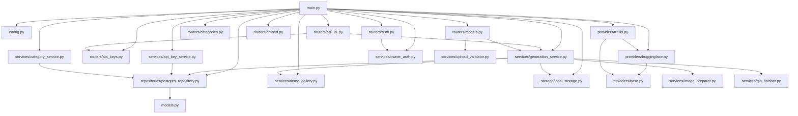

### 5.3 Qui importe qui — frontend

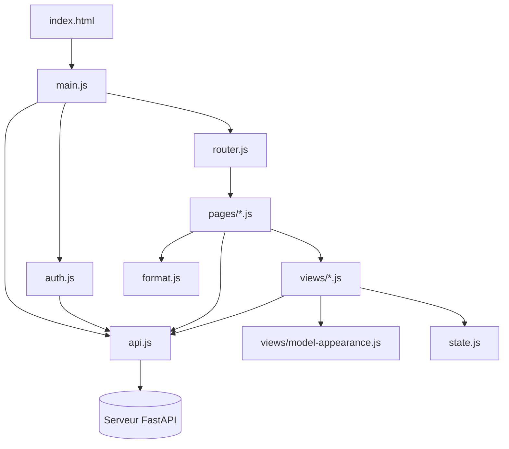

Règle vérifiée par un test (`test_frontend.py`) : **seul `api.js` contient `fetch(`**. ✅ 🔁 Comme un service Angular unique qui centralise tous les appels `HttpClient`.

### 5.4 La chaîne complète sur un exemple réel : « Créer le modèle 3D »

| # | Couche | Fichier et fonction | Ce qui se passe |
|---|---|---|---|
| 1 | Page | `frontend/js/views/uploader.js` → écouteur `submit` du formulaire `#upload-form` | Vérifie qu'une photo et une catégorie sont choisies, puis appelle `startGeneration` |
| 2 | Page | `frontend/js/pages/create.js` → `startGeneration()` | Passe en mode « occupé », lance le chronomètre |
| 3 | Appel HTTP | `frontend/js/api.js` → `createGeneration(photo, category)` | `POST /models` avec un `FormData` |
| 4 | Route | `backend/app/routers/models.py` → route `POST /models` | Protégée par `require_owner` ; valide le fichier avec `UploadValidator` |
| 5 | Service | `GenerationService.create_generation()` | Enregistre la photo, crée l'enregistrement `PENDING` |
| 6 | Dépôt | `PostgresGenerationRepository.save_generation()` | Insère la ligne dans `generations` (upsert) |
| 7 | Tâche de fond | `GenerationService.run()` | Passe en `RUNNING`, prépare la photo (`ImagePreparer`) |
| 8 | Fournisseur | `HuggingFaceSpaceProvider.generate()` ou `TrellisSpaceProvider.generate()` | Appelle le service IA et vérifie le GLB reçu |
| 9 | Service | `_finish_generated_model()` → `glb_finisher.finish_glb()` | Ajoute matériau mat et normales |
| 10 | Stockage | `LocalStorage.save_model()` | Écrit `backend/storage/models/{id}.glb` |
| 11 | Dépôt | `save_generation()` | Statut `DONE`, chemin du GLB, durée |
| 12 | Page | `create.js` → `refreshStatus()` toutes les 1,5 s | `GET /models/{id}` jusqu'à `DONE`, puis affiche le modèle dans le viewer |


---

## 6. Base de données

**En une phrase :** une base **PostgreSQL** (un serveur, dans le conteneur `db` de Docker Compose) garde les catégories, l'historique des modèles et les clés API ; les fichiers eux-mêmes (photos, GLB) restent sur le disque, dans le volume `storage`.

> Historique : de l'étape 8 (Sprint 2) au 16 novembre 2026, la base était un fichier SQLite (`backend/data/forma3d.sqlite3`). Le projet DevOps l'a remplacée par PostgreSQL (décision D5) et les données ont été copiées par un script de reprise, supprimé ensuite. Voir `docs/devops/phase-03a.md`, `phase-03c.md` et `phase-03d.md`.

### 6.1 Schéma entité-relation

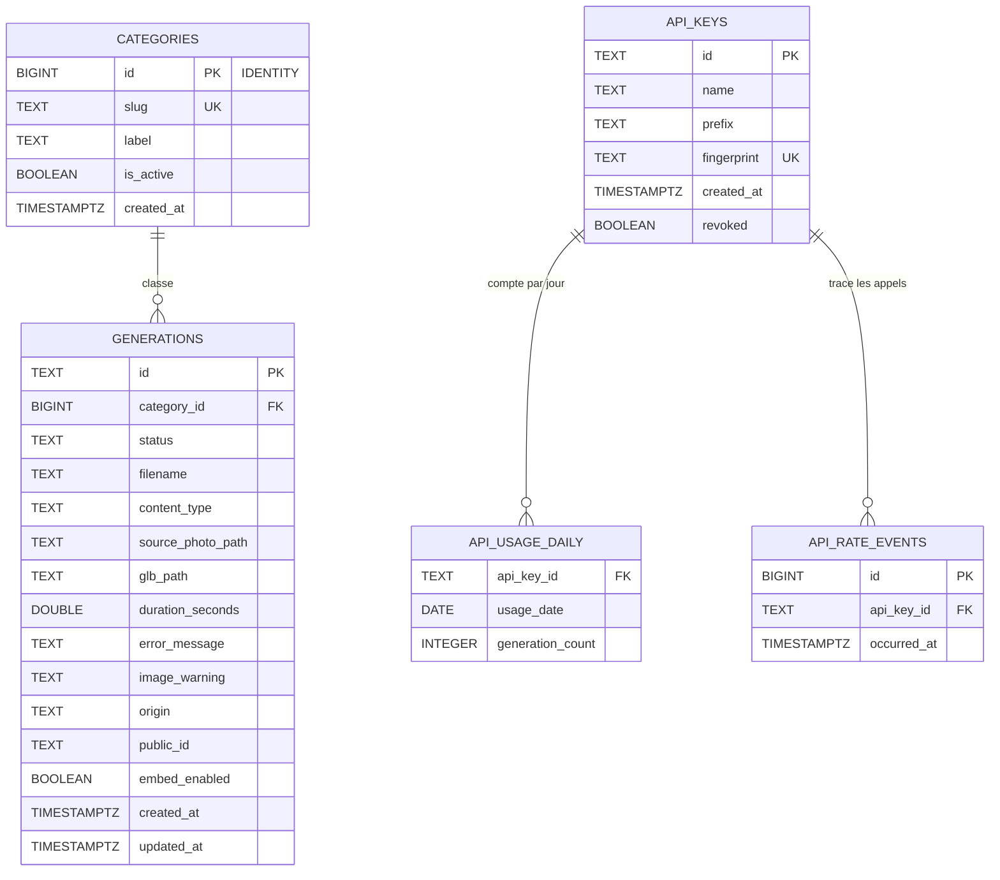

### 6.2 Les tables et leurs colonnes

**`categories`** — les catégories de produits.

| Colonne | Sens |
|---|---|
| `id` | Numéro automatique (`GENERATED ALWAYS AS IDENTITY`) |
| `slug` | Identifiant technique unique (`chair`, `stool`, `side-table`) |
| `label` | Nom affiché (« Chaise », « Tabouret », « Table d'appoint ») |
| `is_active` | `true` = proposée pour les nouvelles créations ; `false` = désactivée |
| `created_at` | Date de création, avec fuseau horaire (`TIMESTAMPTZ`, relue en UTC) |

Au premier démarrage, les trois catégories initiales sont créées si elles n'existent pas. ✅ Les numéros peuvent présenter des « trous » (1, 2, 3, puis 10…) : PostgreSQL garantit l'unicité, pas la continuité.

**`generations`** — chaque modèle : généré, importé ou copié depuis un exemple.

| Colonne | Sens |
|---|---|
| `id` | UUID (identifiant unique) interne, utilisé par le Studio |
| `category_id` | Lien vers `categories` (clé étrangère) |
| `status` | `PENDING`, `RUNNING`, `DONE` ou `FAILED` (contrôle `CHECK`) |
| `filename` | Nom affiché du fichier ou titre |
| `content_type` | Type de la photo (`image/jpeg`…) |
| `source_photo_path` | Chemin de la photo, **relatif** au dossier de stockage (`images/{uuid}.webp`) |
| `glb_path` | Chemin du GLB, relatif (`models/{uuid}.glb`) ; vide tant que le modèle n'est pas terminé |
| `duration_seconds` | Durée de génération mesurée |
| `error_message` | Cause d'un échec, sans secret |
| `image_warning` | Avertissement non bloquant (photo petite ou floue) |
| `origin` | `generated`, `imported` ou `example` |
| `public_id` | UUID **public**, utilisé par `/embed` et le widget (différent de `id`) |
| `embed_enabled` | `true` = intégration autorisée sur un site ; `false` par défaut |
| `created_at`, `updated_at` | Dates avec fuseau horaire |

Pourquoi des chemins **relatifs** ? La même base sert au conteneur Linux (`/app/backend/storage`) et au poste Windows (dossier `backend/storage` du dépôt). On enregistre `models/a.glb`, et chaque environnement le rattache à son propre dossier de stockage (`PostgresGenerationRepository._path_to_db()` et `_path_from_db()`).

**`api_keys`** — les clés API. ⚠️ La clé complète n'est **jamais** enregistrée : seule son **empreinte** (`fingerprint`, un hachage SHA-256) l'est, plus un `prefix` lisible (`f3d_live_xxx…`).

**`api_usage_daily`** — nombre de créations par clé et par jour UTC (quota quotidien).

**`api_rate_events`** — horodatage des appels récents de chaque clé (limite par minute ; les événements de plus de 60 s sont nettoyés).

Les exemples du catalogue ne sont **pas** dans la base : ils sont décrits par une liste fixe dans `demo_gallery.py`.

### 6.3 Pourquoi PostgreSQL ?

- **Un vrai serveur** dans son propre conteneur, comme l'exige le projet DevOps (« application + base de données » dans Compose).
- **Plusieurs écrivains en même temps** : les verrous portent sur une ligne (`SELECT … FOR UPDATE`), pas sur toute la base comme SQLite.
- **Types stricts** : `BOOLEAN`, `TIMESTAMPTZ`, `DATE` au lieu de nombres et de textes.
- **Même base partout** (développement, tests, CI, staging) : un bug lié à la base apparaît tout de suite, pas seulement en production.
- 🔁 SQL standard : vous retrouvez `CREATE TABLE`, `REFERENCES`, `CHECK`, comme dans Oracle ; avec un utilisateur (`forma3d`) et une base (`forma3d`).

### 6.4 Où se trouve la base, et comment la voir

| Situation | Adresse | Qui l'utilise |
|---|---|---|
| Docker Compose (`docker compose up -d`) | hôte `db`, port 5432, **non publié** | le conteneur `api` uniquement |
| Debug (`compose.debug.yaml`) | `127.0.0.1:5433` | DBeaver, HeidiSQL, `scripts/dev.ps1` |
| Tests | base séparée `forma3d_test` | pytest (vidée avant chaque test) |
| CI GitHub | service `postgres:17-alpine` jetable | jobs `test` et `docker-build` |

La variable **`DATABASE_URL`** (`postgresql://utilisateur:motdepasse@hôte:port/base`) dit à l'application où se connecter. Elle est **obligatoire** : sans elle, l'application refuse de démarrer avec un message clair (`repositories/factory.py`). Le mot de passe n'est jamais écrit dans les journaux (`mask_database_url()` le remplace par `***`).

Pour voir les tables : `docker compose -f compose.yaml -f compose.debug.yaml up -d`, puis DBeaver → PostgreSQL → `127.0.0.1:5433`, base `forma3d`, utilisateur `forma3d`. Pas à pas complet : `docs/devops/phase-03d.md`.

### 6.5 Migrations

**Une migration** est une modification de la structure d'une base existante sans perdre les données. `PostgresGenerationRepository.initialize()` les applique à chaque démarrage, sans danger :

1. `CREATE TABLE IF NOT EXISTS …` crée les tables absentes.
2. `ALTER TABLE generations ADD COLUMN IF NOT EXISTS …` ajoute les colonnes apparues au fil des étapes : `image_warning`, `origin`, `public_id`, `embed_enabled`.
3. Les modèles terminés sans `public_id` en reçoivent un.
4. Un **verrou consultatif** (`pg_advisory_xact_lock`) garantit que deux API démarrant ensemble n'appliquent pas les migrations en même temps.

🔁 C'est l'équivalent très simplifié de Flyway (Spring) ou des migrations Doctrine (Symfony), sans numéro de version. ⚠️ Il n'existe pas de retour arrière automatique.

**Migration de données** (une seule fois, 16 novembre 2026) : un script de reprise a copié les anciennes données vers PostgreSQL, en lecture seule côté source, dans une seule transaction, en transformant les chemins Windows absolus en chemins relatifs. Il a été supprimé après usage : aucun code SQLite ne reste dans le projet (historique : `docs/devops/phase-03d.md`).

### 6.6 Au redémarrage du serveur

Les générations restées `PENDING` ou `RUNNING` (le serveur s'est arrêté au milieu) passent à `FAILED` avec le message « Génération interrompue au redémarrage du serveur. » ✅ Une génération n'est donc jamais bloquée pour toujours en « en cours ».

### 6.7 Le patron Repository : pourquoi le passage à PostgreSQL n'a touché aucun service

Les services ne parlent jamais à la base directement : ils utilisent le **contrat** `GenerationRepository` (`backend/app/repositories/base.py`). Ce contrat liste les 19 opérations : `initialize`, `save_generation`, `get_generation`, `get_generation_by_public_id`, `set_embed_enabled`, `delete_generation`, `list_completed_generations`, `get_category`, `list_categories`, `create_category`, `update_category`, `delete_category`, `create_api_key`, `list_api_keys`, `find_api_keys_by_prefix`, `revoke_api_key`, `delete_revoked_api_key`, `consume_api_rate_limit`, `consume_api_daily_quota`.

🔁 C'est une **interface Java** : `PostgresGenerationRepository` (`backend/app/repositories/postgres_repository.py`) implémente ces méthodes ; `factory.py` la crée à partir de `DATABASE_URL`. Les routes et les services n'ont pas changé d'une ligne lors du remplacement de SQLite.

### 6.8 Encadrés

> **Un exemple concret.** Après la génération du fauteuil vert, la table `generations` contient une ligne : `status = DONE`, `category_id` = celui de « chair », `glb_path = models/4521a7f1-….glb`, `embed_enabled = true` (il a été activé). Quand la propriétaire désactive l'intégration, seule la colonne `embed_enabled` change ; le `public_id` reste le même. Quand elle supprime le modèle (étape 23), la ligne est effacée, puis le GLB et la photo.

> **Une analogie.** 🔁 Le schéma ressemble à ce que vous écririez en Oracle : clés primaires, clé étrangère `category_id`, contrainte `CHECK` sur le statut, utilisateur et base dédiés. La logique reste dans les services Python, et l'accès passe par un dépôt comme un `@Repository` Spring.

> **Ce que je réponds si on me demande pourquoi.** « J'ai commencé avec SQLite, suffisant pour un prototype local. Pour le projet DevOps, il fallait une vraie base dans un service séparé : comme tout l'accès passait par l'interface `GenerationRepository`, j'ai écrit une implémentation PostgreSQL sans toucher aux services, puis retiré SQLite pour avoir la même base partout, et migré les données existantes par un script rejouable. »

---

## 7. Fournisseurs 3D

**En une phrase :** un « fournisseur » est la classe qui envoie la photo à un service d'IA et rapporte un GLB ; le projet en contient deux, TripoSR (par défaut) et TRELLIS.

### 7.1 Le contrat commun

```python
class Image3DProvider(Protocol):
    def generate(self, image_path: Path) -> bytes: ...
```

Une image entre, des octets GLB sortent. 🔁 Comme une interface Spring avec deux implémentations, choisies au démarrage.

### 7.2 Les deux fournisseurs

| | TripoSR — `HuggingFaceSpaceProvider` | TRELLIS — `TrellisSpaceProvider` |
|---|---|---|
| Fichier | `backend/app/providers/huggingface.py` | `backend/app/providers/trellis.py` |
| Où tourne l'IA | Un Space Hugging Face **ou** un serveur Gradio temporaire sur Google Colab (`HF_SPACE_ID`) | Le Space public `trellis-community/TRELLIS` (`TRELLIS_SPACE_ID`) |
| Enchaînement | Lit le contrat (`view_api()`), choisit la fonction disponible, envoie la photo | `view_api()` → `/start_session` → `/preprocess_image` (détourage du fond) → `/generate_and_extract_glb` |
| Résultat | GLB à couleurs de sommets | GLB texturé |
| Relance | Oui si le Space démarre (`HF_MAX_ATTEMPTS`, 1 ou 2) | Non |
| Délai maximal | `HF_TIMEOUT_SECONDS` (300 s par défaut) | Même délai global, plus **120 s par requête HTTP** (`_HTTP_REQUEST_TIMEOUT_SECONDS`) |
| Compatibilité en plus | Sait aussi lire le contrat de Stable Fast 3D (`/run_button`) | — |

Après le fournisseur, **le même traitement** s'applique : vérification GLB 2.0, puis finition (`glb_finisher.py`) qui ajoute un matériau mat et des normales. ✅

### 7.3 Lequel est utilisé par défaut ?

**TripoSR**, car `IMAGE3D_PROVIDER` vaut `triposr` par défaut (`backend/app/config.py`). ✅ Dans la configuration de démonstration de l'étudiante, `IMAGE3D_PROVIDER=trellis` est défini dans `backend/.env` : c'est **TRELLIS** qui génère (une génération complète depuis le Studio a réussi le 15 novembre 2026).

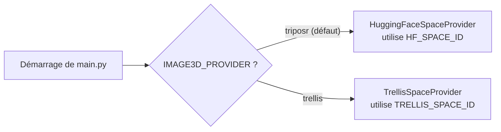

**Comment vérifier :** ouvrez `http://127.0.0.1:8001/health/provider` (serveur lancé par `dev.ps1` ; `8000` si uvicorn est lancé à la main). Quand le service est hors ligne, le message parle de « Colab » pour TripoSR et de « Space TRELLIS » pour TRELLIS (section 17).

**Comment changer :** dans `backend/.env`, mettez `IMAGE3D_PROVIDER=trellis`, puis redémarrez le serveur. Ou lancez le serveur depuis un terminal où la variable est définie (elle a alors priorité sur `.env`).

### 7.4 Le jeton `HF_TOKEN`

- C'est un **mot de passe pour programme** fourni gratuitement par Hugging Face (*Settings → Access Tokens*, type « Read »).
- Il augmente le **quota GPU gratuit** de TRELLIS. Ordre de grandeur : environ **2 minutes** de GPU par jour sans jeton et **5 minutes** avec un compte gratuit — **à vérifier** sur https://huggingface.co/docs/hub/spaces-zerogpu. Une génération TRELLIS a pris environ 1 min 30 à 2 min pendant les essais.
- ⚠️ Le quota est attaché au **compte**, pas au jeton : créer un nouveau jeton sur le même compte ne redonne **aucun** quota. Multiplier les comptes serait un contournement, interdit par les conditions d'utilisation et par les règles du projet.
- Où le ranger : **uniquement** dans `backend/.env` (ignoré par Git) ou dans la variable d'un terminal. **Jamais** dans `.env.example`, dans le code ou dans une conversation.
- Sécurité : le code ne l'envoie qu'à Hugging Face. `TRELLIS_SPACE_ID` doit être un identifiant `propriétaire/nom`, jamais une URL, et le fournisseur TripoSR refuse d'envoyer le jeton à une URL Gradio externe. Il est masqué dans les messages d'erreur. ✅

### 7.5 Quotas, erreurs et mode hors ligne

| Situation | Ce que voit la propriétaire |
|---|---|
| `HF_SPACE_ID` vide (TripoSR) | Badge « Serveur 3D : hors ligne » ; bouton « Créer » désactivé ; statut `UNCONFIGURED` |
| Lien Colab expiré (72 h maximum) | Badge hors ligne ; message « Le serveur 3D (Colab) est arrêté ou son lien a expiré » |
| Quota TRELLIS épuisé | La création échoue avec « Quota GPU gratuit du Space TRELLIS atteint pour aujourd'hui… » |
| Space TRELLIS en veille | « Le Space TRELLIS est en veille, en panne ou indisponible » |
| Contrat du Space modifié | La génération s'arrête avant l'envoi de la photo (« Le contrat … a changé ») |
| Space très lent | Avant le 15 novembre 2026, « The read operation timed out » (délai HTTP de 5 s par défaut) ; corrigé avec 120 s par requête |

Quand le fournisseur est hors ligne, le reste du Studio fonctionne : exemples, import GLB, fiches, intégration.

### 7.6 Les notebooks Google Colab

- Le dépôt contient **un seul** notebook : `tools/colab/triposr_server.ipynb`. Il vérifie le GPU, installe TripoSR et documente le dépannage. Sa dernière cellule **empêche** de lancer un service web public sur un Colab gratuit géré (règle de la FAQ Colab).
- Vos notebooks de test **TRELLIS v1, SF3D et comparaison** ne sont **pas** dans le dépôt Git (**à vérifier** : probablement sur votre Google Drive).
- **Ils ne font pas partie de l'application** : le serveur ne les lit jamais.
- **Quand les garder** : comme preuves d'expérimentation pour la soutenance (captures, résultats). **Quand les supprimer** : quand leurs résultats sont recopiés dans `docs/QUALITE-3D.md` et qu'ils ne servent plus. N'y laissez jamais un jeton en clair.

### 7.7 Licences à vérifier

| Élément | Licence | À vérifier |
|---|---|---|
| TripoSR | MIT | Droits des photos utilisées |
| TRELLIS (code et poids) | MIT | Usage commercial des modèles générés via le Space (question ouverte) |
| Stable Fast 3D | Stability AI Community License | Gratuit sous un seuil de chiffre d'affaires |
| Hunyuan3D-2 | Licence Tencent | Exclut l'Union européenne, le Royaume-Uni et la Corée du Sud : non retenu |
| model-viewer | Apache 2.0 | — |

Détails et essais : `docs/ALTERNATIVES-3D.md` et `docs/QUALITE-3D.md`.


### 7.8 Encadrés

> **Un exemple concret.** Le 15 novembre 2026, plusieurs créations échouaient avec « The read operation timed out ». Diagnostic : `gradio_client` coupait chaque requête HTTP après 5 s (valeur par défaut de httpx), alors que la simple connexion au Space chargé prenait 26 s. Avec un délai de 120 s par requête, une photo du fauteuil a produit un GLB en 117 s : connexion 26 s, détourage 14 s, génération 73 s.

> **Une analogie.** 🔁 `Image3DProvider` est une interface Java avec deux implémentations (`HuggingFaceSpaceProvider`, `TrellisSpaceProvider`), et `main.py` choisit laquelle injecter selon une propriété de configuration, comme un `@ConditionalOnProperty` de Spring Boot.

> **Ce que je réponds si on me demande pourquoi.** « Je n'entraîne aucun modèle : j'appelle des modèles pré-entraînés gratuits. Je lis toujours le contrat réel du service (`view_api()`) avant d'envoyer la photo, pour ne jamais inventer un nom de paramètre. Et j'isole le fournisseur derrière une interface, parce que les services gratuits changent, ferment ou atteignent leur quota. »

---

## 8. Cycle de vie d'un modèle

**En une phrase :** un modèle généré passe par quatre états, enregistrés dans PostgreSQL et lus par la page toutes les 1,5 seconde.

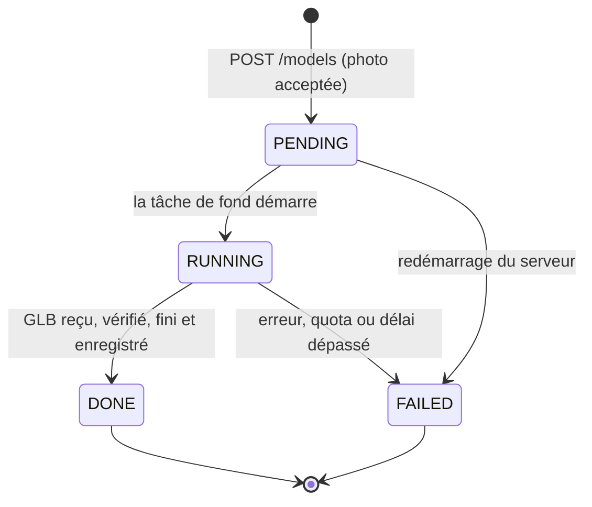

| État | Sens | Ce que montre la page Créer |
|---|---|---|
| `PENDING` | Photo reçue, en attente | Étape « En file » active |
| `RUNNING` | Le fournisseur travaille | Étape « Création du modèle » active, chronomètre |
| `DONE` | GLB prêt | Modèle affiché, lien « Ouvrir la fiche du modèle → » |
| `FAILED` | Échec | Message renvoyé par le serveur, bouton « Réessayer avec cette photo » |

- **Tâche de fond** : FastAPI répond tout de suite `202 Accepted`, puis exécute `GenerationService.run()` avec `BackgroundTasks`. 🔁 Comme une méthode `@Async` de Spring.
- **Aucun pourcentage inventé** : la page n'affiche que les états réellement renvoyés.
- **Reprise après redémarrage** : pas de reprise automatique ; une génération `PENDING` ou `RUNNING` passe en `FAILED` (section 6.5) et il faut la relancer.
- Les modèles **importés** ou **copiés** sont créés directement en `DONE`.


> **Un exemple concret.** Le fauteuil blanc photographié sur fond gris est passé par `PENDING` → `RUNNING` → `DONE` en 1 min 33 s, avec un `image_warning` (« La photo est petite… ») : l'avertissement n'a pas bloqué la création. Une tentative pendant que le Space était trop lent est passée de `RUNNING` à `FAILED` avec le message réel du serveur.

> **Une analogie.** 🔁 C'est une machine à états comme le statut d'une commande dans une application Symfony ou Spring : chaque transition est écrite en base, et l'interface Angular ne ferait que lire l'état courant (ici, par interrogation régulière plutôt que par WebSocket).

> **Ce que je réponds si on me demande pourquoi.** « Les quatre états sont enregistrés en base de données pour qu'un rechargement de page ou un redémarrage ne perde pas le suivi. Je n'affiche aucun pourcentage inventé : seulement l'état réellement renvoyé par le serveur. »

---

## 9. Variables d'environnement

**En une phrase :** les réglages et secrets sont lus dans des variables d'environnement, rangées dans un fichier `.env` local que Git ignore.

### 9.1 `.env` contre `.env.example`

| | `.env.example` | `backend/.env` (ou `.env` à la racine) |
|---|---|---|
| Contient | La **liste** des variables, avec des valeurs vides ou par défaut | Vos **vraies** valeurs (mot de passe, jeton) |
| Suivi par Git ? | ✅ oui | ❌ non (ignoré) |
| Qui le lit ? | Les humains | Le serveur, au démarrage |

Ordre de lecture (`config.py`) : `backend/.env` d'abord, puis `.env` à la racine, **sans écraser** une variable déjà définie dans le terminal. 🔁 Comme `application.properties` de Spring, avec les variables système prioritaires.

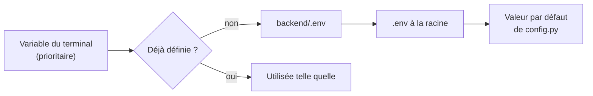

⚠️ Le fichier `.env` n'est lu qu'**au démarrage** du serveur : après une modification, il faut arrêter puis relancer le serveur (section 15.2).

### 9.2 Toutes les variables

Les exemples de valeurs ci-dessous sont **faux** et servent seulement à montrer le format.

| Variable | Rôle | Défaut | Lue par | Effet si absente | Exemple (faux) |
|---|---|---|---|---|---|
| `HF_SPACE_ID` | Adresse du serveur TripoSR : identifiant de Space ou URL Gradio | vide | `config.py` → `huggingface.py` | TripoSR non configuré, statut `UNCONFIGURED` | `https://exemple-faux.gradio.live` |
| `HF_TOKEN` | Jeton Hugging Face (quota plus élevé, Space privé) | vide | `config.py`, outils `tools/trials/` | Accès anonyme, quota plus faible | `hf_EXEMPLEFAUX123` |
| `HF_TIMEOUT_SECONDS` | Délai maximal d'une génération | `300` | `config.py` | 300 s | `300` |
| `HF_MAX_ATTEMPTS` | Nombre de tentatives TripoSR (1 ou 2) | `2` | `config.py` | 2 | `2` |
| `HF_RETRY_DELAY_SECONDS` | Attente avant relance | `5` | `config.py` | 5 s | `5` |
| `FOREGROUND_RATIO` | Réglage TripoSR, utilisé seulement s'il existe dans le contrat du serveur | vide | `config.py` | Valeur du serveur | `0.85` |
| `MC_RESOLUTION` | Résolution TripoSR, même règle | vide | `config.py` | Valeur du serveur | `256` |
| `MAX_GLB_UPLOAD_MB` | Taille maximale d'un GLB importé (1 à 512) | `30` | `config.py` | 30 Mo | `30` |
| `API_DAILY_GENERATION_LIMIT` | Créations par clé et par jour | `20` | `config.py` | 20 | `20` |
| `API_RATE_LIMIT_PER_MINUTE` | Requêtes `/api/v1` par clé et par minute | `10` | `config.py` | 10 | `10` |
| `API_CORS_ORIGINS` | Sites autorisés à appeler l'API en JavaScript (`*` refusé) | vide | `config.py` → `main.py` | Aucun site tiers | `http://boutique-exemple.test` |
| `EMBED_ALLOWED_ORIGINS` | Sites autorisés à afficher `/embed` dans une iframe (`*` refusé) | vide | `config.py` → `embed.py` | Seul le Studio lui-même | `http://127.0.0.1:8081` |
| `FORMA3D_OWNER_PASSWORD` | Mot de passe unique de la propriétaire | vide | `services/owner_auth.py` | **Connexion refusée** (503) | `mot-de-passe-exemple-long` |
| `FORMA3D_SESSION_SECRET` | Clé fixe de signature des sessions (32 caractères minimum) | vide | `owner_auth.py` → `main.py` | Clé aléatoire à chaque démarrage : reconnexion après redémarrage | `exemple-faux-0123456789abcdefghijklmnop` |
| `IMAGE3D_PROVIDER` | Fournisseur 3D : `triposr` ou `trellis` | `triposr` | `config.py` → `main.py` | TripoSR | `trellis` |
| `TRELLIS_SPACE_ID` | Space TRELLIS (`propriétaire/nom`, jamais une URL) | `trellis-community/TRELLIS` | `config.py` → `trellis.py` | Space communautaire par défaut | `trellis-community/TRELLIS` |

⚠️ Une valeur invalide (par exemple `IMAGE3D_PROVIDER=meshy`, une origine `*` ou un `FORMA3D_SESSION_SECRET` trop court) empêche le serveur de démarrer, avec un message clair. ✅

`PYTHON_DOTENV_DISABLED=true` n'est pas une variable du projet mais de la bibliothèque python-dotenv : `scripts/dev.ps1` la pose **seulement pendant pytest** (avec `HF_SPACE_ID` vide) pour que les tests ne lisent jamais `backend/.env`, puis la retire avant de démarrer le serveur.

---

## 10. Le site page par page

**En une phrase :** le Studio est une seule page HTML (`index.html`) dont le contenu change selon l'adresse après le `#` (exemple : `#/creer`), sans recharger la page.

🔁 **Angular** : c'est le principe d'une SPA (Single Page Application, application à page unique) avec un routeur, mais écrit à la main dans `router.js`.

### 10.0 La coque commune (présente sur toutes les pages après connexion)

```
┌──────────────────────────────────────────────────────────────────────────────┐
│ [cube] Forma3D Studio  Accueil  Créer  Mes modèles  Exemples  Administration ▾│
│                                        ● Serveur 3D : hors ligne  ⇥ Déconnexion│
├──────────────────────────────────────────────────────────────────────────────┤
│                         (contenu de la page, dans #app)                        │
├──────────────────────────────────────────────────────────────────────────────┤
│ Forma3D Studio v1.0   Documentation   Guide d'intégration   GitHub           │
│                                   Prototype de soutenance · Aucun entraînement │
└──────────────────────────────────────────────────────────────────────────────┘
```

| Élément | Emplacement | Au clic | Fichier |
|---|---|---|---|
| Logo « Forma3D Studio » | En haut à gauche | Va à `#/accueil` | `index.html` |
| « Accueil », « Créer », « Mes modèles », « Exemples » | Menu | Change la page ; le lien actif a un fond vert pâle | `router.js` → `updateNavigation()` |
| « Administration » ▾ | Menu | Ouvre un sous-menu : « Catégories », « Clés API », « Guide d'intégration » | `index.html` (élément `<details>`) |
| Badge « Serveur 3D : en ligne / hors ligne » | En haut à droite | Aucun clic ; mis à jour toutes les 30 s par `GET /health/provider` | `main.js` → `refreshProviderHealth()` |
| « Déconnexion » | En haut à droite | `POST /auth/logout`, efface le cookie, retour à `#/login` | `auth.js` → `logout()` |
| Bouton ☰ | Sur mobile seulement | Ouvre ou ferme le menu | `router.js` |
| « Documentation », « GitHub » | Pied de page | Ouvre le dépôt GitHub (privé : visible seulement par un compte autorisé) | `index.html` |
| « Guide d'intégration » | Pied de page | Va à `#/guide` | `index.html` |

Sur l'écran de connexion, le menu, le badge et le pied de page sont **masqués**.

### 10.1 Connexion — `#/login`

**But :** protéger le Studio par le mot de passe de la propriétaire.

```
┌───────────────────────────────────┐
│            [cube vert]            │
│          CONSOLE PRIVÉE           │
│          Forma3D Studio           │
│ Saisissez le mot de passe de la   │
│ propriétaire pour accéder au      │
│ Studio.                           │
│ Mot de passe                      │
│ [••••••••••••••••]   [Afficher]   │
│ [   Accéder au Studio →        ]  │
│ Session protégée par le serveur…  │
└───────────────────────────────────┘
```

| Élément | Ce qui se passe | Fichier, fonction, route |
|---|---|---|
| Champ « Mot de passe » | Saisie masquée | `pages/login.js` |
| « Afficher » / « Masquer » | Montre ou cache le texte saisi | `login.js` |
| « Accéder au Studio → » | Le bouton passe à « Vérification… » ; envoi du mot de passe | `auth.js` → `login()` → `api.js` → `loginOwner()` → `POST /auth/login` |

| État | Message affiché |
|---|---|
| Champ vide | « Saisissez le mot de passe. » |
| Mot de passe faux | « Mot de passe incorrect. » (réponse 401) |
| 6e tentative en moins d'une minute | « Trop de tentatives. Patientez une minute avant de réessayer. » (429) |
| Mot de passe non configuré sur le serveur | « Connexion impossible : définissez FORMA3D_OWNER_PASSWORD dans backend/.env, puis redémarrez le serveur. » |
| Succès | Cookie de session posé ; retour à la page demandée, sinon `#/accueil` |

⚠️ **Piège** : mettre le mot de passe dans `.env.example` ne marche pas ; le serveur lit seulement `backend/.env` (ou `.env` à la racine).

### 10.2 Accueil — `#/accueil`

**But :** une vue d'ensemble et des raccourcis.

```
┌────────────────────────────────────────────────────────────────┐
│ ● Serveur 3D hors ligne · exemples disponibles                  │
│ Transformez vos photos en modèles 3D            [chaise 3D qui  │
│ Créez, gérez et intégrez vos modèles 3D…         tourne]        │
│ [Créer un modèle 3D →]  [Voir les exemples]                     │
├──────────────────┬──────────────────┬──────────────────────────┤
│ 3 Modèles  Voir  │ 1 Clés API  Gérer│ 3 Catégories   Organiser │
├──────────────────┴──────────────────┴──────────────────────────┤
│ Vos modèles récents                                 Tout voir → │
│ [carte] [carte] [carte]   ou   « Votre bibliothèque est vide » │
│ Exemples du catalogue                               Explorer →  │
│ [carte] [carte] [carte] [carte] [carte]  (défilement horizontal)│
│ Raccourcis                                                      │
│ [Créer un modèle] [Importer un GLB] [Gérer les clés API] [Guide]│
└────────────────────────────────────────────────────────────────┘
```

| Élément | Au clic | Données |
|---|---|---|
| « Créer un modèle 3D → » | Va à `#/creer` | — |
| « Voir les exemples » | Va à `#/exemples` | — |
| Carte « Modèles enregistrés » → « Voir » | Va à `#/modeles` | Nombre lu par `GET /models/gallery` (modèles UUID seulement) |
| Carte « Clés API actives » → « Gérer » | Va à `#/cles-api` | `GET /api-keys`, clés non révoquées |
| Carte « Catégories disponibles » → « Organiser » | Va à `#/categories` | `GET /categories` |
| « Tout voir → » | Va à `#/modeles` | 3 derniers modèles par date |
| Une carte de modèle | Ouvre la fiche `#/modeles/{id}` | La miniature tourne au survol |
| « Créer mon premier modèle » (état vide) | Va à `#/creer` | — |
| « Explorer → » | Va à `#/exemples` | — |
| Raccourci « Importer un GLB » | Va à `#/modeles?import=1`, qui ouvre directement le formulaire d'import | — |
| Raccourci « Guide d'intégration » | Va à `#/guide` | — |

Fichier : `pages/dashboard.js`. États : cartes grises animées (« squelettes ») pendant le chargement ; message rouge si le serveur ne répond pas.

### 10.3 Créer — `#/creer`

**But :** transformer une photo en modèle 3D.

```
┌──────────────────────────────┬─────────────────────────────────────────┐
│ Photo et catégorie           │ ESPACE DE TRAVAIL       [Aperçu d'un    │
│ ┌──────────────────────────┐ │ Aperçu du modèle         fichier GLB…]  │
│ │  (+) Glissez une photo   │ │ ┌─────────────────────────────────────┐ │
│ │  ici ou [Choisir une     │ │ │                                     │ │
│ │  photo]                  │ │ │       Votre modèle apparaîtra ici   │ │
│ └──────────────────────────┘ │ │                                     │ │
│ Catégorie du produit [▼]     │ └─────────────────────────────────────┘ │
│ [   Créer le modèle 3D →   ] │ [↶][↷] [←][→][↑][↓] [−][+] Rotation auto │
│ Choisissez une photo…        │ Plein écran  Réinitialiser              │
│ + Conseils photo             │ ⓘ Aperçu 3D généré automatiquement…     │
│ + Détails techniques         │                                         │
├──────────────────────────────┴─────────────────────────────────────────┤
│ Suivi de création  ①Photo envoyée ②En file ③Création ④Validation ⑤Terminé│
└────────────────────────────────────────────────────────────────────────┘
```

| Élément | Ce qui se passe | Fichier, fonction, route |
|---|---|---|
| Zone « Glissez une photo ici » / « Choisir une photo » | Choix ou glisser-déposer ; aperçu de la photo dans la zone ; contrôle JPG, PNG ou WebP, 10 Mo maximum | `views/uploader.js` → `setSelectedPhoto()` |
| « Catégorie du produit » | Liste des catégories **actives** | `GET /categories?include_inactive=true` puis filtre |
| « Créer le modèle 3D → » | Désactivé tant que photo, catégorie ou serveur 3D manquent ; sinon `POST /models` | `uploader.js` → `create.js` → `startGeneration()` → `api.js` → `createGeneration()` |
| Texte sous le bouton | Explique pourquoi le bouton est désactivé (« Choisissez une photo pour activer la création. », « Le serveur 3D est hors ligne. Consultez les exemples en attendant. », « Tout est prêt pour créer le modèle. ») | `uploader.js` → `syncState()` |
| « Voir les exemples » (bandeau jaune) | Va à `#/exemples` ; visible si le serveur 3D est hors ligne | `create.js` |
| « Conseils photo » | Déplie 4 conseils (un objet, fond uni, lumière douce, 70 % de l'image) | `create.js` |
| « Détails techniques » | Déplie l'état du serveur et comment relancer Colab | `create.js` |
| « Aperçu d'un fichier GLB (sans enregistrer) » | Ouvre un GLB local **dans le navigateur seulement** (rien n'est envoyé) | `views/viewer.js` |
| « Vue 3D / Photo source / Comparer » | Change l'affichage (visible quand une photo source existe) ; en « Comparer », la rotation s'arrête et la caméra se recadre | `viewer.js` → `setView()` → `model-appearance.js` → `refitCamera()` |
| ↶ ↷ | Tourne de 15° | `viewer.js` → `rotateCamera()` |
| ← → ↑ ↓ | Déplace la vue | `viewer.js` → `panCamera()` |
| − + | Zoom | `viewer.js` |
| « Rotation auto » | Active ou arrête la rotation | `viewer.js` |
| « Plein écran » | Plein écran du viewer | `viewer.js` |
| « Réinitialiser » | Remet la caméra par défaut | `viewer.js` |
| « Télécharger » | Télécharge le GLB | lien vers `/models/{id}/glb` |
| Vignette « Agrandir » | Ouvre la photo source en grand | `viewer.js` |
| « Réessayer avec cette photo » | Relance après un échec | `create.js` |
| « Ouvrir la fiche du modèle → » | Va à la fiche après `DONE` | `create.js` |

| État | Ce qu'on voit |
|---|---|
| Vide | Cube dessiné, « Votre modèle apparaîtra ici » |
| Envoi / en file / création | Étapes du suivi colorées, chronomètre, roue de chargement |
| Avertissement photo | Bandeau jaune « La photo est petite… » ou « …floue… » (n'empêche pas la création) |
| Succès | Modèle affiché, « Votre modèle est prêt » |
| Échec | Cause réelle renvoyée par le serveur (exemple : quota TRELLIS) |

⚠️ **Pièges** : le bouton reste gris si le badge est « hors ligne » ; un échec dû au quota n'est pas un problème de photo.

### 10.4 Mes modèles — `#/modeles`

**But :** la bibliothèque des modèles enregistrés (générés, importés, copiés).

```
┌──────────────────────────────────────────────────────────────────┐
│ Mes modèles                          [Importer un modèle (.glb)] │
│ Modèles enregistrés                                  [3 modèles] │
│ [Tous 3] [Chaise 2] [Tabouret 1] [Table d'appoint 0]             │
│ ┌────────┐ ┌────────┐ ┌────────┐                                 │
│ │Généré  │ │Importé │ │Exemple │   badge d'origine                │
│ │ (3D)   │ │ (3D)   │ │ (3D)   │                                 │
│ │Titre   │ │Titre   │ │Titre   │                                 │
│ │Chaise · il y a 2 jours · 1,2 Mo                                │
│ └────────┘ └────────┘ └────────┘                                 │
└──────────────────────────────────────────────────────────────────┘
```

| Élément | Ce qui se passe | Route |
|---|---|---|
| « Importer un modèle (.glb) » | Ouvre le formulaire d'import | — |
| Champs « Fichier .glb », « Titre », « Catégorie » | Le titre se remplit avec le nom du fichier | — |
| « Importer dans Mes modèles » | Envoie le fichier ; message « Modèle importé… » et lien « Ouvrir sa fiche » | `POST /models/import` |
| « Annuler » | Ferme le formulaire | — |
| Filtres « Tous », catégories avec compteur | Filtrent les cartes | local (aucun appel) |
| Une carte | Ouvre la fiche | — |
| État vide : « Créer à partir d'une photo », « Importer un modèle » | Va à Créer / ouvre l'import | — |

Fichiers : `pages/models.js`, `views/gallery.js`. Le GLB importé est vérifié (format GLB 2.0, taille `MAX_GLB_UPLOAD_MB`) et marqué « Importé ».

### 10.5 Fiche du modèle — `#/modeles/{id}`

**But :** examiner un modèle, le télécharger et l'intégrer à un site.

```
┌───────────────────────────────────────────┬─────────────────────────┐
│ Aperçu 3D      [Vue 3D|Photo source|Comparer]│ Chaise en bois cintré   │
│ ┌───────────────────┬───────────────────┐ │ État        Prêt        │
│ │  modèle 3D        │  photo source     │ │ Catégorie   Chaise      │
│ │  (mode Comparer)  │                   │ │ Origine     Exemple · TRELLIS│
│ └───────────────────┴───────────────────┘ │ Date        …           │
│ ⓘ Aperçu 3D généré automatiquement…       │ Durée       1 min 16 s  │
│                                           │ [Télécharger le modèle] │
├───────────────────────────────────────────┴─────────────────────────┤
│ Afficher ce modèle sur un site                                      │
│ ① Activez l'intégration            [○—]  interrupteur               │
│ ② Choisissez votre méthode         [IFrame][Widget Forma3D]         │
│ ③ Copiez le code                   <iframe src=…>        [Copier]   │
│ ④ Aperçu                           [cadre de navigateur avec /embed]│
└─────────────────────────────────────────────────────────────────────┘
```

| Élément | Ce qui se passe | Route |
|---|---|---|
| « ← Retour à Mes modèles » / « ← Retour aux exemples » | Retour à la liste | — |
| « Vue 3D », « Photo source », « Comparer » | Changent l'affichage ; « Comparer » met le modèle et la photo côte à côte | local |
| « Télécharger le modèle (.glb) » | Télécharge le fichier | `/models/{id}/glb` ou `/models/gallery/{id}` |
| ① Interrupteur « Intégration publique de ce modèle » | Active ou désactive la publication (désactivée par défaut) | `PATCH /models/{id}/integration` |
| ② Onglets « IFrame » / « Widget Forma3D » | Choisissent le code affiché ; bloqués tant que l'étape 1 n'est pas faite | local |
| ③ « Copier » | Copie le code ; « Code copié. Collez-le dans la page produit de votre site. » | presse-papiers |
| ④ Aperçu | Affiche la vraie page `/embed/{public_id}` dans un cadre | `/embed/...` |
| « Supprimer ce modèle » (rouge, sous « Télécharger ») | Fenêtre de confirmation (« Cette action est irréversible », avec un avertissement si l'intégration est active), puis suppression de la ligne, du GLB et de la photo, et retour à « Mes modèles ». Caché pour les exemples et pendant une création | `DELETE /models/{id}` |

| État | Ce qu'on voit |
|---|---|
| Chargement | « Chargement des informations… », roue sur le modèle |
| Modèle en cours | « Le modèle est encore en cours de création. » ; la page se met à jour toutes les 2 s |
| Échec | « La création n'a pas abouti. Aucun fichier n'est disponible. » |
| Identifiant inconnu | « Ce modèle est introuvable. Il a peut-être été supprimé. » |
| Suppression refusée | Message sous le bouton (par exemple 409 : « Ce modèle est encore en cours de création… ») |

⚠️ Les **exemples du catalogue** n'ont pas de section d'intégration : il faut d'abord les copier dans « Mes modèles ». Fichier : `pages/model-detail.js`.

### 10.6 Exemples — `#/exemples`

**But :** montrer les 5 modèles de démonstration, réellement générés pendant les essais.

| Élément | Ce qui se passe | Route |
|---|---|---|
| Filtres par catégorie avec compteur | Filtrent | local |
| Une carte | Ouvre la fiche de l'exemple | — |
| Texte sous la carte | « Généré avec TRELLIS à partir d'une seule photo en 1 min 16 s. » (fournisseur et durée réellement mesurés) | `format.js` |
| « Ajouter à mes modèles » | Ouvre le panneau « Ajouter l'exemple à Mes modèles » | — |
| « Ajouter à Mes modèles » (panneau) | Copie l'exemple ; « Exemple ajouté à Mes modèles. » + « Ouvrir sa fiche » | `POST /models/examples/{id}/copy` |
| « Annuler » | Ferme le panneau | — |

Depuis le 11 novembre 2026, 3 exemples (chaise cintrée, tabouret, table d'appoint) viennent de **TRELLIS** et 2 (chaises métal) de **TripoSR**. Fichier : `pages/examples.js`.

### 10.7 Catégories — `#/categories` (menu Administration)

| Élément | Ce qui se passe | Route |
|---|---|---|
| « Nouvelle catégorie » + « Ajouter la catégorie » | Crée une catégorie (le slug est calculé à partir du nom) | `POST /categories` |
| Champ du nom + « Renommer » | Change le nom affiché | `PATCH /categories/{slug}` |
| Badge « Active » / « Désactivée » | État de la catégorie | — |
| Badge « N modèles » | Nombre de modèles enregistrés dans cette catégorie | calculé depuis `GET /models/gallery` |
| « Désactiver » / « Réactiver » | Fenêtre de confirmation, puis la catégorie n'est plus proposée à la création | `PATCH /categories/{slug}` |
| « Supprimer » | Grisé si la catégorie est utilisée ; sinon confirmation puis suppression | `DELETE /categories/{slug}` |

Message d'erreur si le nom existe déjà : « Ce nom de catégorie est déjà utilisé… ». Fichiers : `pages/categories.js`, `views/categories.js`.

### 10.8 Clés API — `#/cles-api` (menu Administration)

```
┌───────────────────────────────────────────────────────────────┐
│ Comment utiliser l'API                       Guide complet →  │
│ ①Créez une clé → ②Copiez le secret → ③Ajoutez l'en-tête → ④Testez│
│ [exemple curl]                                       [Copier] │
├───────────────────────────────────────────────────────────────┤
│ Créer une clé   Nom pour la reconnaître [______] [Créer une clé API]│
│ ⚠ Copiez votre clé maintenant  f3d_live_…      [Copier la clé]│
├───────────────────────────────────────────────────────────────┤
│ Clés existantes                          [1 active · 2 clés]  │
│ ┌ Boutique ● Active ┐  ┌ dd ○ Révoquée ───────────┐           │
│ │ f3d_live_abc…     │  │ f3d_live_xyz…            │           │
│ │ [Révoquer]        │  │ [Supprimer définitivement]│           │
└───────────────────────────────────────────────────────────────┘
```

| Élément | Ce qui se passe | Route |
|---|---|---|
| « Guide complet → » | Va à `#/guide` | — |
| « Copier » (exemple curl) | Copie la commande d'exemple | — |
| « Nom pour la reconnaître » + « Créer une clé API » | Crée la clé ; affiche le secret **une seule fois** | `POST /api-keys` |
| « Copier la clé » | Copie le secret | — |
| « Révoquer » (clé active) | Confirmation, puis la clé est refusée par l'API ; le secret affiché disparaît | `DELETE /api-keys/{id}` |
| « Supprimer définitivement » (clé révoquée) | Confirmation, puis la clé et ses compteurs sont effacés | `DELETE /api-keys/{id}/permanent` |

⚠️ Une clé active ne peut pas être supprimée directement (le serveur répond 409) : il faut d'abord la révoquer. Fichier : `pages/api-keys.js`.

### 10.9 Guide d'intégration — `#/guide` (menu Administration)

Page de lecture : sommaire (« Créer une clé », « Envoyer une photo », « Suivre le modèle », « Activer et intégrer », « Quotas et origines », « Sécurité »), 6 sections et des blocs de code avec un bouton « Copier ». Les adresses des exemples utilisent l'adresse réelle du serveur. Aucun appel au serveur. Fichier : `pages/guide.js`.

### 10.10 Page introuvable

Toute adresse inconnue affiche « Cette page n'existe pas » et un bouton « Retour à l'accueil ». Fichier : `router.js` → `makeNotFoundPage()`.

---

## 11. Utiliser le site de bout en bout

**En une phrase :** trois personnes utilisent Forma3D, chacune avec un chemin différent.

### 11 a. La propriétaire : de la connexion à un modèle intégré

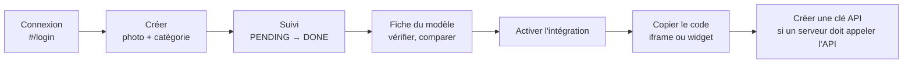

1. Lancer `.\scripts\dev.ps1`, ouvrir `http://127.0.0.1:8001` (ou `8000` si uvicorn est lancé à la main), se connecter.
2. Aller dans **Créer**, déposer une photo nette, choisir la catégorie, cliquer sur « Créer le modèle 3D → ».
3. Attendre l'étape « Terminé », puis cliquer sur « Ouvrir la fiche du modèle → ».
4. Vérifier le modèle avec « Comparer » ; le télécharger si besoin.
5. Activer l'interrupteur « Intégration publique de ce modèle ».
6. Choisir « IFrame » ou « Widget Forma3D », cliquer sur « Copier », envoyer le code au développeur de la boutique.
7. Si le développeur doit appeler l'API, créer une clé dans **Clés API** et la lui transmettre de façon sûre.

Sans serveur 3D en ligne : remplacer l'étape 2 par **Exemples → « Ajouter à mes modèles »** ou **Mes modèles → « Importer un modèle (.glb) »**.

### 11 b. Le développeur d'une boutique : de la clé API à l'affichage

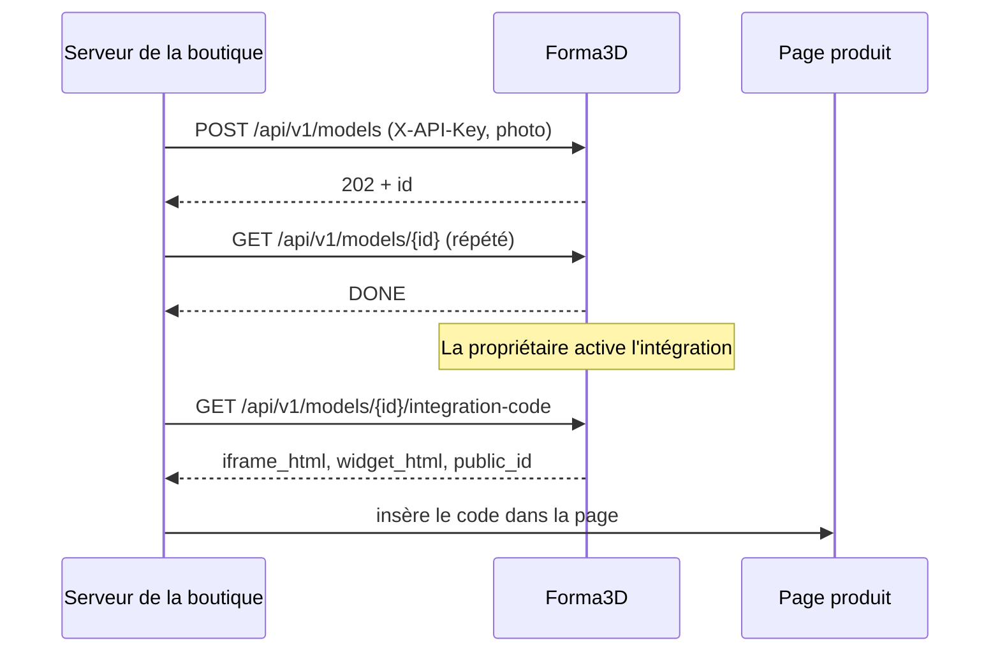

1. Recevoir une clé API de la propriétaire et la ranger **côté serveur** (jamais dans le JavaScript public).
2. Envoyer une photo : `POST /api/v1/models` avec l'en-tête `X-API-Key`.
3. Suivre l'état : `GET /api/v1/models/{id}` jusqu'à `DONE`.
4. Après activation par la propriétaire, récupérer le code : `GET /api/v1/models/{id}/integration-code`.
5. Insérer l'iframe ou le widget dans la page produit.
6. Faire autoriser l'adresse du site dans `EMBED_ALLOWED_ORIGINS`.

### 11 c. Le visiteur final


1. Le visiteur ouvre la page produit de la boutique.
2. Le navigateur charge l'iframe `/embed/{public_id}` depuis Forma3D.
3. Forma3D vérifie que le modèle existe, est terminé et que son intégration est activée ; sinon, il affiche « Ce modèle 3D n'est pas disponible… ».
4. Le visiteur fait tourner le modèle à la souris ou au doigt. Il ne voit **jamais** de clé API.

---

## 12. Sécurité

**En une phrase :** le Studio est protégé par un mot de passe vérifié par le serveur, l'API par des clés dont seule l'empreinte est gardée, et l'affichage public par une liste de sites autorisés.

### 12.1 Ce qui protège quoi

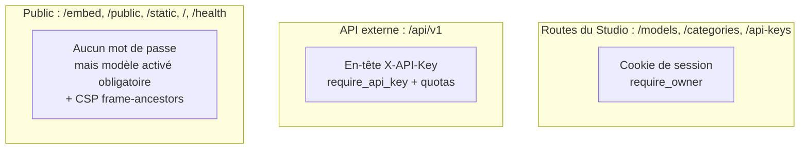

### 12.2 Connexion de la propriétaire

- Le mot de passe vient de `FORMA3D_OWNER_PASSWORD` ; il n'est jamais dans le code ni dans le navigateur.
- Comparaison avec `hmac.compare_digest` : le temps de réponse ne révèle pas la longueur des caractères corrects (protection contre les attaques par mesure du temps).
- Après connexion, le serveur pose un **cookie** `forma3d_session` :
  - **HttpOnly** : JavaScript ne peut pas le lire (protège contre le vol par script) ;
  - **SameSite=Lax** : il n'est pas envoyé par les formulaires d'autres sites ;
  - **Secure** en HTTPS ;
  - durée **8 heures**.
- Le contenu du cookie est un **jeton signé HMAC-SHA256** : `owner.<expiration>.<signature>`. Sans la clé secrète du serveur, impossible d'en fabriquer un faux. Par défaut, la clé est tirée au hasard à chaque démarrage : un redémarrage déconnecte la propriétaire. Si `FORMA3D_SESSION_SECRET` (32 caractères minimum) est défini dans `backend/.env`, la clé est fixe et la session survit aux redémarrages, toujours 8 h au plus ; changer cette valeur déconnecte tout le monde (étape 24).
- Limite : **5 tentatives par minute et par adresse IP** (en mémoire).

🔁 **Keycloak** fait la même chose en plus complet (jetons JWT signés, sessions, rôles). Ici, il n'y a qu'un utilisateur et un seul rôle.

### 12.3 Clés API

- Format : `f3d_live_…` (un préfixe lisible + un secret aléatoire).
- Le secret est montré **une seule fois**, à la création (réponse avec `Cache-Control: no-store`).
- La base garde seulement l'**empreinte SHA-256** du secret. Un **hachage** est une fonction à sens unique : on peut vérifier une clé, mais pas retrouver la clé à partir de l'empreinte.
- **Révoquer** : la clé est refusée immédiatement (401), la ligne reste comme trace. **Supprimer définitivement** : seulement après révocation.
- **Quotas par clé** : `API_DAILY_GENERATION_LIMIT` créations par jour, `API_RATE_LIMIT_PER_MINUTE` requêtes par minute (429 avec `Retry-After`).

### 12.4 CORS et CSP

| Mécanisme | Question à laquelle il répond | Réglage | Par défaut |
|---|---|---|---|
| **CORS** (Cross-Origin Resource Sharing) | « Le JavaScript d'un autre site peut-il appeler l'API ? » | `API_CORS_ORIGINS` | Aucun site |
| **CSP `frame-ancestors`** (Content Security Policy) | « Un autre site peut-il afficher `/embed` dans une iframe ? » | `EMBED_ALLOWED_ORIGINS` | Seulement le Studio (`'self'`) |

Les deux refusent `*`. Le test d'intégration du 12 novembre 2026 l'a vérifié : la page s'affiche sur le site autorisé et elle est bloquée sur un site non autorisé (voir `docs/etapes/etape-17.md`). ✅

### 12.5 Ce qui n'est pas encore protégé

- ⚠️ **HTTP en local** : sans HTTPS, le cookie et les clés circulent en clair sur le réseau. Usage local uniquement tant qu'il n'y a pas de déploiement HTTPS.
- ⚠️ Pas de jeton anti-CSRF dédié (seulement `SameSite=Lax`).
- ⚠️ Pas de comptes multiples ni de rôles : un seul mot de passe (conception de la suite : section 18).
- ✅ La suppression d'un modèle n'existe que dans le Studio (session propriétaire) ; l'API `/api/v1` n'en propose pas : une clé API volée ne peut rien effacer.
- ⚠️ La limite de tentatives est en mémoire : elle repart à zéro au redémarrage.
- ⚠️ `/health/provider` est public (il ne donne qu'un statut, jamais l'adresse du serveur).
- ⚠️ Tout le monde qui connaît le `public_id` d'un modèle activé peut le voir ; désactiver l'intégration coupe l'accès.


### 12.6 Encadrés

> **Un exemple concret.** Trois essais avec PowerShell montrent le rôle de la clé API : sans en-tête `X-API-Key` → **401** ; avec une fausse clé → **401** ; avec la vraie clé → **200** et l'état du modèle. Après révocation dans « Clés API », le même appel repasse à **401**. Côté Studio, si le serveur redémarre sans `FORMA3D_SESSION_SECRET`, le cookie n'est plus reconnu et l'écran de connexion réapparaît.

> **Une analogie.** 🔁 Keycloak émet des jetons JWT signés et gère utilisateurs et rôles ; ici, un seul utilisateur, un jeton signé HMAC dans un cookie HttpOnly, et une dépendance FastAPI `require_owner` qui joue le rôle d'un filtre Spring Security sur les routes du Studio. Les clés API ressemblent aux « client credentials » d'un client OAuth, stockées seulement sous forme d'empreinte, comme un mot de passe haché.

> **Ce que je réponds si on me demande pourquoi.** « J'ai séparé trois portes : la session de la propriétaire pour le Studio, une clé API pour les programmes, et un accès public limité aux modèles explicitement activés sur des sites autorisés. Aucun secret n'est stocké en clair, et tout est fermé par défaut. »

---

## 13. Intégration chez un client

**En une phrase :** un site partenaire affiche un modèle activé avec une iframe ou une balise `<forma3d-viewer>`, et peut piloter les créations par l'API `/api/v1`.

### 13.1 Trois façons d'intégrer

| Méthode | Pour qui | Clé API ? | Exemple |
|---|---|---|---|
| **iframe** | N'importe quel site | Non | `<iframe src="https://SERVICE/embed/PUBLIC_ID" width="100%" height="480">` |
| **Widget** `<forma3d-viewer>` | Site qui accepte un script | Non | voir ci-dessous |
| **API `/api/v1`** | Le **serveur** de la boutique | Oui (`X-API-Key`) | `curl -H "X-API-Key: …" …/api/v1/models/ID` |

### 13.2 Le widget pas à pas

```html
<script src="https://SERVICE/static/widget.js" defer></script>
<forma3d-viewer model="PUBLIC_ID" height="480" auto-rotate></forma3d-viewer>
```

1. `widget.js` définit la balise `forma3d-viewer` (Web Component).
2. La balise lit `model` (le `public_id`, contrôlé : format UUID), `height` (bornée entre 240 et 1200 px) et `auto-rotate`.
3. Elle crée une iframe vers `/embed/{public_id}` sur le même serveur que le script.
4. La clé API n'est **jamais** utilisée par le widget.

### 13.3 Les routes de l'API externe

| Méthode | Route | Rôle |
|---|---|---|
| `POST` | `/api/v1/models` | Envoyer une photo (`file`, `category`) ; réponse 202 |
| `GET` | `/api/v1/models/{id}` | Lire l'état |
| `GET` | `/api/v1/models/{id}/glb` | Télécharger le GLB (409 si pas prêt) |
| `GET` | `/api/v1/models/{id}/integration-code` | Obtenir `iframe_html`, `widget_html`, `public_id` (403 si l'intégration n'est pas activée) |

Les erreurs ont toujours la forme `{"error": {"code": "...", "message": "..."}}`.

### 13.4 Exemple de test fourni

`examples/integration.html` est un faux site de boutique : on y saisit l'adresse de Forma3D et un `public_id`, puis la page charge le widget. Mode d'emploi complet : `docs/INTEGRATION.md` et la page `#/guide`.


### 13.5 Ce qui se passe quand un visiteur ouvre la page produit

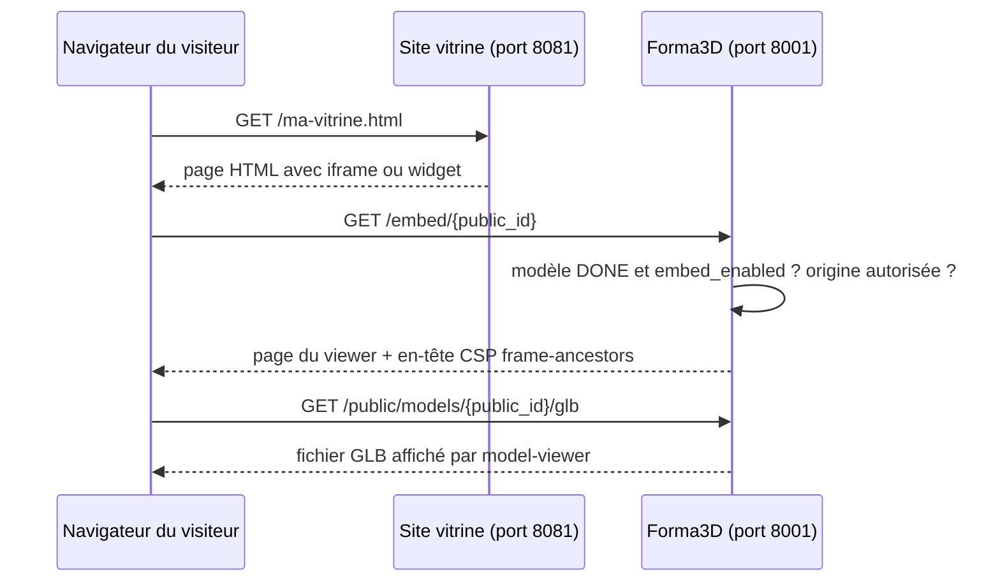

> **Un exemple concret.** Sur le PC de l'étudiante : terminal 1, `dev.ps1` (Forma3D sur 8001) ; terminal 2, `python -m http.server 8081` (le « site vitrine »). Avec `EMBED_ALLOWED_ORIGINS=http://127.0.0.1:8081` dans `backend/.env`, la page `examples/integration.html` affiche le fauteuil vert. Le port fait partie de l'origine : pour le navigateur, 8001 et 8081 sont deux sites différents.

> **Une analogie.** 🔁 C'est comme intégrer une vidéo YouTube : on colle une balise, la vidéo reste hébergée chez YouTube, et YouTube décide quels sites ont le droit de l'afficher. Le widget `<forma3d-viewer>` est un Web Component, comparable à un composant Angular exporté en « Angular Elements » utilisable dans n'importe quelle page.

> **Ce que je réponds si on me demande pourquoi.** « L'intégration n'a besoin d'aucune clé : le visiteur ne voit jamais de secret. La clé API sert seulement au serveur de la boutique. L'adresse `127.0.0.1` ne fonctionne que sur mon PC ; un vrai site en ligne demanderait un hébergement HTTPS, prévu dans l'architecture cible. »

---

## 14. Tests et CI/CD

**En une phrase :** 159 tests automatiques (au 15 novembre 2026) vérifient le backend et les fichiers du frontend, et GitHub les relance à chaque envoi de code.

### 14.1 Ce que prouvent les tests

- Ils prouvent que les **règles du code** sont respectées : validation des photos, états des générations, sécurité des clés, protection des routes, structure des GLB, présence des éléments d'interface.
- Ils utilisent des **faux fournisseurs** : aucun test n'appelle vraiment un service d'IA.
- Ils **ne prouvent pas** la qualité visuelle d'un modèle, ni le rendu réel dans un navigateur, ni la disponibilité des services gratuits.

Lancer les tests (Windows, depuis la racine du dépôt) :

```powershell
cd backend
$env:PYTHON_DOTENV_DISABLED = "true"; $env:HF_SPACE_ID = ""
.venv\Scripts\python.exe -m pytest -q
```

**Isolation des tests** (corrigée le 15 novembre 2026) : un test ne doit jamais dépendre de la machine de la développeuse.

| Problème rencontré | Cause | Correction |
|---|---|---|
| Avec `IMAGE3D_PROVIDER=trellis` et `HF_TOKEN` dans `backend/.env`, deux tests de `test_health.py` recevaient « ONLINE » | Le test remplaçait `main_module.provider`, mais la route lit `app.state.generation_provider` (TRELLIS), qui interrogeait le vrai Space | Le test remplace l'objet réellement lu par la route |
| Après une vraie génération, deux tests de `test_demo_gallery.py` échouaient | Ils lisaient la vraie base locale (SQLite à l'époque) | Le service est remplacé par un faux service vide pendant ces tests |
| `dev.ps1` dépendait du `.env` réel pendant pytest | python-dotenv chargeait `backend/.env` | pytest tourne avec `PYTHON_DOTENV_DISABLED=true` et `HF_SPACE_ID` vide ; le serveur, lui, lit toujours `.env` |

### 14.2 CI et CD en mots simples

- **CI (intégration continue)** : à chaque envoi de code, un robot récupère le projet, installe les dépendances et lance les tests. Si un test échoue, on le voit tout de suite.
- **CD (déploiement continu)** : après des tests réussis, un robot met automatiquement le site en ligne.
- ✅ Le projet a la **CI**. ❌ Il n'a **pas de CD** : aucun déploiement automatique n'existe.

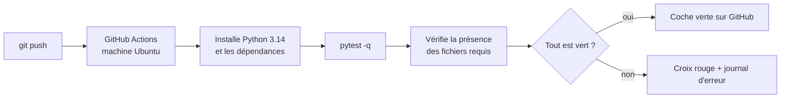

### 14.3 `.github/workflows/ci.yml` ligne par ligne

| Ligne(s) | Sens |
|---|---|
| `name: Project checks` | Nom affiché dans l'onglet « Actions » de GitHub |
| `on: push` et `pull_request` | Se lance à chaque envoi de code et à chaque demande de fusion |
| `permissions: contents: read` | Le robot peut seulement **lire** le dépôt (sécurité) |
| `jobs: project-checks:` | Une seule tâche nommée « Documents and backend tests » |
| `runs-on: ubuntu-latest` | Machine virtuelle Linux fournie par GitHub |
| `uses: actions/checkout@v7` | Récupère le code du dépôt |
| `uses: actions/setup-python@v7` avec `python-version: "3.14"` | Installe Python 3.14 |
| `run: python -m pip install -r requirements.txt` (dans `backend`) | Installe les dépendances |
| `run: python -m pytest -q` (dans `backend`) | Lance tous les tests |
| `test -f README.md` … `test -f frontend/README.md` | Vérifie que les documents obligatoires existent (`set -euo pipefail` arrête au premier fichier manquant) |

⚠️ Le résultat de la CI se lit dans l'onglet **Actions** du dépôt GitHub ; il n'a pas été vérifié pour ce document (**à vérifier**).


### 14.4 Encadrés

> **Un exemple concret.** Le 15 novembre 2026, `dev.ps1` refusait de démarrer : « Les tests ont échoué ». Les tests de santé lisaient le vrai `.env` de l'étudiante (TRELLIS + jeton) et interrogeaient le vrai Space. Correction : le test remplace l'objet que la route utilise vraiment, et pytest tourne sans `.env`. Preuve : les tests passent avec l'environnement par défaut **et** avec des variables factices (`IMAGE3D_PROVIDER=trellis`, `HF_TOKEN=jeton-factice-pour-test`).

> **Une analogie.** 🔁 C'est l'équivalent de JUnit avec Mockito : les fournisseurs 3D sont remplacés par des faux objets (`FakeClient`, `SuccessfulProvider`), et `app.dependency_overrides` de FastAPI joue le rôle de `@MockBean` dans un test Spring Boot.

> **Ce que je réponds si on me demande pourquoi.** « Un test doit donner le même résultat sur toutes les machines. Mes tests n'appellent jamais un service d'IA, n'utilisent pas ma vraie base et ne lisent pas mon `.env` ; ils prouvent les règles du code, pas la qualité visuelle, que je vérifie à la main. »

---

## 15. Installer, configurer, lancer, dépanner

**En une phrase :** on installe Python, on crée un environnement virtuel, on renseigne `backend/.env`, puis on lance uvicorn depuis la racine du dépôt principal.

### 15.1 Installation (Windows, une seule fois)

```powershell
cd C:\chemin\vers\forma3d-kit
python -m venv backend\.venv
backend\.venv\Scripts\python.exe -m pip install -r backend\requirements.txt
copy .env.example backend\.env
```

Puis ouvrez `backend\.env` et renseignez au minimum `FORMA3D_OWNER_PASSWORD`.

### 15.2 Lancer

```powershell
cd C:\chemin\vers\forma3d-kit
backend\.venv\Scripts\python.exe -m uvicorn app.main:app --app-dir backend --port 8000
```

Ouvrez `http://127.0.0.1:8000`. Variante automatique, recommandée : `.\scripts\dev.ps1` (lance d'abord les tests isolés, puis le serveur sur le port **8001**, et ouvre Edge).

| Lancement | Port | Lit `backend/.env` ? |
|---|---|---|
| `.\scripts\dev.ps1` | **8001** | Oui pour le serveur, non pour les tests |
| `uvicorn … --port 8000` à la main | **8000** (ou le port choisi) | Oui |

⚠️ Si un serveur répond déjà sur le port, `dev.ps1` affiche « API prête » **sans le redémarrer** : après une modification de `backend/.env`, arrêtez d'abord l'ancien serveur. Le serveur tourne en arrière-plan et ne s'arrête pas quand on ferme le terminal :

```powershell
Get-NetTCPConnection -LocalPort 8001 -State Listen | ForEach-Object { Stop-Process -Id $_.OwningProcess }
```

### 15.3 Erreurs fréquentes

| Symptôme | Cause probable | Solution |
|---|---|---|
| La page affiche encore l'ancienne version | Cache du navigateur | Recharger avec **Ctrl+F5** |
| Mes modèles ou mes réglages ont « disparu » | Serveur lancé depuis le mauvais dossier (une copie de travail au lieu du dépôt principal) | Lancer depuis la racine du dépôt principal, celle qui contient votre `backend/.env` et `backend/data/` |
| « Connexion impossible : définissez FORMA3D_OWNER_PASSWORD… » | Mot de passe absent de `backend/.env` (ou mis par erreur dans `.env.example`) | L'ajouter dans `backend/.env`, redémarrer |
| `error while attempting to bind on address … 8000` | Port déjà utilisé par un autre serveur | Arrêter l'autre serveur (Ctrl+C) ou utiliser `--port 8001` |
| Badge « Serveur 3D : hors ligne » | Voir la section 17 (fournisseur non configuré, ancien serveur, quota, Colab expiré…) | Lire `/health/provider`, puis suivre la section 17 |
| « Les tests ont échoué ; le serveur n'a pas été démarré » | Un test a échoué : `dev.ps1` refuse alors de démarrer le serveur | Lire le nom du test en rouge ; mettre le dépôt à jour (`git pull`) |
| « API prête » mais l'ancienne configuration reste active | Un ancien serveur occupait déjà le port | Arrêter l'ancien serveur (commande ci-dessus), relancer |
| « The read operation timed out » | Space TRELLIS très lent (ancien délai de 5 s) | Corrigé (120 s par requête) ; mettre le dépôt à jour |
| Le bouton « Supprimer ce modèle » n'apparaît pas | Ancienne version de `model-detail.js` en cache | **Ctrl+F5**, ou F12 puis « Vider le cache et effectuer une actualisation forcée » |
| « Quota GPU gratuit du Space TRELLIS atteint » | Quota journalier épuisé | Réessayer plus tard ; ajouter un jeton gratuit `HF_TOKEN` |
| Le modèle paraît noir | Matériau métallique par défaut (ancien fichier) | Déjà corrigé à l'affichage et pour les nouveaux fichiers ; recharger avec Ctrl+F5 |
| Un site partenaire n'affiche rien | Origine absente de `EMBED_ALLOWED_ORIGINS`, ou intégration non activée | Ajouter l'origine exacte, redémarrer, activer l'interrupteur sur la fiche |

---

## 16. Limites, travail restant et perspectives

**En une phrase :** le prototype fonctionne de bout en bout en local, mais il reste mono-propriétaire, dépendant de services gratuits instables, et non déployé.

### 16.1 Limites honnêtes

- **Qualité 3D** : une seule photo ne montre pas l'arrière ; TripoSR a des couleurs approximatives, TRELLIS invente parfois des parties (exemple observé : une table en demi-lune devenue ovale).
- **Fiabilité** : Colab expire, les Spaces gratuits ont des quotas journaliers et des mises en veille.
- **Génération TRELLIS depuis le Studio** : obtenue le 15 novembre 2026 (fauteuil rétro vert : GLB affiché, intégré et visible sur une page de test), après la correction du délai HTTP. Elle reste dépendante du quota quotidien et de la disponibilité du Space.
- **Qualité selon la photo** : un fauteuil blanc sur fond gris clair, en petite capture d'écran, a donné un modèle posé sur une « dalle » : le détourage n'a pas séparé l'objet du sol (contraste trop faible, ombre, image de moins de 512 px).
- **Sécurité** : usage local, HTTP, un seul mot de passe (section 12.5).
- **Données** : PostgreSQL (volume Docker `pgdata`) et disque local, sans sauvegarde automatique.
- **Pas de déploiement** ni de CD.

### 16.2 La deuxième partie du projet (proposée, non commencée)

Décision du 15 novembre 2026 : option C (rester mono-propriétaire pour la soutenance). L'architecture détaillée est dans `docs/ARCHITECTURE-CIBLE.md` et résumée en section 18. La suppression d'un modèle existe désormais, en version définitive avec confirmation (étape 23).

| Étape | Contenu |
|---|---|
| D | Comptes vendeurs et inscription ; données séparées par boutique ; tests d'isolation |
| E | Rôle `superadmin`, journal d'audit, suppression réversible |
| F | Passage à PostgreSQL grâce à l'interface `GenerationRepository` ; sauvegardes |
| G | Récupération de mot de passe par courriel (service d'envoi à choisir) |
| Plus tard | Plusieurs vues d'un même produit (face, côté, arrière) si le modèle le permet ; application pour une plateforme e-commerce ; déploiement HTTPS |

---

## 17. Pourquoi le serveur 3D affiche « hors ligne »

**En une phrase :** le badge rouge signifie que Forma3D ne peut pas joindre son fournisseur 3D ; la cause se lit sur `/health/provider`, et tout le reste du Studio continue de fonctionner.

### 17.1 Lire le diagnostic

Ouvrez `http://127.0.0.1:8001/health/provider` (ou `8000` si uvicorn est lancé à la main). La réponse ne contient jamais l'adresse du serveur ni le jeton :

```json
{"status": "OFFLINE", "message": "Le serveur 3D (Colab) est arrêté ou son lien a expiré (72 h)…"}
```

| `status` | Message | Ce que ça veut dire |
|---|---|---|
| `ONLINE` | « Le serveur 3D est joignable. » | Tout va bien |
| `UNCONFIGURED` | « HF_SPACE_ID est vide… » | Fournisseur TripoSR sans adresse : `IMAGE3D_PROVIDER` n'est pas `trellis` et `HF_SPACE_ID` est vide |
| `OFFLINE` + « Colab » | « Le serveur 3D (Colab) est arrêté ou son lien a expiré… » | Le serveur utilise **TripoSR** : soit le lien Colab a expiré, soit `IMAGE3D_PROVIDER=trellis` n'a pas été pris en compte |
| `OFFLINE` + « TRELLIS » | « Le Space TRELLIS est en veille, en panne ou indisponible… » | TRELLIS est bien configuré, mais le Space ne répond pas « RUNNING » |

### 17.2 Les causes, dans l'ordre où les chercher

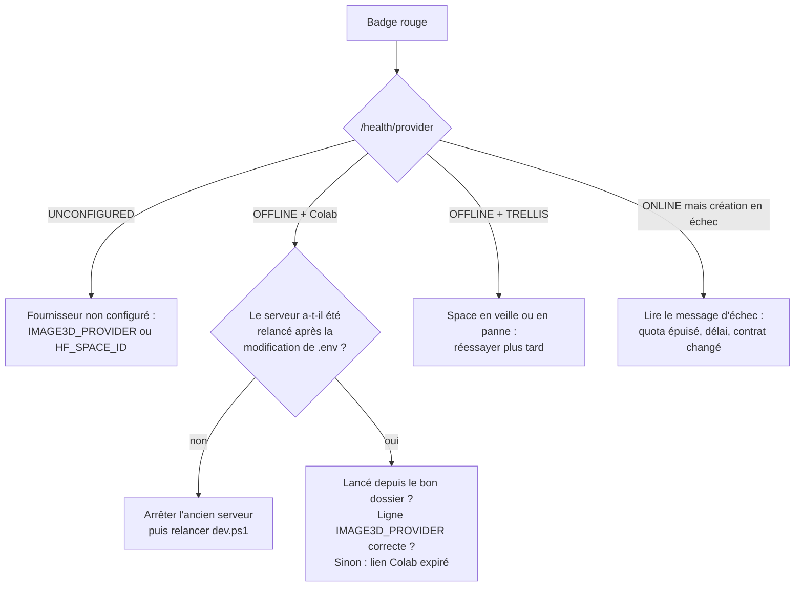

| Cause | Comment la reconnaître | Que faire |
|---|---|---|
| **Fournisseur non configuré** | `UNCONFIGURED` | Dans `backend/.env` : `IMAGE3D_PROVIDER=trellis` (ou une adresse `HF_SPACE_ID` pour TripoSR), puis redémarrer |
| **Ancien serveur encore actif** | Message « Colab » alors que `.env` dit `trellis` ; `dev.ps1` affiche « API prête » sans redémarrer | Arrêter le serveur sur le port 8001 (section 15.2), relancer |
| **Serveur lancé depuis le mauvais dossier** | Par exemple depuis `.claude\worktrees\…`, qui n'a pas de `backend/.env` | Lancer depuis la racine du dépôt principal |
| **Jeton absent** | Pas d'erreur immédiate, mais quota anonyme très petit | Ajouter `HF_TOKEN` (gratuit) dans `backend/.env` |
| **Quota épuisé** | Badge parfois vert, mais création en échec : « Quota GPU gratuit du Space TRELLIS atteint… » | Attendre la recharge quotidienne ; ne pas relancer en boucle |
| **Lien Colab expiré** (TripoSR) | `OFFLINE` + « Colab » | Relancer le notebook, copier la nouvelle adresse dans `HF_SPACE_ID`, redémarrer |
| **Space lent ou en veille** | `OFFLINE` + « TRELLIS », ou création longue | Réessayer plus tard |

⚠️ Le badge est rafraîchi toutes les 30 s (`main.js`) ; au chargement il peut être jaune quelques secondes (vérification en cours).

### 17.3 Ce qui reste utilisable sans fournisseur

- ✅ Exemples du catalogue, et « Ajouter à mes modèles »
- ✅ Import d'un `.glb` existant
- ✅ Fiches, comparaison photo/modèle, téléchargement, suppression
- ✅ Activation de l'intégration, iframe, widget, page `/embed`
- ✅ Clés API et routes `/api/v1` de lecture
- ❌ Seule la **création à partir d'une photo** est bloquée (bouton désactivé)

> **Ce que je réponds si on me demande pourquoi.** « Le fournisseur est un service gratuit externe : il peut dormir ou atteindre son quota. J'ai donc rendu son état visible, sans jamais exposer d'adresse ni de jeton, et j'ai gardé tout le reste du Studio utilisable hors ligne. »

---

## 18. Du Studio privé au SaaS

**En une phrase :** pour la soutenance, Forma3D reste une console privée (option C) ; le passage à un SaaS multi-clients est conçu en détail dans `docs/ARCHITECTURE-CIBLE.md`, mais pas codé.

| Thème | Aujourd'hui | Demain (cible) |
|---|---|---|
| Rôles | Propriétaire seule | Visiteur, client inscrit, administrateur |
| Isolation | Sans objet | `owner_id` sur modèles, clés API et sites autorisés ; chaque requête vérifie le propriétaire (sinon : faille IDOR) |
| Base | PostgreSQL local (Docker) | PostgreSQL hébergé, avec Row Level Security |
| Fichiers | `backend/storage/` | Stockage d'objets séparé |
| Authentification | Mot de passe unique | Supabase Auth recommandé (option A) plutôt qu'une authentification maison (option B) |
| Goulot | Quota GPU gratuit | Le même quota, partagé par tous les clients : c'est la vraie limite |
| Données personnelles | Aucune inscription | RGPD : consentement, export, suppression de compte |

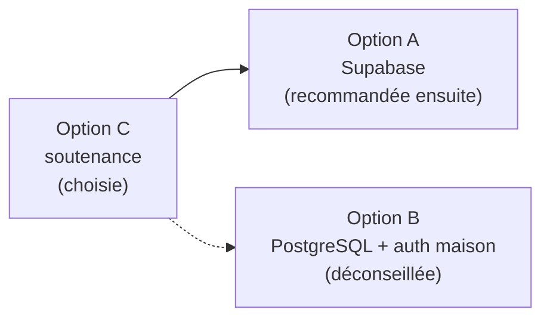

Pourquoi la migration est possible : le service dépend de l'interface `GenerationRepository`, pas d'une base précise (section 6.7) ; le passage de SQLite à PostgreSQL l'a déjà prouvé. Le vrai travail serait d'ajouter l'`owner_id` à chaque méthode et à chaque route.

👉 Lire `docs/ARCHITECTURE-CIBLE.md` : schéma des tables, comparaison des options avec les liens officiels, plan en étapes, et dix phrases prêtes pour l'oral.

---

## 19. Comment travailler avec Git sur ce projet

**En une phrase :** chaque changement est fait sur une branche, proposé dans une pull request, fusionné dans `main` sur GitHub, puis récupéré sur le PC avec `git pull`.

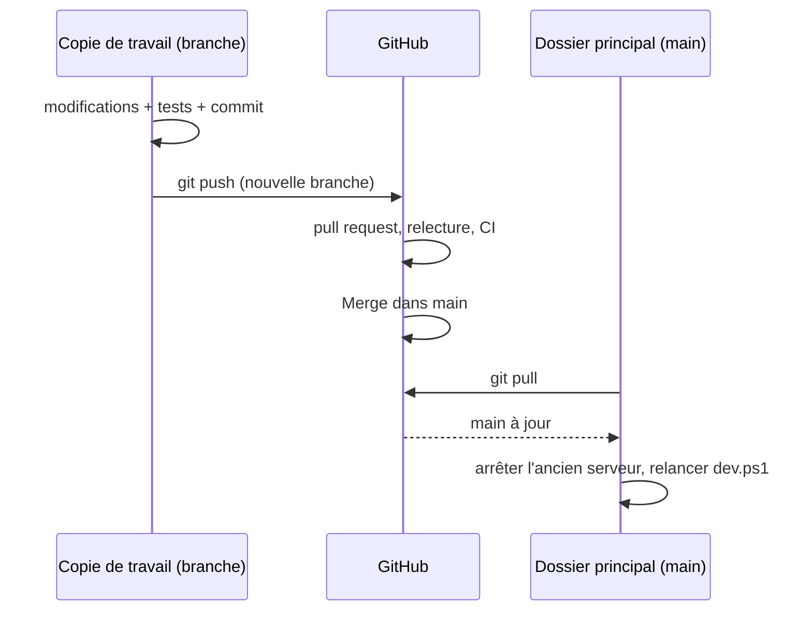

| Mot | Sens | Commande |
|---|---|---|
| **Branche** | Une ligne de travail séparée de `main` | `git switch -c ma-branche` |
| **Commit** | Une photo enregistrée des modifications | `git commit -m "message"` |
| **Push** | Envoyer ses commits sur GitHub | `git push -u origin ma-branche` |
| **Pull request (PR)** | Demande de fusion d'une branche dans `main`, avec relecture et CI | bouton « Create pull request » sur GitHub |
| **Merge** | Fusionner la PR dans `main` | bouton « Merge » sur GitHub |
| **Pull** | Récupérer sur son PC ce qui a été fusionné | `git pull` |

**Pourquoi un assistant peut travailler dans un worktree séparé.** Un *worktree* est un **deuxième dossier** relié au même dépôt Git, sur une autre branche (ici sous `.claude\worktrees\…`). L'assistant y travaille sans toucher au dossier où la propriétaire lance le site. Conséquences vécues le 15 novembre 2026 :

- une correction faite dans le worktree n'est **pas** active chez soi tant que la PR n'est pas fusionnée et que `git pull` n'est pas fait ;
- le worktree n'a **pas** de `backend/.env` ni de base `backend/data/` : un serveur lancé depuis ce dossier affiche « hors ligne » et une bibliothèque vide ;
- après `git pull`, il faut **redémarrer** le serveur, et parfois faire **Ctrl+F5** dans le navigateur (fichiers JavaScript en cache).

> **Une analogie.** 🔁 C'est le même flux que sur GitLab ou GitHub avec un projet Angular ou Spring Boot en équipe : une branche par fonctionnalité, une *merge request*, la CI, puis la fusion.

> **Ce que je réponds si on me demande pourquoi.** « Chaque changement passe par une pull request : il est relu et testé par la CI avant d'arriver dans `main`. L'historique montre exactement quand et pourquoi chaque fonctionnalité a été ajoutée. »

---

## 20. Le backend en détail, fichier par fichier

**En une phrase :** cette section ouvre chaque fichier important du serveur, montre un vrai extrait, l'explique ligne par ligne et prépare la question probable du jury.

Comment lire chaque fiche : **Rôle** → **Extrait réel** (copié du code, raccourci à 25 lignes maximum) → **Ligne par ligne** → **Technologie** → **Pourquoi ce choix** → **Question du jury**.

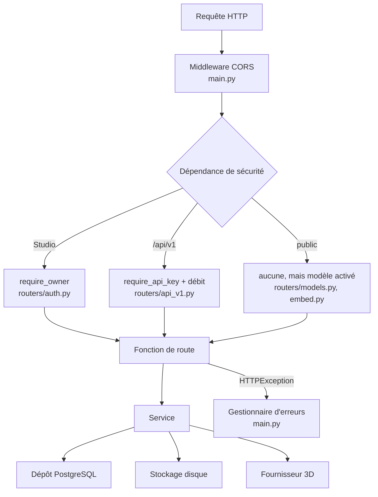

### 20.1 `main.py` — l'assemblage de l'application

**Rôle :** créer l'application FastAPI, choisir le fournisseur, créer les services une seule fois, brancher les routeurs avec leur protection.

```python
# backend/app/main.py, lignes 40-46 et 88-99
provider = HuggingFaceSpaceProvider()
generation_provider = (
    TrellisSpaceProvider(provider.settings)
    if provider.settings.image3d_provider == "trellis"
    else provider
)
...
app.state.owner_auth = OwnerAuthService(signing_key=session_key_from_environment())

studio_protection = [Depends(require_owner)]
app.include_router(auth_router)
app.include_router(models_router, dependencies=studio_protection)
app.include_router(categories_router, dependencies=studio_protection)
app.include_router(api_keys_router, dependencies=studio_protection)
app.include_router(public_models_router)
app.include_router(api_v1_router)
app.include_router(embed_router)
```

**Ligne par ligne :**
- `HuggingFaceSpaceProvider()` lit la configuration (`Settings`) au démarrage.
- L'expression `A if condition else B` est un **opérateur ternaire** Python : TRELLIS si `IMAGE3D_PROVIDER=trellis`, sinon TripoSR.
- `app.state` est un **sac d'objets partagés** attaché à l'application : les routes y retrouvent les services. 🔁 C'est le conteneur de beans de Spring, en très simple.
- `dependencies=studio_protection` ajoute `require_owner` à **toutes** les routes d'un routeur d'un coup. 🔁 Comme une règle `requestMatchers("/models/**").authenticated()` de Spring Security.
- Les trois derniers routeurs n'ont pas cette protection : ils ont leur propre règle (modèle activé, clé API).

Autres éléments du même fichier :

| Lignes | Élément | Ce qu'il fait |
|---|---|---|
| 54-65 | `lifespan` (gestionnaire de contexte asynchrone) | Au démarrage : initialise la base, écrit des avertissements si `backend/.env`, le mot de passe ou `HF_SPACE_ID` manquent. Ne bloque pas le démarrage. |
| 100-108 | `CORSMiddleware` | Autorise seulement les origines de `API_CORS_ORIGINS`, les méthodes GET/POST/OPTIONS et l'en-tête `X-API-Key` ; pas de cookies (`allow_credentials=False`). |
| 111-133 | `@app.exception_handler` | Sur `/api/v1`, transforme toute erreur en `{"error": {"code": "...", "message": "..."}}` ; ailleurs, garde `{"detail": "..."}`. |
| 136-140 | `app.mount("/static", StaticFiles(...))` | Sert le dossier `frontend/` sous `/static`. |
| 143-146 | `GET /` | Renvoie `frontend/index.html`. |
| 155-177 | `GET /health/provider` | Statut du fournisseur + message lisible, jamais l'adresse (section 17). |

**Pourquoi ce choix :** tout est créé **une seule fois** au même endroit ; les tests peuvent remplacer un objet (`app.dependency_overrides`) sans toucher au reste.

**Question du jury :** « Où se fait l'injection de dépendances ? » → « Les objets sont créés dans `main.py` et rangés dans `app.state` ; chaque route les reçoit par `Depends(...)`. C'est l'équivalent de l'injection par constructeur de Spring, sans annotations. »

### 20.2 `config.py` — la configuration validée au démarrage

**Rôle :** lire les variables d'environnement, leur donner un type, et **refuser** une valeur dangereuse avant que le serveur ne démarre.

```python
# backend/app/config.py, lignes 18-24 et 65-69
@dataclass(frozen=True)
class Settings:
    hf_space_id: str = ""
    hf_token: str | None = None
    hf_timeout_seconds: int = 300
    ...
    def __post_init__(self) -> None:
        if self.image3d_provider not in {"triposr", "trellis"}:
            raise ValueError("IMAGE3D_PROVIDER doit valoir « triposr » ou « trellis ».")
        if not _SPACE_ID_PATTERN.fullmatch(self.trellis_space_id):
            raise ValueError("TRELLIS_SPACE_ID doit être un identifiant de Space « propriétaire/nom », pas une URL.")
```

**Ligne par ligne :**
- `@dataclass(frozen=True)` fabrique automatiquement le constructeur ; `frozen` rend l'objet **non modifiable** après création.
- `str | None` veut dire « une chaîne ou rien ».
- `__post_init__` est appelé **juste après** le constructeur : c'est l'endroit des vérifications.
- `_SPACE_ID_PATTERN.fullmatch` vérifie avec une **expression régulière** (motif de texte) que la valeur ressemble à `propriétaire/nom`.

Les règles complètes de `__post_init__` (lignes 38-97) : délai positif, 1 ou 2 tentatives, origines CORS et iframe en HTTP(S) **précis** (jamais `*`, pas de chemin, pas d'identifiants), taille GLB entre 1 et 512 Mo, quotas au moins 1. `get_settings()` (ligne 110) charge `backend/.env` puis `.env`, sans écraser l'environnement.

**Pourquoi ce choix :** une erreur de configuration doit se voir **au démarrage**, pas au milieu d'une démo.

**Question du jury :** « Pourquoi refuser `*` dans CORS ? » → « `*` autoriserait n'importe quel site à appeler l'API depuis le navigateur ; on veut une liste précise et fermée par défaut. »

### 20.3 `models.py` et `schemas.py` — objets internes contre JSON

**Rôle :** `models.py` décrit les objets **internes** (ce que le service manipule) ; `schemas.py` décrit le **JSON** échangé avec le navigateur.

```python
# backend/app/models.py, lignes 22-28 et 47-65 (extrait)
class GenerationStatus(StrEnum):
    PENDING = "PENDING"
    RUNNING = "RUNNING"
    DONE = "DONE"
    FAILED = "FAILED"

@dataclass(frozen=True, slots=True)
class GenerationRecord:
    id: str
    status: GenerationStatus
    image_path: Path | None
    model_path: Path | None = None
    public_id: str | None = None
    embed_enabled: bool = False
```

```python
# backend/app/schemas.py, lignes 11-22 (extrait)
class GenerationResponse(BaseModel):
    id: str = Field(description="Identifiant de suivi créé par le serveur.")
    status: Literal["PENDING", "RUNNING", "DONE", "FAILED"]
    status_url: str
    model_url: str | None = None
```

**Ligne par ligne :**
- `StrEnum` : une **énumération** dont chaque valeur est aussi une chaîne. 🔁 Un `enum` Java.
- `slots=True` : l'objet n'accepte que les attributs déclarés (moins de mémoire, pas de faute de frappe silencieuse).
- `GenerationRecord` contient des **chemins disque** (`image_path`, `model_path`) : ils ne doivent jamais sortir du serveur.
- `GenerationResponse` hérite de `BaseModel` (Pydantic) : FastAPI vérifie et convertit automatiquement en JSON. `Literal[...]` limite les valeurs possibles.
- La conversion de l'un vers l'autre se fait dans `routers/models.py`, fonction `_to_response` (ligne 41) : elle construit `status_url` et `model_url` et **n'expose aucun chemin local**.

**Pourquoi ce choix :** séparer l'objet interne du DTO empêche de publier par erreur un champ privé.

**Question du jury :** « Quelle différence entre `models.py` et `schemas.py` ? » → « `models.py`, ce sont mes entités internes ; `schemas.py`, mes DTO JSON. Comme une entité JPA et un DTO dans Spring. »

### 20.4 `routers/auth.py` — connexion et protection du Studio

```python
# backend/app/routers/auth.py, lignes 30-33 et 55-63
def require_owner(request: Request) -> None:
    if not _service(request).validate_token(request.cookies.get(SESSION_COOKIE_NAME)):
        raise HTTPException(status_code=status.HTTP_401_UNAUTHORIZED, detail="Connexion requise.")

    response.set_cookie(
        SESSION_COOKIE_NAME,
        service.issue_token(),
        max_age=service.ttl_seconds,
        httponly=True,
        samesite="lax",
        secure=request.url.scheme == "https",
        path="/",
    )
```

**Ligne par ligne :**
- `require_owner` est une **dépendance** : FastAPI l'exécute avant la route. Si elle lève `HTTPException`, la route n'est jamais appelée.
- `request.cookies.get(...)` lit le cookie `forma3d_session` (ou `None`).
- `set_cookie(...)` : `httponly` (illisible par JavaScript), `samesite="lax"` (non envoyé par les formulaires d'autres sites), `secure` seulement en HTTPS, `max_age` = 8 h.

Ordre dans `login` (lignes 36-64) : 1) limite de tentatives par IP → 429 avec `Retry-After` ; 2) mot de passe non configuré → 503 ; 3) mot de passe faux → 401 ; 4) cookie posé. `GET /auth/me` renvoie `{"authenticated": …, "configured": …}` ; le frontend l'appelle au démarrage.

**Question du jury :** « Pourquoi un cookie et pas un jeton dans le `localStorage` ? » → « Un cookie HttpOnly ne peut pas être lu par un script injecté ; un jeton dans `localStorage` le pourrait. »

### 20.5 `services/owner_auth.py` — le jeton signé

Déjà décrit en section 12.2. Points de code à connaître :
- `issue_token()` construit `owner.<expiration>.<signature>` ; `validate_token()` refuse un format inattendu, compare la signature avec `hmac.compare_digest`, puis vérifie l'expiration.
- `LoginAttemptLimiter` garde, **en mémoire**, une file (`deque`) des tentatives par IP sur 60 s, protégée par un verrou (`threading.Lock`).
- `session_key_from_environment()` (étape 24) : clé fixe si `FORMA3D_SESSION_SECRET` fait au moins 32 caractères, sinon clé aléatoire.

**Question du jury :** « Que se passe-t-il si quelqu'un modifie la date d'expiration dans son cookie ? » → « La signature HMAC ne correspond plus : le jeton est refusé. »

### 20.6 `routers/api_keys.py` et `services/api_key_service.py` — les clés API

```python
# backend/app/services/api_key_service.py, lignes 38-39 et 77-92 (extrait)
secret = _KEY_PREFIX + secrets.token_urlsafe(32)
prefix = secret[: len(_KEY_PREFIX) + _PREFIX_RANDOM_LENGTH]

def authenticate(self, candidate: str | None) -> APIKeyRecord | None:
    supplied = candidate or ""
    prefix = supplied[:prefix_length] if supplied.startswith(_KEY_PREFIX) else ""
    fingerprint = self._fingerprint(supplied)
    matches = self._repository.find_api_keys_by_prefix(prefix) if prefix else []
    if not matches:
        hmac.compare_digest(fingerprint, _DUMMY_FINGERPRINT)
        return None
    accepted: APIKeyRecord | None = None
    for record in matches:
        if hmac.compare_digest(fingerprint, record.fingerprint):
            accepted = record
    return accepted
```

**Ligne par ligne :**
- `secrets.token_urlsafe(32)` : 32 octets aléatoires **cryptographiques** (module `secrets`, pas `random`).
- Le **préfixe** (`f3d_live_` + 8 caractères) est stocké en clair pour retrouver vite les candidates ; le reste n'est connu que par son **empreinte SHA-256**.
- Si aucune clé ne correspond, on fait quand même une comparaison factice (`_DUMMY_FINGERPRINT`) : le temps de réponse est le même que pour une clé existante. Un attaquant ne peut pas deviner les préfixes en mesurant le temps.
- La boucle ne s'arrête pas au premier succès, toujours pour garder un temps constant.

Côté routes : `POST /api-keys` répond avec `Cache-Control: no-store` (le secret ne doit pas rester en cache) ; `require_api_key` (ligne 83) lit l'en-tête avec `Header(alias="X-API-Key")` et répond 401 avec `WWW-Authenticate: ApiKey`.

**Question du jury :** « Si votre base fuit, peut-on utiliser les clés ? » → « Non : la base ne contient que des empreintes SHA-256, à sens unique. »

### 20.7 `routers/api_v1.py` — l'API externe, quotas et erreurs

```python
# backend/app/routers/api_v1.py, création d'un modèle (extrait)
reason = key_service.consume_daily_quota(_key, request.app.state.api_daily_generation_limit)
if reason == "revoked":
    raise HTTPException(status_code=401, detail="Clé API absente, invalide ou révoquée.")
if reason == "daily_quota":
    now = datetime.now(UTC)
    tomorrow = (now + timedelta(days=1)).replace(hour=0, minute=0, second=0, microsecond=0)
    wait_seconds = max(1, int((tomorrow - now).total_seconds()))
    raise HTTPException(status_code=429,
        detail="Quota quotidien de créations atteint pour cette clé.",
        headers={"Retry-After": str(wait_seconds)})
```

**Ligne par ligne :**
- Chaque route `/api/v1` passe d'abord par `require_api_v1_key` : clé valide **et** limite par minute (429 + `Retry-After: 60`).
- La création consomme en plus **le quota du jour** (jour UTC). Dépassement → **429** avec le nombre de secondes jusqu'à minuit UTC.
- Catégorie inconnue ou désactivée → 403.
- Ensuite, le **même** `GenerationService` que le Studio est utilisé : aucune logique dupliquée.

Correspondance des codes (gestionnaire de `main.py`) : 400 `bad_request`, 401 `unauthorized`, 403 `forbidden`, 404 `not_found`, 409 `conflict`, 413 `payload_too_large`, 415 `unsupported_media_type`, 422 `invalid_request`, 429 `rate_limited`.

**Question du jury :** « Comment évitez-vous qu'une clé lance 1 000 générations ? » → « Deux limites par clé, stockées en base : 10 requêtes par minute et 20 créations par jour par défaut, réglables dans `.env`. »

### 20.8 `repositories/postgres_repository.py` — connexions et transactions

```python
# backend/app/repositories/postgres_repository.py, lignes 83-97
@contextmanager
def _connection(self) -> Iterator[psycopg.Connection[dict[str, Any]]]:
    with psycopg.connect(
        self._database_url,
        row_factory=dict_row,
        connect_timeout=self._connect_timeout,
        options="-c TimeZone=UTC",
    ) as connection:
        yield connection
```

**Ligne par ligne :**
- `@contextmanager` transforme la fonction en **gestionnaire de contexte** utilisable avec `with self._connection() as connection:`.
- `psycopg.connect(...)` ouvre une connexion réseau vers le serveur PostgreSQL désigné par `DATABASE_URL`.
- `row_factory=dict_row` : on lit les colonnes par leur nom (`row["status"]`).
- `connect_timeout` : on n'attend pas indéfiniment une base injoignable.
- `TimeZone=UTC` : toutes les dates relues sont en UTC, quel que soit le réglage du serveur.
- Le bloc `with` de psycopg fait `commit` si tout va bien, `rollback` en cas d'erreur, et **toujours** ferme la connexion.
- Une connexion **par opération** : pas de connexion partagée entre la requête HTTP et la tâche de fond (un test le vérifie avec un espion sur `psycopg.connect`).
- Les valeurs passent par des paramètres `%s`, envoyés **séparément** du texte SQL : pas d'injection SQL possible.

La limite par minute (`consume_api_rate_limit`, ligne 449) commence par `SELECT … FROM api_keys WHERE id = %s … FOR UPDATE` : la ligne de la clé est **verrouillée** jusqu'à la fin de la transaction, donc deux requêtes simultanées avec la même clé passent l'une après l'autre et ne peuvent pas dépasser la limite ensemble. Un test lance 8 requêtes en parallèle avec une limite de 3 : exactement 3 sont acceptées.

🔁 C'est l'équivalent d'une méthode `@Transactional` de Spring, ou d'un bloc `BEGIN … COMMIT; EXCEPTION WHEN OTHERS THEN ROLLBACK;` en PL/SQL ; `FOR UPDATE` existe aussi en Oracle.

### 20.9 `routers/models.py` — envoi d'une photo et routes publiques

```python
# backend/app/routers/models.py, lignes 64-90 (extrait)
@router.post("", response_model=GenerationResponse, status_code=202)
async def create_model_generation(
    file: Annotated[UploadFile, File(description="Photo JPG, PNG ou WebP, jusqu'à 10 Mo.")],
    category: Annotated[str, Form(description="Slug d'une catégorie active du catalogue.")],
    background_tasks: BackgroundTasks,
    service: Annotated[GenerationService, Depends(get_generation_service)],
) -> GenerationResponse:
    try:
        content = await file.read(MAX_UPLOAD_BYTES + 1)
        validated = UploadValidator.validate(filename=file.filename,
            content_type=file.content_type, content=content)
    except UploadValidationError as error:
        raise HTTPException(status_code=error.status_code, detail=error.detail) from error
    finally:
        await file.close()
    record = service.create_generation(validated, content, category)
    background_tasks.add_task(service.run, record.id)
    return _to_response(record)
```

**Ligne par ligne :**
- `status_code=202` : « accepté, traitement en cours ».
- `File(...)` et `Form(...)` : lecture d'un formulaire `multipart/form-data` (fichier + champ texte).
- `file.read(MAX_UPLOAD_BYTES + 1)` : on lit **au plus** 10 Mo + 1 octet. Si on obtient plus de 10 Mo, le fichier est trop gros, sans jamais charger un fichier énorme en mémoire.
- `finally: await file.close()` : le fichier temporaire est fermé même en cas d'erreur.
- `background_tasks.add_task(service.run, record.id)` : la génération démarre **après** l'envoi de la réponse.

Les routes **publiques** (`/public/models/{public_id}` et `/glb`) passent toutes par `_get_enabled_public_model` (ligne ~155) : 404 si le modèle n'existe pas, n'est pas `DONE`, n'est pas activé ou n'a plus de fichier. La même réponse 404 dans tous les cas : on ne révèle pas pourquoi.

Autres routes du fichier : `POST /models/import` (GLB local, extension `.glb`, taille ≤ `MAX_GLB_UPLOAD_MB`, format GLB 2.0), `POST /models/examples/{id}/copy`, `GET /models/gallery`, `PATCH /models/{id}/integration`, `DELETE /models/{id}` (étape 23), `GET /models/{id}`, `/glb`, `/source-image`.

**Question du jury :** « Pourquoi 202 et pas 200 ? » → « Le modèle n'existe pas encore au moment de la réponse ; 202 dit "accepté, en cours", et la réponse donne l'adresse de suivi. »

### 20.10 `routers/embed.py` — la page affichée dans l'iframe

```python
# backend/app/routers/embed.py, lignes 19-22 et 65-70
def _frame_ancestors(request: Request) -> str:
    allowed_origins = tuple(request.app.state.embed_allowed_origins)
    return "frame-ancestors 'self'" + (" " + " ".join(allowed_origins) if allowed_origins else "")

    headers = {
        "Content-Security-Policy": _frame_ancestors(request),
        "Cache-Control": "no-store",
        "X-Content-Type-Options": "nosniff",
        "Referrer-Policy": "strict-origin-when-cross-origin",
    }
```

**Ligne par ligne :**
- `frame-ancestors` dit au **navigateur** quels sites ont le droit d'afficher cette page dans une iframe ; `'self'` = Forma3D lui-même.
- `nosniff` : le navigateur ne doit pas deviner un autre type de contenu.
- `Referrer-Policy` : limite l'adresse transmise aux autres sites.
- La page HTML est construite à la main (`_viewer_page`), et le titre passe par `html.escape(...)` : un nom de fichier contenant `<script>` ne peut pas s'exécuter (protection contre le **XSS**, l'injection de script).
- Modèle indisponible → page d'erreur 404 avec les **mêmes** en-têtes.

**Question du jury :** « Qui bloque un site non autorisé : votre serveur ou le navigateur ? » → « Le navigateur, en lisant l'en-tête CSP envoyé par mon serveur. »

### 20.11 Les services de traitement

| Service | Rôle | Point clé du code |
|---|---|---|
| `upload_validator.py` | Valide la photo | Extension, type MIME, **signature** (premiers octets : `FF D8 FF` JPEG, `89 50 4E 47` PNG, `RIFF…WEBP`), 10 Mo. Un fichier renommé (AVIF en `.jpg`) est refusé. |
| `image_preparer.py` | Prépare une copie carrée | `ImageOps.exif_transpose` (redresse selon l'appareil photo), fond uni, carré d'au moins 512 px avec 12 % de marge, `LANCZOS` (agrandissement de qualité), PNG. Avertissement si un côté < 512 px ou si la **variance des contours** est trop faible (photo floue). |
| `glb_finisher.py` | Complète le GLB | Lit l'en-tête et les chunks, ajoute des normales (moyenne pondérée par l'aire des triangles), un matériau mat, met `metallicFactor` à 0 quand il manque. **Ne lève jamais d'exception** : en cas de doute, renvoie le fichier d'origine. |
| `demo_gallery.py` | Les 5 exemples | Liste fixe de noms autorisés ; `is_valid_glb_2` vérifie octet par octet : `glTF`, version 2, longueur totale, chunk JSON multiple de 4, `asset.version == "2.0"`. |
| `category_service.py` | Règles des catégories | Slug en minuscules, chiffres et tirets (64 caractères max), libellé non vide (100 max), `require_active` pour les envois. |
| `generation_service.py` | Orchestration | Machine à états, verrou `RLock` autour des lectures/écritures, masquage du jeton dans les erreurs, suppression (étape 23). |

```python
# backend/app/services/image_preparer.py, cœur du cadrage (extrait)
canvas_side = max(_MINIMUM_SIDE, original_width, original_height)
content_side = max(1, round(canvas_side * (1 - _MARGIN_RATIO)))
contained = ImageOps.contain(rgb, (content_side, content_side), method=Image.Resampling.LANCZOS)
canvas = Image.new("RGB", (canvas_side, canvas_side), _CANVAS_COLOR)
offset = ((canvas_side - contained.width) // 2, (canvas_side - contained.height) // 2)
canvas.paste(contained, offset)
```

- La toile fait au moins 512 px de côté ; l'objet occupe 88 % (12 % de marge) ; `//` est la division entière, pour centrer.

**Question du jury :** « Pourquoi préparer la photo avant l'IA ? » → « Les modèles image→3D attendent un objet centré dans une image carrée ; je le fais localement avec Pillow, sans IA, et je garde la photo originale intacte. »

### 20.12 Les fournisseurs : relance, délais et jeton

```python
# backend/app/providers/huggingface.py, lignes 333-342
def _client_token(self) -> str | bool:
    """N'envoie un jeton HF qu'à HF, jamais à un serveur public tiers."""
    if not self.settings.hf_token:
        return False
    if not self._is_http_url(self.settings.hf_space_id):
        return self.settings.hf_token
    host = (urlsplit(self.settings.hf_space_id).hostname or "").casefold()
    if host in {"huggingface.co", "www.huggingface.co"}:
        return self.settings.hf_token
    return False
```

- Le jeton part seulement si la cible est un identifiant de Space ou une adresse `huggingface.co` ; jamais vers une adresse Colab `gradio.live`.
- `generate()` (ligne 54) : boucle de **1 ou 2 tentatives** dans un **délai global** (`time.monotonic()`, une horloge qui ne recule jamais). `_is_retryable` (ligne 987) ne relance que pour des messages passagers (« starting », « sleeping », « 503 »…).
- `TrellisSpaceProvider._call` (ligne 122) soumet chaque étape avec le temps restant ; le client Gradio reçoit `httpx_kwargs={"timeout": 120.0}` (ligne 91) depuis le 15 novembre 2026.

**Question du jury :** « Pourquoi ne pas relancer à chaque erreur ? » → « Une erreur permanente (quota, contrat changé) ne guérit pas en relançant ; on gaspillerait le quota. On ne relance que les erreurs de réveil ou de réseau. »

---

## 21. Le frontend, les tests et la CI en détail

**En une phrase :** le frontend est du JavaScript sans framework, découpé en modules ; cette section montre comment les modules démarrent, se parlent, appellent le serveur, et comment les tests et GitHub Actions vérifient le tout.

### 21.1 Le démarrage de la page, dans l'ordre

```mermaid
sequenceDiagram
    participant H as index.html
    participant M as main.js
    participant A as auth.js
    participant API as api.js
    participant R as router.js
    participant P as pages/*.js
    H->>M: <script type="module">
    M->>A: await refreshSession()
    A->>API: getSession() → GET /auth/me
    API-->>A: {authenticated, configured}
    M->>R: startRouter()
    R->>R: parseRoute(location.hash)
    R->>P: render() puis mount()
    M->>API: getProviderHealth() toutes les 30 s
```

```javascript
// frontend/js/main.js, lignes 40-47
logoutButton.addEventListener("click", () => void logout());

// Le routeur démarre après la réponse du serveur, pour éviter d'afficher une page puis de rediriger.
await refreshSession();
startRouter();
void refreshProviderHealth();
const providerHealthTimer = window.setInterval(() => void refreshProviderHealth(), 30_000);
window.addEventListener("pagehide", () => window.clearInterval(providerHealthTimer), { once: true });
```

**Ligne par ligne :**
- `await` **au niveau du module** (hors de toute fonction) : autorisé dans un module ES ; la suite attend la réponse de `/auth/me`.
- `void promesse` : on lance la fonction asynchrone sans attendre son résultat, et on le dit explicitement.
- `30_000` : le tiret bas sépare les milliers pour la lisibilité (30 000 ms = 30 s).
- `pagehide` avec `{ once: true }` : arrête le minuteur quand on quitte la page.
- `publishHealth()` (lignes 17-24) met à jour le badge et **diffuse** un événement `forma3d:health` que la page Créer écoute pour activer ou non son bouton.

### 21.2 `auth.js` — l'état de connexion côté navigateur

| Fonction | Ce qu'elle fait | Appel serveur |
|---|---|---|
| `refreshSession()` | Lit la session ; mémorise aussi si un mot de passe est configuré | `GET /auth/me` |
| `login(password)` | Connexion, puis `setAuthenticated(true)` | `POST /auth/login` |
| `logout()` | Déconnexion, puis retour à `#/login` (même si le serveur ne répond pas : bloc `finally`) | `POST /auth/logout` |
| `rememberNextRoute(hash)` / `consumeNextRoute()` | Garde dans `sessionStorage` la page demandée avant la connexion, pour y revenir après | — |

```javascript
// frontend/js/auth.js, lignes 68-74
window.addEventListener("forma3d:unauthorized", () => {
  if (!authenticated) return;
  setAuthenticated(false);
  rememberNextRoute(window.location.hash);
  window.location.hash = "#/login";
});
```

- `api.js` émet `forma3d:unauthorized` dès qu'une route du Studio répond 401 (session expirée, serveur redémarré). `auth.js` l'écoute et renvoie vers la connexion. Les deux modules ne s'importent pas pour cela : ils communiquent par **événement personnalisé** (`CustomEvent`).
- ⚠️ Le navigateur ne connaît **pas** le mot de passe ni le jeton (cookie HttpOnly) : il garde seulement un booléen.

### 21.3 `router.js` — le routage par `#`

```javascript
// frontend/js/router.js, lignes 42-49 et 114-119 (extrait)
function parseRoute(hash) {
  const withoutHash = hash.replace(/^#/, "");
  const [beforeAnchor, anchor = ""] = withoutHash.split("#");
  const [rawPath, rawQuery = ""] = beforeAnchor.split("?");
  const raw = rawPath || "/accueil";
  const query = new URLSearchParams(rawQuery);
  const parts = raw.split("/").filter(Boolean);
  const base = { query, anchor, fullPath: withoutHash || "/accueil" };
  ...
}
  if (!authenticated && !route.public) {
    rememberNextRoute(window.location.hash);
    window.location.replace(`${window.location.pathname}${window.location.search}#/login`);
    return;
  }
```

- Exemple : `#/modeles?import=1` donne le chemin `/modeles` et le paramètre `import=1`, qui ouvre directement le formulaire d'import.
- `const [a, b = ""] = ...split(...)` : **destructuration** avec valeur par défaut.
- Un identifiant de modèle au format UUID est rangé sous « Mes modèles » ; un autre (`chair-bentwood`) sous « Exemples ».
- Anciennes adresses (`#/studio`, `#/gallery`, `#/category-management`) : redirigées vers les nouvelles.
- `location.replace(...)` : redirection **sans** ajouter d'entrée dans l'historique (le bouton Retour ne boucle pas).
- `window.addEventListener("hashchange", renderRoute)` (ligne 173) : chaque changement après `#` réaffiche la bonne page, sans recharger.
- Chaque page exporte `render()` (le HTML) et `mount()` (les écouteurs) ; `mount()` peut renvoyer une fonction de **nettoyage** appelée en quittant la page (arrêt des minuteurs).
- ⚠️ La page **Créer** n'est jamais détruite en changeant de page : une génération en cours continue d'être suivie. Elle est détruite à la déconnexion.

🔁 **Angular** : `parseRoute` joue le rôle de la table `Routes`, la redirection vers `#/login` celui d'un `CanActivate` (garde de route), `mount()`/nettoyage ceux de `ngOnInit`/`ngOnDestroy`.

### 21.4 `api.js` — le seul fichier qui parle au serveur

```javascript
// frontend/js/api.js, lignes 6-22
async function readResponse(response, fallbackMessage) {
  if (response.status === 401 && !new URL(response.url, window.location.origin).pathname.startsWith("/auth/")) {
    window.dispatchEvent(new CustomEvent("forma3d:unauthorized"));
  }
  let data = {};
  try {
    data = await response.json();
  } catch {
    data = {};
  }
  if (!response.ok) {
    const detail = typeof data.detail === "string" ? data.detail : fallbackMessage;
    throw new Error(detail);
  }
  return data;
}
```

- Toutes les fonctions (`createGeneration`, `getGenerationStatus`, `deleteModel`, `listApiKeys`…) passent par `readResponse` : une seule façon de lire les erreurs.
- Si le serveur renvoie un message (`detail`), il est affiché tel quel ; sinon un message de secours.
- `createGeneration` envoie un `FormData` (fichier + catégorie) ; `getGenerationStatus` refuse une adresse de suivi d'une **autre origine** (protection contre une redirection inattendue) et désactive le cache (`cache: "no-store"`).
- `withFileVersion(url, size)` ajoute la taille du fichier à l'adresse du GLB : si le fichier change, l'adresse change, et le navigateur ne réutilise pas l'ancienne copie.

🔁 Un **service Angular** unique qui encapsule `HttpClient`, avec un intercepteur pour le 401.

### 21.5 `state.js` et la page Créer — le suivi d'une génération

`state.js` contient un seul objet partagé `appState` (photo choisie, statut, minuteurs) et quatre petites fonctions (`beginGeneration`, `updateGenerationStatus`, `updateElapsedSeconds`, `stopGenerationTimers`).

```javascript
// frontend/js/pages/create.js, lignes 185-205 (extrait)
async function startGeneration(photo, category) {
  if (appState.isGenerating || !photo) return;
  stopTracking();
  beginGeneration(photo);
  uploader.setBusy(true);
  progress.render("SENDING", { elapsedSeconds: 0 });
  appState.clockTimer = window.setInterval(() => updateProgress(appState.generationStatus), 1000);
  try {
    const data = await createGeneration(photo, category);
    appState.currentStatusUrl = sameOriginPath(data.status_url);
    const terminal = await applyStatus(data);
    if (!terminal && appState.currentStatusUrl)
      appState.pollingTimer = window.setInterval(() => void refreshStatus(), 1500);
  } catch (error) {
    const [titleText, message] = describeUploadError(error);
    showFailure(message, titleText);
  }
}
```

- Deux minuteurs : le **chronomètre** (chaque seconde) et l'**interrogation** du serveur (toutes les 1,5 s).
- `applyStatus(data)` (ligne 134) : `PENDING`/`RUNNING` → met à jour le suivi ; `FAILED` → affiche `error_message` du serveur ; `DONE` → affiche le modèle, le lien « Ouvrir la fiche du modèle → » et « Votre modèle est prêt ».
- `appState.pollingInFlight` empêche deux interrogations en même temps.
- Si l'**envoi** lui-même échoue, `describeUploadError(error)` affiche **la cause et l'action à faire**. `api.js` (`readResponse`) attache à l'erreur le code HTTP (`status`), le message du serveur (`serverDetail`) et l'en-tête `Retry-After` (`retryAfterSeconds`) ; les autres pages continuent d'afficher `error.message` comme avant.

| Cas réel | Code | Titre affiché | Message (cause + action) |
|---|---|---|---|
| Serveur arrêté, réseau coupé | — (`TypeError` de `fetch`) | Studio injoignable | « Le Studio ne répond pas. Vérifiez que le serveur est lancé (scripts/dev.ps1) et votre connexion, puis réessayez. » |
| Fichier vide, nom invalide | 400 | Photo refusée | Message du serveur + « Choisissez une autre photo puis réessayez. » |
| Plus de 10 Mo | 413 | Photo trop lourde | « Votre photo dépasse 10 Mo. Réduisez-la ou choisissez une image plus légère. » |
| Format, type ou contenu refusé (par exemple un AVIF renommé en `.jpg`) | 415 | Format non accepté | Message du serveur + « Enregistrez la photo en JPG, PNG ou WebP avec un logiciel d'image (renommer le fichier ne suffit pas), puis réessayez. » |
| Catégorie inconnue ou désactivée | 422 | Catégorie indisponible | Message du serveur + « Choisissez une autre catégorie, ou réactivez-la dans Administration → Catégories. » |
| Session expirée | 401 | Session expirée | « Votre session a expiré… » ; puis la page de connexion s'ouvre et affiche « Votre session a expiré. Reconnectez-vous pour continuer. » |
| Trop de demandes | 429 | Trop de demandes | « Réessayez dans N secondes / minutes » si `Retry-After` est présent |
| Erreur du serveur | 500, 502, 503, 504 | Erreur du serveur | « Le serveur a rencontré un problème. Réessayez dans un instant ; si cela continue, redémarrez le serveur. » |
| Autre | — | Création indisponible | « Impossible de lancer la création pour une raison inattendue… » |

  Un fournisseur 3D hors ligne n'est **pas** une erreur d'envoi : le bouton est alors désactivé, et une panne pendant la génération donne `FAILED` avec le message réel du serveur (quota, délai…). Aucun jeton, chemin de fichier ni trace technique n'est affiché.

| Étape affichée (`views/progress.js`) | Statut |
|---|---|
| ① Photo envoyée | `SENDING` |
| ② En file | `PENDING` |
| ③ Création du modèle | `RUNNING` |
| ④ Validation du GLB, ⑤ Terminé | `DONE` |

### 21.6 Les vues réutilisables (`frontend/js/views/`)

| Fichier | Fonction principale | Comportement à connaître |
|---|---|---|
| `uploader.js` | `setupUploader(onSubmit, onStateChange)` | `validatePhoto()` (ligne 12) contrôle **dans le navigateur** extension, type, fichier vide et 10 Mo, avant tout envoi ; glisser-déposer ; `syncState()` explique pourquoi le bouton est désactivé |
| `viewer.js` | `setupViewer()` | `rotateCamera(±1)` tourne de π/12 = **15°** ; `panCamera(axe, ±1)` déplace de 5 % de la plus grande dimension ; aperçu d'un GLB local par une adresse `blob:` (rien n'est envoyé) libérée ensuite (`URL.revokeObjectURL`) |
| `progress.js` | `createProgressView()` | Associe chaque statut à une étape, un titre et un texte |
| `gallery.js` | `createModelCard()`, `setupGallery()` | Construit chaque carte avec `document.createElement` (mini `<model-viewer>`, badge « Généré / Importé / Exemple ») ; filtres par catégorie sans appel serveur |
| `categories.js` | `setupCategoryManager()` | Ligne par catégorie : renommer, désactiver/réactiver, supprimer (grisé si utilisée) avec confirmation |
| `confirm-dialog.js` | `confirmDialog({...})` | Fenêtre modale `<dialog>` qui renvoie une promesse `true`/`false` ; remplace `window.confirm` |
| `model-appearance.js` | `watchProductAppearance()`, `refitCamera()` | Rend mats les matériaux « défaut glTF » à l'affichage ; recadre la caméra |
| `illustrations.js` | dessin SVG | Le cube des états vides |

```javascript
// frontend/js/views/model-appearance.js, lignes 15-21
export function isDefaultGltfMaterial(material) {
  const pbr = material?.pbrMetallicRoughness;
  if (!pbr) return false;
  const hasBaseTexture = Boolean(pbr.baseColorTexture?.texture);
  const hasMetalTexture = Boolean(pbr.metallicRoughnessTexture?.texture);
  return !hasBaseTexture && !hasMetalTexture && pbr.metallicFactor === 1 && pbr.roughnessFactor === 1;
}
```

- `material?.pbrMetallicRoughness` : si `material` est absent, le résultat est `undefined` au lieu d'une erreur (**chaînage optionnel**).
- Un matériau texturé, ou créé volontairement, n'est jamais modifié.

### 21.7 Les modules restants

| Fichier | Rôle précis |
|---|---|
| `format.js` | `formatMegabytes`, `formatDuration` (« 1 min 33 s »), `formatRelativeDate` (« il y a 2 heures »), `formatLongDate`, `pluralize`, `exampleDescription` ; tables `exampleProviders` et `exampleGenerationSeconds` (fournisseur et durée **mesurés** des 5 exemples) |
| `pages/viewer-markup.js` | HTML du viewer de la page Créer (boutons ↶ ↷ ← → ↑ ↓ − +, « Rotation auto », « Plein écran », « Réinitialiser ») |
| `pages/login.js` | Formulaire de connexion, bouton « Afficher / Masquer », messages d'erreur (section 10.1) |
| `pages/dashboard.js` | Compteurs et derniers modèles (section 10.2) |
| `pages/guide.js` | Guide d'intégration ; les exemples utilisent `window.location.origin` (adresse réelle du serveur) |
| `pages/api-keys.js` | Création, secret affiché une fois, révocation, suppression définitive (section 10.8) |

### 21.8 Le widget `frontend/widget.js`

```javascript
// frontend/widget.js, lignes 10-30 (extrait)
class Forma3DViewer extends HTMLElement {
  connectedCallback() {
    const root = this.shadowRoot || this.attachShadow({ mode: "open" });
    root.replaceChildren();
    const publicId = (this.getAttribute("model") || "").trim();
    if (!publicIdPattern.test(publicId)) {
      const message = document.createElement("p");
      message.textContent = "Le modèle Forma3D demandé n’est pas disponible.";
      root.append(message);
      return;
    }
    const requestedHeight = (this.getAttribute("height") || "480").trim();
    const parsedHeight = /^\d{2,4}(?:px)?$/i.test(requestedHeight) ? Number.parseInt(requestedHeight, 10) : 480;
    const height = Math.min(1200, Math.max(240, parsedHeight));
    const source = new URL(`/embed/${encodeURIComponent(publicId)}`, widgetOrigin);
```

- Tout le fichier est entouré de `(() => { ... })();` : une **fonction exécutée immédiatement**, pour ne créer aucune variable globale sur le site de la boutique.
- `document.currentScript?.src` (ligne 6) : le widget retrouve l'adresse de **son propre** serveur, d'où il a été chargé.
- `attachShadow` crée un **Shadow DOM** : les styles du widget et ceux de la boutique ne se mélangent pas.
- `connectedCallback` est appelée quand la balise est ajoutée à la page.
- Le `public_id` doit être un UUID ; la hauteur est bornée entre 240 et 1200 px ; `customElements.define` (ligne 45) n'est appelé qu'une fois.

### 21.9 Les fichiers CSS

| Fichier | Contenu |
|---|---|
| `css/theme.css` | **Jetons** de design dans `:root` (couleurs `--page`, `--surface`, `--accent`…, espacements `--space-*`, rayons, ombres), animations `page-enter`, `elegant-spin`, `shimmer`, `pulse-dot`, et respect de `prefers-reduced-motion` |
| `css/components.css` | 14 sections numérotées : 1 Coque, 2 Mise en page, 3 Boutons et champs, 4 Connexion, 5 Accueil, 6 Cartes et filtres, 7 Page Créer, 8 Viewer 3D, 9 Suivi de création, 10 Fiche et intégration, 11 Clés API, 12 Catégories, 13 Fenêtres modales, 14 Adaptations écran (4 media queries : 1180 px, 1023 px, 640 px, écrans larges peu hauts) |

Les techniques CSS sont expliquées en section 22.4.

### 21.10 Les tests : ce que chaque famille vérifie

| Famille | Fichiers | Technique principale |
|---|---|---|
| Règles métier pures | `test_upload_validator.py`, `test_category_service.py`, `test_image_preparer.py`, `test_glb_finisher.py` | Appel direct des classes avec des données fabriquées en mémoire |
| Base de données | `test_generation_repository.py`, `test_category_repository.py` | Base PostgreSQL de test `forma3d_test`, vidée avant chaque test, redémarrage simulé en recréant le dépôt |
| Routes HTTP | `test_models_api.py`, `test_categories_api.py`, `test_api_keys.py`, `test_api_v1.py`, `test_embed.py`, `test_model_deletion.py`, `test_model_library.py`, `test_health.py`, `test_demo_gallery.py` | `TestClient` + `app.dependency_overrides` pour injecter un service sur base temporaire |
| Sécurité | `test_auth.py` (marqué `real_auth`), `test_api_settings.py` | Vraie vérification de session, configuration invalide refusée |
| Fournisseurs | `test_huggingface_provider.py`, `test_trellis_provider.py` | Faux client Gradio (`FakeClient`) : aucun appel réseau |
| Frontend | `test_frontend.py` | Lit les fichiers servis et vérifie la présence d'éléments, de textes et de règles (par exemple : `fetch(` seulement dans `api.js`) |
| Outils | `test_trial_tools.py` | Fonctions des scripts d'essai |

Extrait représentatif (les techniques sont détaillées en section 22.5) :

```python
# backend/tests/test_model_deletion.py, lignes 35-45
@pytest.fixture
def setup(tmp_path: Path):
    """Service réel sur la base PostgreSQL de test et un dossier de stockage temporaire."""
    repository = make_repository()   # base forma3d_test, déjà vidée par conftest.py
    repository.initialize()
    storage = LocalStorage(tmp_path / "storage")
    service = GenerationService(SuccessfulProvider(), storage, repository)
    app.dependency_overrides[get_generation_service] = lambda: service
    yield TestClient(app), service, storage
    app.dependency_overrides.pop(get_generation_service, None)
```

**Question du jury :** « Vos tests de frontend testent-ils l'affichage ? » → « Non : ils vérifient le contenu des fichiers servis (éléments, textes, règles d'architecture). Le rendu réel a été vérifié à la main dans le navigateur. »

### 21.11 GitHub Actions et `scripts/dev.ps1`

Le fichier `.github/workflows/ci.yml` est expliqué ligne par ligne en section 14.3. À retenir en plus :
- la CI tourne sur une machine **neuve** : elle n'a ni `backend/.env`, ni base, ni GLB ; c'est une preuve supplémentaire que les tests sont indépendants de la machine de la développeuse ;
- `scripts/dev.ps1` fait localement la même chose avant de démarrer le serveur : venv, dépendances, tests isolés (`PYTHON_DOTENV_DISABLED=true`, `HF_SPACE_ID` vide), puis démarrage d'uvicorn **caché** en arrière-plan, attente de `/health` pendant 30 s, ouverture d'Edge. Journaux : `backend/.dev-server-output.log` et `backend/.dev-server-error.log`.

---

## 22. Comment le code est écrit

**En une phrase :** cette section explique les **techniques d'écriture** utilisées partout dans le projet : pour chacune, où elle apparaît, un extrait réel, ce qu'elle fait, pourquoi on l'écrit ainsi, son équivalent Java/Spring/Angular, et ce qui se passerait sans elle.

### 22.1 Python

#### a) Annotations de types

```python
# backend/app/services/api_key_service.py, ligne 31
def create(self, name: str) -> tuple[APIKeyRecord, str]:
```
- **Ce que ça fait :** indique le type attendu de chaque paramètre (`name: str`) et du résultat (`-> tuple[...]`). `str | None` veut dire « chaîne ou rien ».
- **Pourquoi :** l'éditeur détecte les erreurs, et **FastAPI lit ces annotations** pour valider les requêtes.
- 🔁 **Java :** `public Pair<ApiKeyRecord, String> create(String name)` ; la différence : Python ne les vérifie pas à l'exécution (sauf FastAPI/Pydantic).
- **Sans :** le code marche, mais FastAPI ne saurait plus valider les paramètres, et les erreurs de type n'apparaîtraient qu'à l'exécution.

#### b) `@dataclass(frozen=True, slots=True)`

```python
# backend/app/models.py, lignes 68-77
@dataclass(frozen=True, slots=True)
class APIKeyRecord:
    id: str
    name: str
    prefix: str
    fingerprint: str
    created_at: datetime
    revoked: bool = False
```
- **Ce que ça fait :** génère le constructeur, l'affichage et la comparaison. `frozen` interdit toute modification ; `slots` interdit d'ajouter un attribut non déclaré.
- **Pourquoi :** un enregistrement lu en base ne doit pas changer par accident. Pour « modifier », on crée une copie : `replace(record, status=GenerationStatus.RUNNING)` (`generation_service.py`, méthode `run`).
- 🔁 **Java :** un `record` Java 16+ (immuable, constructeur généré) ; avec Lombok : `@Value`.
- **Sans :** il faudrait écrire `__init__` à la main, et un service pourrait modifier un objet partagé par erreur.

#### c) Pydantic : `BaseModel` et `Field`

```python
# backend/app/schemas.py, lignes 110-113
class APIKeyCreateRequest(BaseModel):
    name: str = Field(min_length=1, max_length=80)
```
- **Ce que ça fait :** quand une requête arrive, FastAPI construit cet objet depuis le JSON. Si `name` manque ou dépasse 80 caractères, la réponse est **422** automatiquement.
- **Pourquoi :** validation et documentation `/docs` sans code supplémentaire.
- 🔁 **Spring :** un DTO avec `@NotBlank @Size(max = 80)` et `@Valid @RequestBody`.
- **Sans :** il faudrait lire le JSON et tester chaque champ à la main dans chaque route.

#### d) Décorateurs de routes

```python
# backend/app/routers/api_keys.py, lignes 69-70
@router.delete("/{key_id}/permanent", status_code=status.HTTP_204_NO_CONTENT)
def delete_revoked_api_key(key_id: str, ...) -> Response:
```
- **Ce que ça fait :** un **décorateur** (`@...`) enveloppe la fonction. Ici, il l'enregistre comme route `DELETE`. `{key_id}` dans le chemin devient le paramètre `key_id`.
- 🔁 **Spring :** `@DeleteMapping("/{keyId}/permanent")` avec `@PathVariable`.
- **Sans :** il faudrait une table de routage écrite à la main.

#### e) `Depends` et `Annotated` — l'injection de dépendances

```python
# backend/app/routers/api_keys.py, lignes 17-19 et 33-38
def get_api_key_service(request: Request) -> APIKeyService:
    return request.app.state.api_key_service

@router.get("", response_model=APIKeyListResponse)
def list_api_keys(
    service: Annotated[APIKeyService, Depends(get_api_key_service)],
) -> APIKeyListResponse:
```
- **Ce que ça fait :** `Annotated[Type, Depends(fonction)]` dit à FastAPI : « avant d'appeler la route, appelle `get_api_key_service` et passe-moi le résultat ». Une dépendance peut elle-même dépendre d'autres (`require_api_key` dépend du service).
- **Pourquoi :** la route ne crée rien elle-même ; un test peut remplacer la dépendance (`app.dependency_overrides`).
- 🔁 **Spring :** injection par constructeur ou `@Autowired` ; dans un test, `@MockBean`. **Angular :** `constructor(private service: ApiKeyService)`.
- **Sans :** chaque route irait chercher ses objets globaux, et les tests ne pourraient pas les remplacer.

#### f) Gestionnaires de contexte (`with`)

```python
# backend/app/services/image_preparer.py, dans prepare()
with Image.open(source_path) as opened:
    image = ImageOps.exif_transpose(opened)
    image.load()
```
- **Ce que ça fait :** `with` garantit qu'une ressource est **libérée** à la fin du bloc, même en cas d'erreur (ici, le fichier image). Le projet en écrit un lui-même : `_connection()` du dépôt PostgreSQL (section 20.8), et `lifespan` dans `main.py`.
- 🔁 **Java :** `try (var in = new FileInputStream(...)) { ... }` (try-with-resources).
- **Sans :** un fichier ou une connexion pourrait rester ouvert après une erreur.

#### g) `pathlib`

```python
# backend/app/main.py, ligne 54 et backend/app/storage/local_storage.py, ligne 23
_PROJECT_ROOT = Path(__file__).resolve().parents[2]
default_root = Path(__file__).resolve().parents[2] / "storage"
```
- **Ce que ça fait :** `Path` représente un chemin ; l'opérateur `/` assemble des morceaux ; `parents[2]` remonte de deux dossiers depuis ce fichier.
- **Pourquoi :** fonctionne sur Windows (`\`) comme sur Linux (`/`), et ne dépend pas du dossier d'où l'on lance la commande.
- 🔁 **Java :** `Path.of(...).resolve("backend")` de `java.nio.file`.
- **Sans :** des chaînes `"..\\data\\"` fragiles, différentes selon le système.

#### h) f-strings

```python
# backend/app/services/owner_auth.py, ligne 77
f"{SESSION_SECRET_ENV} doit contenir au moins {SESSION_SECRET_MIN_LENGTH} caractères "
```
- **Ce que ça fait :** une chaîne préfixée par `f` remplace `{expression}` par sa valeur.
- 🔁 **Java :** `String.format("%s doit contenir...", ...)` ; **JavaScript :** littéral de gabarit `` `${x}` ``.

#### i) Exceptions personnalisées

```python
# backend/app/services/upload_validator.py, lignes 25-32
class UploadValidationError(ValueError):
    def __init__(self, detail: str, status_code: int = 415) -> None:
        super().__init__(detail)
        self.detail = detail
        self.status_code = status_code
```
- **Ce que ça fait :** une erreur **métier** qui transporte son message et le code HTTP à renvoyer. La route la transforme en `HTTPException` (`raise ... from error` garde la cause d'origine pour le diagnostic).
- Autres exemples : `ProviderError` (`providers/base.py`), `CategoryInUseError`, `LoginRateLimitedError`, `APIKeyValidationError`.
- **Pourquoi :** les services ne connaissent pas HTTP ; les routes traduisent.
- 🔁 **Spring :** une `RuntimeException` métier + un `@ExceptionHandler` ou `@ResponseStatus`.
- **Sans :** les services renverraient des codes d'erreur mélangés aux résultats.

#### j) Compréhensions de listes

```python
# backend/app/services/glb_finisher.py, lignes 160-161
primitives = [p for mesh in document.get("meshes", []) for p in mesh.get("primitives", [])]
needs_normals = [p for p in primitives if "NORMAL" not in p.get("attributes", {})]
```
- **Ce que ça fait :** construit une liste en une ligne : « pour chaque maillage, pour chaque primitive » (double boucle), puis « garde celles sans normales » (filtre).
- 🔁 **Java :** `meshes.stream().flatMap(m -> m.primitives().stream()).filter(...).toList()`.
- **Sans :** une boucle `for` de quatre lignes avec `append`.

#### k) `from __future__ import annotations`

```python
# backend/app/services/generation_service.py, ligne 5
from __future__ import annotations
```
- **Ce que ça fait :** les annotations de types ne sont plus évaluées au chargement du fichier ; on peut donc citer une classe définie plus bas ou éviter des imports circulaires.
- **Sans :** certaines annotations provoqueraient une erreur `NameError` au démarrage.

#### l) `hmac.compare_digest`

```python
# backend/app/services/api_key_service.py, lignes 88-91
for record in matches:
    is_match = hmac.compare_digest(fingerprint, record.fingerprint)
    if is_match:
        accepted = record
```
- **Ce que ça fait :** compare deux chaînes en un temps **qui ne dépend pas** du nombre de caractères identiques.
- **Pourquoi :** avec `==`, la comparaison s'arrête au premier caractère différent ; en mesurant le temps, un attaquant pourrait deviner un secret caractère par caractère (**attaque temporelle**).
- 🔁 **Java :** `MessageDigest.isEqual(a, b)`.
- Utilisé aussi pour le mot de passe et la signature des sessions (`owner_auth.py`).

#### m) Tâches de fond

```python
# backend/app/routers/models.py, ligne 90
background_tasks.add_task(service.run, record.id)
```
- **Ce que ça fait :** FastAPI envoie la réponse **202**, puis exécute `service.run(record.id)`.
- **Pourquoi :** une génération dure 1 à 2 minutes ; on ne bloque pas le navigateur.
- 🔁 **Spring :** une méthode `@Async`. ⚠️ Ce n'est pas une file de tâches durable : si le serveur s'arrête, la génération est marquée `FAILED` au redémarrage (section 6.5).

### 22.2 Architecture

```mermaid
flowchart LR
    R["routers/<br/>HTTP, validation, codes"] --> S["services/<br/>règles métier"]
    S --> D["repositories/<br/>SQL"]
    S --> ST["storage/<br/>fichiers"]
    S --> P["providers/<br/>IA externe"]
    D -.contrat.-> DI["GenerationRepository<br/>(Protocol)"]
    ST -.contrat.-> SI["Storage (Protocol)"]
    P -.contrat.-> PI["Image3DProvider (Protocol)"]
```

| Technique | Où | Ce que ça fait | 🔁 Équivalent | Sans elle |
|---|---|---|---|---|
| **Couches** routers / services / dépôts / stockage / fournisseurs | `backend/app/*/` | Chaque couche a un seul rôle ; une route ne fait jamais de SQL | `@RestController` / `@Service` / `@Repository` | Une route de 200 lignes mélangeant HTTP, SQL et appels réseau |
| **Patron Repository** | `repositories/postgres_repository.py` | Tout le SQL est rangé dans une classe | Spring Data `JpaRepository` | Du SQL dispersé dans les services |
| **Interface `Protocol`** | `repositories/base.py`, `storage/base.py`, `providers/base.py` | Décrit les méthodes attendues ; toute classe qui les possède convient (**typage structurel**, sans `implements`) | `interface` Java | Le service dépendrait de PostgreSQL ou de TRELLIS directement |
| **Fournisseur interchangeable** (patron Stratégie) | `main.py` lignes 42-46 | TripoSR ou TRELLIS choisi par une variable | `@ConditionalOnProperty` | Des `if fournisseur == ...` dans tout le service |
| **Machine à états** | `GenerationStatus` + `generation_service.run()` | `PENDING → RUNNING → DONE/FAILED`, chaque transition enregistrée | `enum` + statut d'une entité | Des états incohérents (un GLB sans statut DONE) |
| **Schémas Pydantic comme DTO** | `schemas.py` + `_to_response()` | Le JSON public ne contient jamais de chemin disque | DTO + mapper (MapStruct) | Fuite de chemins locaux ou de champs internes |
| **Verrou** `RLock` | `generation_service.py` (`with self._lock:`) | Une seule lecture-écriture à la fois entre requêtes et tâche de fond | `synchronized` | Deux écritures simultanées pourraient s'écraser |

### 22.3 JavaScript

| Technique | Où (fichier : ligne) | Extrait réel | Ce que ça fait | 🔁 Équivalent | Sans elle |
|---|---|---|---|---|---|
| **Modules ES** (`import` / `export`) | `router.js` : 8-17 | `import * as createPage from "./pages/create.js?v=20261115-e1";` | Chaque fichier exporte ce qu'il partage ; le navigateur charge les dépendances | `import { X } from './x'` en TypeScript/Angular | Un seul gros fichier, ou des variables globales |
| **`async` / `await` et `fetch`** | `api.js` : 24-34 | `const response = await fetch("/models", { method: "POST", body, ... });` | Écrit du code asynchrone comme du code séquentiel | `Observable` + `subscribe` d'Angular `HttpClient` | Des chaînes de `.then()` imbriquées |
| **Littéraux de gabarit** | `model-detail.js` (fonction `integrationSnippet`) | `` `<iframe src="${baseUrl}/embed/${encodeURIComponent(publicId)}" ...>` `` | Chaîne multiligne avec `${...}` | Interpolation `{{ }}` des templates Angular | Concaténations `"..." + x + "..."` |
| **Création du DOM** | `gallery.js` : 20-21 | `const article = document.createElement("article");` | Construit les éléments un par un ; le texte passe par `textContent` | Le template d'un composant Angular | `innerHTML` avec des données : risque d'injection de script |
| **Écouteurs d'événements** | `main.js` : 40 | `logoutButton.addEventListener("click", () => void logout());` | Réagit à un clic, une saisie, un changement d'adresse | `(click)="logout()"` | Attributs `onclick` dans le HTML |
| **Événements personnalisés** | `api.js` : 9 ; `auth.js` : 69 | `window.dispatchEvent(new CustomEvent("forma3d:unauthorized"));` | Deux modules communiquent sans s'importer | `EventEmitter` / `Subject` RxJS | Dépendances croisées entre modules |
| **Chaînage optionnel `?.` et `??`** | `model-appearance.js` : 16 ; `gallery.js` : 19 | `material?.pbrMetallicRoughness` ; `options.categories ?? []` | `?.` : pas d'erreur si l'objet est absent ; `??` : valeur par défaut si `null`/`undefined` | Opérateurs identiques en TypeScript | Des `if (a && a.b && a.b.c)` en cascade |
| **Destructuration** | `router.js` : 44-45 | `const [rawPath, rawQuery = ""] = beforeAnchor.split("?");` | Range les morceaux dans des variables, avec valeur par défaut | Identique en TypeScript | `const parts = ...; const rawPath = parts[0];` |
| **Décomposition `...`** | `router.js` : 52 | `return { ...base, key: "dashboard", ... };` | Copie les propriétés d'un objet dans un autre | Identique en TypeScript | Recopier chaque propriété à la main |
| **Routage par `#`** | `router.js` : 42, 173 | `window.addEventListener("hashchange", renderRoute);` | Change de page sans recharger ; le serveur ne sert que `index.html` | `RouterModule` avec `useHash: true` | Un rechargement complet à chaque clic |
| **Web Component** | `widget.js` : 10, 45 | `class Forma3DViewer extends HTMLElement { connectedCallback() {...} }` | Crée une vraie balise HTML `<forma3d-viewer>` | Angular Elements | Le client devrait copier une iframe et calculer l'adresse lui-même |
| **Shadow DOM** | `widget.js` : 12 | `this.attachShadow({ mode: "open" })` | Isole le style du widget de celui du site | `ViewEncapsulation.ShadowDom` | Les styles de la boutique déformeraient le widget |
| **Clés de cache `?v=`** | tous les imports | `"./api.js?v=20261115-e1"` | Changer la valeur force le navigateur à recharger le fichier | Empreinte dans le nom des fichiers d'un build Angular (`main.3f2a.js`) | L'ancienne version reste en cache (vécu : bouton « Supprimer » invisible avant Ctrl+F5, car la valeur n'avait pas changé) |
| **Fonction immédiatement exécutée** | `widget.js` : 5 | `(() => { ... })();` | Aucune variable globale sur le site client | Portée d'un module | Conflit possible avec les variables de la boutique |

### 22.4 CSS

| Technique | Où | Extrait réel | Ce que ça fait | Sans elle |
|---|---|---|---|---|
| **Variables personnalisées** | `theme.css` : 8-40 | `--accent: #2DD4BF;` puis `background: var(--accent);` (`components.css` : 34) | Une couleur définie une fois, utilisée partout ; on change le thème en un endroit | Couleur recopiée dans des dizaines de règles |
| **Flexbox** | `components.css` : 43-47 (`.site-header`) | `display: flex;` | Aligne des éléments sur une ligne (menu, boutons) ; 40 règles l'utilisent | Positionnements flottants fragiles |
| **Grid** | `components.css` : 2079-2083 (`.detail-layout`) | `grid-template-columns: minmax(0, 1.7fr) minmax(320px, 1fr);` | Grille en colonnes : viewer large à gauche, informations à droite ; 44 règles l'utilisent | Tableaux HTML détournés pour la mise en page |
| **Media queries** | `components.css` : 2828, 2846, 2862, 2965 | `@media (max-width: 640px) { ... }` | Adapte la mise en page aux petits écrans (menu ☰, colonnes empilées) | Site illisible sur téléphone |
| **Animations** | `theme.css` : 169-187 | `@keyframes elegant-spin { 0% { transform: rotate(0deg); } 100% { transform: rotate(360deg); } }` | Roue de chargement, apparition des pages, reflet des squelettes | Interface figée, sans retour visuel |
| **Mouvement réduit** | `theme.css` : 189-198 | `@media (prefers-reduced-motion: reduce) { ... }` | Coupe les animations si l'utilisateur l'a demandé dans son système (accessibilité) | Gêne pour les personnes sensibles au mouvement |
| **Couleurs transparentes** | `theme.css` (`--accent-soft`) | `--accent-soft: rgb(45 212 191 / 8%);` | Teinte claire dérivée de l'accent | — |

⚠️ **`color-mix()`** n'est **pas** utilisé dans le projet : les teintes dérivées sont écrites directement avec `rgb(... / 8%)`. Si on vous pose la question, c'est la réponse exacte.

🔁 Ces fichiers CSS jouent le rôle d'un thème Angular Material ou d'un fichier de variables SCSS, sans préprocesseur.

### 22.5 Tests

| Technique | Où | Extrait réel | Ce que ça fait | 🔁 JUnit / Spring |
|---|---|---|---|---|
| **Fixture** | `test_model_deletion.py` : 34-43 | `@pytest.fixture` puis `def setup(tmp_path: Path): ... yield ...` | Prépare un contexte avant le test, nettoie après le `yield` | `@BeforeEach` / `@AfterEach` |
| **Fixture automatique** | `conftest.py` : 15-16 | `@pytest.fixture(autouse=True)` | S'applique à tous les tests sans être demandée (ici : session ouverte) | `@BeforeEach` dans une classe parente |
| **Marqueur** | `test_auth.py` | `pytestmark = pytest.mark.real_auth` | Ces tests gardent la vraie vérification de session | `@Tag` |
| **monkeypatch** | `test_health.py` : 32-33 | `monkeypatch.setattr(main_module.provider, "health_status", lambda: status)` | Remplace un attribut le temps d'un test, puis le restaure | `Mockito.when(...)` |
| **parametrize** | `test_health.py` : 28 | `@pytest.mark.parametrize("status", ["ONLINE", "OFFLINE", "UNCONFIGURED"])` | Lance le même test avec plusieurs valeurs | `@ParameterizedTest @ValueSource` |
| **Base de test remise à zéro** | `conftest.py`, `pg_support.py` | `TRUNCATE … RESTART IDENTITY` avant chaque test | Chaque test part de trois catégories, sans dépendre des autres | H2 en mémoire, `@DataJpaTest` |
| **Surcharge de dépendances** | `test_model_deletion.py` : 41 | `app.dependency_overrides[get_generation_service] = lambda: service` | La route reçoit le service du test au lieu du vrai | `@MockBean` |
| **TestClient** | partout | `client.delete(f"/models/{generation_id}")` | Appelle l'application en mémoire, sans serveur ni réseau | `MockMvc` |
| **Faux objets** | `test_trellis_provider.py` (`FakeClient`), `test_models_api.py` (`SuccessfulProvider`) | `class SuccessfulProvider: def generate(...)` | Remplace le service d'IA ; ce n'est jamais une vraie génération | Mock Mockito |

### 22.6 Conventions du projet

| Convention | Exemple réel | Pourquoi |
|---|---|---|
| **En-tête « Rôle / Exécution » en français** dans chaque fichier de code | `# Rôle : sert une page isolée…` / `# Exécution : une iframe ou le widget Forma3D ouvre /embed/{public_id}.` (`routers/embed.py`, lignes 1-2) ; en JavaScript : `/* * Rôle : … * Exécution : … */` | Règle d'AGENTS.md : chaque fichier doit être compréhensible pour la soutenance |
| **Docstring** sous chaque classe et fonction Python | `"""Vérifie une clé active avec comparaison d'empreintes à temps constant."""` | Explique le **pourquoi** en une phrase |
| Code, noms de fichiers et commandes **en anglais**, explications **en français** | `generation_service.py`, `delete_generation()` | Règle du projet |
| Fichiers Python en `snake_case`, classes en `PascalCase`, constantes en `MAJUSCULES` | `image_preparer.py`, `ImagePreparer`, `MAX_UPLOAD_BYTES` | Conventions PEP 8 de Python |
| Nom « privé » commençant par `_` | `_to_response`, `_connection`, `_KEY_PREFIX` | Signale « usage interne au fichier » (pas d'accès réellement interdit en Python) |
| Fichiers JavaScript en `kebab-case`, fonctions en `camelCase` | `model-detail.js`, `startGeneration()` | Conventions web habituelles |
| Classes CSS en `kebab-case` par composant | `.model-card`, `.model-card-preview`, `.detail-layout`, `.button-danger` | Nom du composant, puis de la partie, puis de la variante |
| Attributs `data-*` pour l'état | `data-status="online"`, `data-view="compare"`, `data-locked` | Le CSS réagit à l'état sans classes ajoutées en JavaScript |
| Accessibilité | `aria-label`, `aria-pressed`, `role="status"`, `aria-live="polite"` | Lecteurs d'écran et navigation au clavier |
| Messages d'erreur clairs, sans secret | « Clé API absente, invalide ou révoquée. » ; jeton remplacé par `[jeton masqué]` | Compréhensible pour l'utilisateur, sûr pour la sécurité |

### 22.7 Si le jury me demande : quelle technique, où, pourquoi

| Question | Technique | Où | Pourquoi |
|---|---|---|---|
| Comment validez-vous les données reçues ? | Pydantic `BaseModel` + `Field` | `schemas.py`, `routers/auth.py` | Erreur 422 automatique, pas de code répétitif |
| Comment injectez-vous les services ? | `Depends` + `Annotated` | tous les routeurs | Routes simples, services remplaçables dans les tests |
| Comment protégez-vous toutes les routes du Studio d'un coup ? | `dependencies=[Depends(require_owner)]` | `main.py` : 91-95 | Une seule règle, impossible d'oublier une route |
| Pourquoi des objets immuables ? | `@dataclass(frozen=True, slots=True)` | `models.py` | Pas de modification accidentelle d'un objet partagé |
| Comment changez-vous de base de données ? | Patron Repository + `Protocol` | `repositories/base.py` | Le service dépend d'un contrat, pas d'une base : SQLite a été remplacé par PostgreSQL sans toucher aux services |
| Comment changez-vous de fournisseur 3D ? | Stratégie + `Protocol` | `providers/base.py`, `main.py` : 42-46 | Une variable d'environnement suffit |
| Comment garantissez-vous la cohérence de la base ? | Gestionnaire de contexte + transaction | `postgres_repository.py` : 83-97 | `commit` ou `rollback` garanti |
| Comment évitez-vous les dépassements de quota simultanés ? | `SELECT … FOR UPDATE` | `postgres_repository.py` : 449 | Verrou de ligne, prouvé par un test de concurrence |
| Pourquoi la génération ne bloque-t-elle pas ? | `BackgroundTasks` + réponse 202 | `routers/models.py` : 90 | 1 à 2 minutes de calcul |
| Comment suivez-vous l'avancement ? | Machine à états + interrogation toutes les 1,5 s | `models.py`, `create.js` : 201 | États réels, aucun pourcentage inventé |
| Comment comparez-vous un secret ? | `hmac.compare_digest` | `api_key_service.py`, `owner_auth.py` | Protection contre les attaques temporelles |
| Comment stockez-vous les clés API ? | Empreinte SHA-256 + préfixe | `api_key_service.py` | La base ne permet pas de retrouver une clé |
| Pourquoi un cookie HttpOnly ? | `set_cookie(httponly=True, samesite="lax")` | `routers/auth.py` : 55-63 | Illisible par un script injecté |
| Comment limitez-vous l'affichage en iframe ? | En-tête CSP `frame-ancestors` | `routers/embed.py` : 19-22 | Le navigateur bloque les sites non autorisés |
| Comment empêchez-vous l'injection de script dans la page embed ? | `html.escape` ; `textContent` côté JavaScript | `routers/embed.py`, `gallery.js` | Un nom de fichier ne peut pas devenir du code |
| Comment le frontend change-t-il de page ? | Routage par `#` + `hashchange` | `router.js` : 42, 173 | Pas de rechargement, pas de framework |
| Comment les modules se parlent-ils sans s'importer ? | `CustomEvent` | `api.js` : 9, `auth.js` : 69 | Faible couplage |
| Comment le widget s'intègre-t-il à n'importe quel site ? | Web Component + Shadow DOM | `widget.js` : 10-12 | Une balise suffit, styles isolés |
| Pourquoi `?v=` dans les imports ? | Clé de cache | tous les imports JavaScript | Forcer le rechargement après une mise à jour |
| Comment le design reste-t-il cohérent ? | Variables CSS | `theme.css` : 8-40 | Une couleur définie une seule fois |
| Comment le site s'adapte-t-il au téléphone ? | Media queries + grid/flex | `components.css` : 2828-2985 | Colonnes empilées, menu ☰ |
| Comment testez-vous sans appeler l'IA ? | Faux fournisseurs + `dependency_overrides` | `test_models_api.py`, `test_trellis_provider.py` | Tests rapides, reproductibles, sans quota |
| Comment testez-vous plusieurs cas d'un coup ? | `@pytest.mark.parametrize` | `test_health.py` : 28 | Un test, trois statuts |
| Comment vos tests évitent-ils votre vraie base ? | `tmp_path` + base temporaire | `test_model_deletion.py` : 37 | Chaque test est isolé |
| Pourquoi un en-tête « Rôle / Exécution » partout ? | Convention de documentation | tous les fichiers | Chaque fichier explicable en soutenance |

---

## 23. Glossaire A–Z

| Terme | Définition |
|---|---|
| **API** | Interface qui permet à un programme d'en appeler un autre par des requêtes |
| **Clé API** | Secret qui identifie un programme client ; ici `f3d_live_…` |
| **CI / CD** | Intégration continue (tests automatiques) / déploiement continu (mise en ligne automatique) |
| **Colab** | Service Google qui prête un GPU gratuitement, pour une durée limitée |
| **Cookie HttpOnly** | Petit fichier du navigateur, illisible par JavaScript, qui garde la session |
| **CORS** | Règle qui autorise ou non le JavaScript d'un autre site à appeler une API |
| **CSP** | Politique de sécurité envoyée par le serveur ; `frame-ancestors` dit qui peut afficher la page dans une iframe |
| **Détourage** | Suppression du fond d'une photo pour ne garder que l'objet |
| **Empreinte (hachage)** | Résultat d'une fonction à sens unique (SHA-256) : sert à vérifier un secret sans le stocker |
| **FastAPI** | Framework Python qui transforme des fonctions en routes HTTP |
| **GLB / glTF** | Format standard de fichier 3D pour le web ; GLB est la version binaire en un seul fichier |
| **Gradio** | Bibliothèque qui crée une page web autour d'un modèle d'IA |
| **HMAC** | Signature calculée avec une clé secrète ; prouve qu'un jeton n'a pas été modifié |
| **Hugging Face Space** | Démonstration d'IA hébergée gratuitement sur huggingface.co |
| **IDOR** | Faille où l'on accède à la ressource d'un autre en changeant un identifiant, faute de vérifier le propriétaire |
| **iframe** | Cadre qui affiche une page web à l'intérieur d'une autre page |
| **Maillage (mesh)** | Ensemble des triangles qui forment la surface d'un objet 3D |
| **Matériau** | Description de la réaction d'une surface à la lumière (couleur, métal, rugosité) |
| **Migration** | Modification de la structure d'une base de données sans perdre les données |
| **model-viewer** | Composant HTML de Google qui affiche un fichier 3D |
| **Module ES** | Fichier JavaScript qui exporte et importe des fonctions (`import` / `export`) |
| **Multi-tenant** | Une seule application et une seule base servent plusieurs clients, dont les données sont séparées |
| **Normale** | Direction perpendiculaire à une surface, utilisée pour l'éclairage |
| **owner_id** | Colonne qui indique à quel client appartient une ligne (modèle, clé API, site autorisé) |
| **Pré-entraîné** | Modèle d'IA déjà appris par une autre équipe ; on l'utilise sans l'entraîner |
| **Pull request (PR)** | Demande de fusion d'une branche dans `main`, relue et testée avant la fusion |
| **Pydantic** | Bibliothèque Python qui valide la forme des données JSON |
| **Quota** | Limite d'utilisation (par jour ou par minute) |
| **RGPD** | Règlement européen sur la protection des données personnelles (consentement, accès, effacement) |
| **Révoquer** | Désactiver définitivement une clé tout en gardant sa trace |
| **RLS (Row Level Security)** | Règle PostgreSQL qui filtre les lignes selon l'utilisateur, même si le code oublie le filtre |
| **Routeur** | Code qui associe une adresse à une page (frontend) ou une route à une fonction (backend) |
| **SPA** | Application à page unique : le contenu change sans recharger la page |
| **PostgreSQL** | Serveur de base de données SQL, lancé ici dans un conteneur Docker |
| **SQLite** | Base SQL contenue dans un seul fichier ; utilisée jusqu'au 16 novembre 2026 |
| **Tâche de fond** | Travail exécuté après la réponse HTTP (ici, la génération) |
| **Texture** | Image plaquée sur la surface d'un objet 3D |
| **TRELLIS** | Modèle d'IA de Microsoft qui produit un modèle 3D texturé à partir d'une image |
| **TripoSR** | Modèle d'IA de Stability AI et Tripo qui produit un modèle 3D à couleurs de sommets |
| **UUID** | Identifiant unique de 36 caractères, impossible à deviner en pratique |
| **uvicorn** | Serveur qui exécute une application FastAPI |
| **Worktree** | Deuxième dossier de travail relié au même dépôt Git, sur une autre branche |
| **Web Component** | Balise HTML personnalisée créée en JavaScript (`<forma3d-viewer>`) |
| **Widget** | Petit composant intégrable dans un autre site |
| **ZeroGPU** | GPU gratuit partagé des Spaces Hugging Face, limité par un quota journalier attaché au compte (environ 2 min sans compte, 5 min avec un compte gratuit : à vérifier) |
