# Comprendre Forma3D Studio — le guide complet

> Document pédagogique pour comprendre **tout** le projet et l'expliquer à un jury.
> Il décrit uniquement ce qui existe dans le dépôt au 15 novembre 2026 (dernier commit lu : `3623e92`).
> Quand une information n'a pas pu être vérifiée dans le code, elle est marquée **« à vérifier »**.

---

## 0. Comment lire ce document

**En une phrase :** chaque section commence par un résumé « En une phrase », puis détaille avec des tableaux, des schémas et des exemples.

- **Si vous avez 10 minutes :** lisez les sections 1, 3 et 11 (le projet, l'architecture, les parcours).
- **Pour la soutenance :** ajoutez les sections 10 (le site page par page) et 12 (la sécurité).
- **Pour comprendre le code :** sections 4, 5, 6 et 8.
- Les schémas sont écrits en **Mermaid** (un langage texte que GitHub transforme en dessin). Sur GitHub, ils s'affichent automatiquement.
- Des **analogies** avec ce que vous connaissez déjà (Angular, Spring Boot, Keycloak, Oracle PL/SQL, Symfony) sont signalées par 🔁.

Légende :

| Symbole | Sens |
|---|---|
| 🔁 | Analogie avec une technologie que vous connaissez |
| ⚠️ | Piège, limite ou point temporaire |
| ✅ | Vérifié dans le code ou par un test |
| **à vérifier** | Information non confirmée par le code |

---

## 1. Le projet en 5 minutes

**En une phrase :** Forma3D Studio transforme une photo de petit meuble en modèle 3D, permet de le vérifier, puis de l'afficher sur le site d'une boutique en ligne.

### Le problème

Une boutique en ligne montre ses produits avec des photos plates. Un modèle 3D (que l'on fait tourner à la souris) aide l'acheteur, mais il coûte cher à fabriquer : il faut un logiciel 3D et une personne formée.

### La solution

1. La propriétaire du Studio envoie **une photo** d'un meuble (chaise, tabouret, table d'appoint).
2. Un **modèle d'intelligence artificielle déjà entraîné** (TripoSR ou TRELLIS) fabrique un fichier 3D `.glb`.
3. Le Studio affiche ce modèle, le compare à la photo et permet de le télécharger.
4. La propriétaire **active l'intégration** : un site partenaire peut alors afficher le modèle avec une simple balise HTML.
5. Un développeur partenaire peut aussi piloter Forma3D par une **API** protégée par une **clé API**.

### Pour qui ?

| Personne | Ce qu'elle fait |
|---|---|
| **La propriétaire** (vous) | Utilise le Studio : crée, importe, vérifie et publie les modèles. Seule personne qui se connecte. |
| **Le développeur d'une boutique** | Utilise une clé API et le code d'intégration (iframe ou widget). |
| **Le visiteur final** | Voit et fait tourner le modèle 3D sur la page produit de la boutique. |
| **Le jury** | Doit comprendre un prototype honnête sur ses limites. |

### Ce que le projet n'est PAS

- ❌ **Aucun entraînement de modèle** : le projet utilise uniquement des modèles **pré-entraînés** (déjà appris par d'autres équipes). Aucun réseau de neurones n'est entraîné ou ajusté.
- ❌ **Aucune API payante** : tout est gratuit. Les services gratuits ont des **quotas** (limites journalières) et peuvent être hors ligne.
- ❌ **Pas un service de production** : c'est un prototype de soutenance, à utiliser en local tant qu'il n'est pas déployé en HTTPS.
- ❌ **Pas de comptes multiples** : un seul mot de passe, celui de la propriétaire (les comptes vendeurs sont une perspective, voir section 16).
- ❌ **Pas une reconstruction exacte** : une seule photo ne montre pas l'arrière de l'objet ; le modèle est une **estimation**, pas un plan de fabrication.

---

## 2. Le format `.glb`

**En une phrase :** un fichier `.glb` est un objet 3D complet (forme, couleurs, matériaux) rangé dans un seul fichier binaire que les navigateurs savent afficher.

### Ce que c'est

- **glTF** (GL Transmission Format) est le format 3D standard du web, publié par le Khronos Group. On le surnomme « le JPEG de la 3D ».
- **GLB** est la version **binaire** de glTF : tout tient dans **un seul fichier**.
- Un fichier GLB contient deux parties appelées **chunks** (morceaux) :

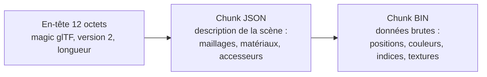

| Partie | Contenu | 🔁 Analogie |
|---|---|---|
| En-tête | Le mot `glTF`, la version `2`, la longueur totale | La signature d'un fichier |
| Chunk JSON | La **description** : quels maillages, quels matériaux, où lire les nombres | Le schéma d'une table Oracle |
| Chunk BIN | Les **nombres** : coordonnées des sommets, triangles, image de texture | Les lignes de la table |

Le code du projet vérifie cette structure dans `DemoGallery.is_valid_glb_2()` (`backend/app/services/demo_gallery.py`) et `HuggingFaceSpaceProvider._read_glb()` (`backend/app/providers/huggingface.py`). ✅

### Vocabulaire de la 3D

| Terme | Définition simple |
|---|---|
| **Sommet** (vertex) | Un point dans l'espace (x, y, z) |
| **Triangle** | Trois sommets reliés ; la surface d'un objet est faite de milliers de triangles |
| **Maillage** (mesh) | L'ensemble des triangles d'un objet |
| **Normale** | Une flèche perpendiculaire à la surface ; elle sert à calculer la lumière |
| **Matériau** | Comment la surface réagit à la lumière : couleur, aspect **métallique**, **rugosité** |
| **Texture** | Une image collée sur la surface (comme un papier peint) |

### Couleurs de sommets contre textures

| | Couleurs de sommets (TripoSR) | Texture (TRELLIS) |
|---|---|---|
| Principe | Chaque sommet porte une couleur ; entre deux sommets, la couleur est mélangée | Une image PNG est plaquée sur la surface grâce à des coordonnées UV |
| Précision | Faible : les détails fins disparaissent | Bonne : motifs, cannage de l'assise visibles |
| Mesuré dans le projet | 20 000 à 65 000 sommets, aucun matériau, aucune normale | Texture PNG d'environ 1 Mo, un matériau, pas de normales |

⚠️ **Piège découvert dans le projet** : quand un GLB n'a pas de matériau, ou qu'il oublie la valeur `metallicFactor`, la norme glTF le considère **100 % métallique**. Le modèle paraît alors presque noir. Le projet corrige cela à deux endroits (voir section 7) : à l'affichage (`frontend/js/views/model-appearance.js`) et dans le fichier lui-même (`backend/app/services/glb_finisher.py`).

### Comment un navigateur l'affiche

Le navigateur utilise **WebGL** (la carte graphique depuis JavaScript). Le projet n'écrit pas de WebGL à la main : il utilise le composant **`<model-viewer>`** de Google, chargé depuis un CDN dans `frontend/index.html`. On écrit simplement :

```html
<model-viewer src="/models/gallery/chair-bentwood" camera-controls auto-rotate></model-viewer>
```

### Où les GLB sont stockés

| Dossier | Contenu | Suivi par Git ? |
|---|---|---|
| `backend/storage/models/` | GLB générés, importés ou copiés depuis les exemples (nommés par un UUID) | ❌ non (ignoré) |
| `backend/storage/images/` | Photos sources envoyées | ❌ non |
| `backend/data/feasibility-results/` | Les 5 GLB du catalogue d'exemples | ❌ non |
| `backend/data/feasibility-results-triposr/` | Sauvegarde des 3 anciens exemples TripoSR remplacés par TRELLIS | ❌ non |
| `backend/data/trials/` | GLB bruts des essais de fournisseurs | ❌ non |

Les fichiers 3D et la base sont **locaux** : ils ne partent jamais sur GitHub.

### Comment un GLB entre dans le projet

1. **Génération** : une photo est envoyée au fournisseur (TripoSR ou TRELLIS), qui renvoie un GLB ; le service le **finit** (matériau, normales) puis l'enregistre.
2. **Import** : la propriétaire importe un `.glb` existant depuis « Mes modèles ».
3. **Copie d'exemple** : un exemple du catalogue est copié dans « Mes modèles ».

### Ouvrir un GLB sur votre PC

- **Windows** : double-cliquez sur le fichier ; il s'ouvre dans la **Visionneuse 3D** de Windows (application « 3D Viewer », à installer depuis le Microsoft Store si elle n'est pas présente — **à vérifier** sur votre version de Windows).
- **Blender** (gratuit) : menu *File → Import → glTF 2.0 (.glb/.gltf)*.
- **Dans le Studio** : page Créer, bouton « Aperçu d'un fichier GLB (sans enregistrer) » ; le fichier est lu par le navigateur et n'est pas envoyé au serveur.

---

## 3. Architecture

**En une phrase :** un navigateur parle à un serveur FastAPI, qui range les informations dans SQLite, les fichiers sur le disque, et demande les modèles 3D à un service d'IA externe.

### 3.1 Les composants

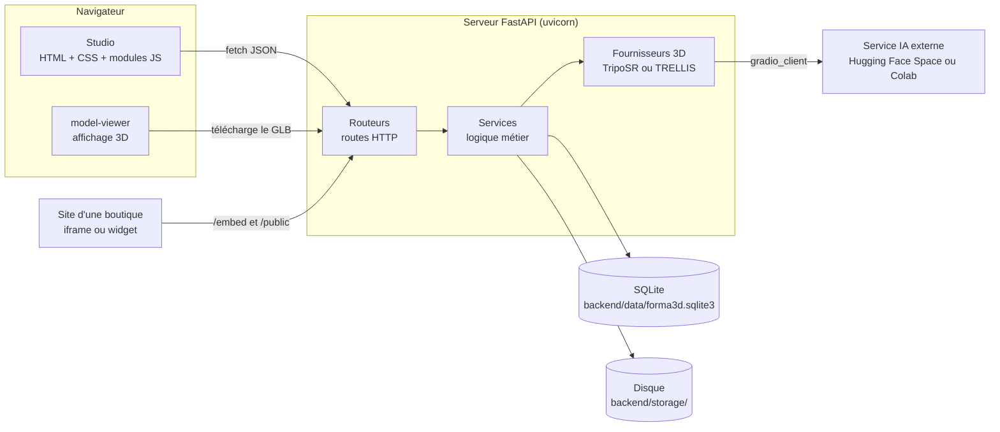

🔁 **Analogie Spring Boot** : les **routeurs** sont les `@RestController`, les **services** sont les `@Service`, les **dépôts** (repositories) sont les `@Repository`. FastAPI joue le rôle de Spring Boot, uvicorn celui de Tomcat.

🔁 **Analogie Angular** : le frontend n'utilise **pas** Angular. C'est du JavaScript « vanille » organisé en modules : `router.js` joue le rôle du `RouterModule`, chaque fichier de `pages/` est comme un composant, `api.js` est comme un `HttpClient` centralisé dans un service.

### 3.2 Le parcours complet d'un modèle

```mermaid
flowchart LR
    A["1. Photo<br/>JPG, PNG ou WebP"] --> B["2. Validation<br/>format, 10 Mo max"]
    B --> C["3. Préparation<br/>carré, marges, 512 px min"]
    C --> D["4. Génération<br/>TripoSR ou TRELLIS"]
    D --> E["5. Finition GLB<br/>matériau mat + normales"]
    E --> F["6. Stockage<br/>disque + SQLite"]
    F --> G["7. Viewer<br/>fiche du modèle"]
    G --> H["8. Activation<br/>de l'intégration"]
    H --> I["9. Site client<br/>iframe ou widget"]
```

### 3.3 Séquence d'une génération

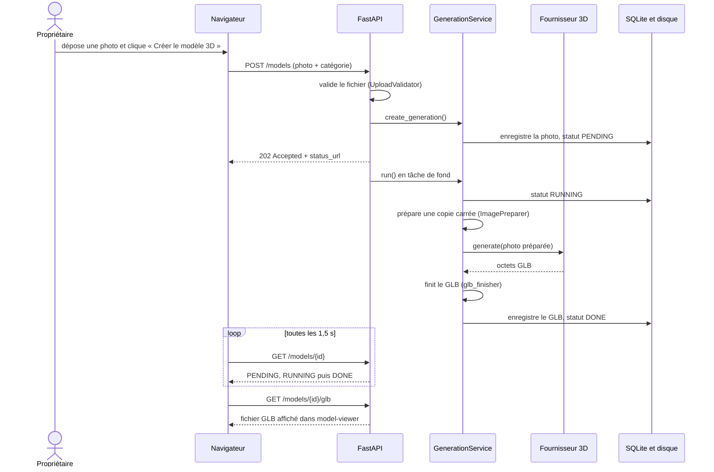

⚠️ Le statut terminé s'appelle **`DONE`** dans le code (pas `COMPLETED`). ✅

---

## 4. Technologies

**En une phrase :** le projet utilise volontairement peu de technologies, toutes gratuites, pour rester explicable.

### 4.1 Tableau récapitulatif

| Technologie | Rôle | Pourquoi ce choix | Alternative possible | Où dans le code |
|---|---|---|---|---|
| **Python 3** | Langage du serveur | Écosystème IA (gradio_client) | Java | `backend/` |
| **FastAPI** | Framework web | Simple, rapide, documentation automatique | Spring Boot, Symfony, Flask | `backend/app/main.py`, `routers/` |
| **uvicorn** | Serveur HTTP qui exécute FastAPI | Standard pour FastAPI | Tomcat (Java), gunicorn | commande de lancement |
| **Pydantic** | Validation des données JSON | Intégré à FastAPI | Bean Validation (Java) | `backend/app/schemas.py` |
| **python-multipart** | Lecture des formulaires avec fichier | Nécessaire pour l'upload | — | upload `POST /models` |
| **python-dotenv** | Lecture du fichier `.env` | Garde les secrets hors du code | variables système | `backend/app/config.py` |
| **SQLite** | Base de données | Un seul fichier, aucun serveur à installer | PostgreSQL, Oracle | `repositories/sqlite_repository.py` |
| **Pillow** | Traitement d'image | Léger, sans IA | OpenCV | `services/image_preparer.py` |
| **gradio_client** | Appel des services IA Gradio | Bibliothèque officielle | requêtes HTTP à la main | `providers/huggingface.py`, `providers/trellis.py` |
| **httpx2** | Requêtes HTTP (contrôle de santé du fournisseur) | Client HTTP moderne | requests | `providers/huggingface.py`, `providers/trellis.py` |
| **Hugging Face Spaces** | Hébergement gratuit de démonstrations IA | Gratuit avec quota | Replicate (payant) | configuration `TRELLIS_SPACE_ID` |
| **Google Colab** | GPU gratuit temporaire pour TripoSR | Gratuit, sans carte | serveur GPU payant | `tools/colab/triposr_server.ipynb` |
| **TripoSR** | Modèle image→3D (couleurs de sommets) | Premier modèle qui a fonctionné | — | fournisseur par défaut |
| **TRELLIS** | Modèle image→3D (texture) | Meilleures couleurs mesurées | Hunyuan3D (licence exclut l'UE) | `providers/trellis.py` |
| **model-viewer** | Composant web d'affichage 3D | Une balise HTML suffit | Three.js | `frontend/index.html`, `pages/` |
| **Modules ES** | Découpage du JavaScript en fichiers | Natif, sans outil de build | Angular, webpack | `frontend/js/` |
| **Web Components** | Balise HTML personnalisée `<forma3d-viewer>` | Fonctionne sur tout site | iframe seule | `frontend/widget.js` |
| **pytest** | Tests automatiques | Standard Python | JUnit | `backend/tests/` |
| **GitHub Actions** | Intégration continue | Gratuit pour un dépôt GitHub | GitLab CI, Jenkins | `.github/workflows/ci.yml` |

### 4.2 Explications simples

- **FastAPI** : on écrit une fonction Python et on la décore avec `@router.get("/chemin")`. FastAPI la transforme en route HTTP, vérifie les données et génère une documentation interactive sur `/docs`. 🔁 C'est un `@GetMapping` de Spring Boot.
- **uvicorn** : le programme qui écoute sur un port (ex. 8000) et transmet les requêtes à FastAPI. 🔁 Tomcat pour Spring Boot.
- **Pydantic** : des classes qui décrivent la forme d'un JSON (`class LoginRequest(BaseModel): password: str`). Si le JSON reçu ne correspond pas, FastAPI répond 422. 🔁 DTO + `@Valid`.
- **SQLite** : une base SQL complète dans **un seul fichier**. Pas de serveur à installer. 🔁 Comme Oracle, mais sans instance ni utilisateur.
- **Pillow** : ouvre une image, la redimensionne, ajoute des marges, mesure la netteté.
- **gradio_client** : **Gradio** est une bibliothèque qui crée une page web autour d'un modèle IA. `gradio_client` permet d'appeler cette page **depuis un programme**. Le projet appelle toujours `view_api()` d'abord pour lire les fonctions réellement disponibles (le « contrat »).
- **Hugging Face Spaces** : un site qui héberge gratuitement des démonstrations IA. Le GPU gratuit (**ZeroGPU**) a un **quota par jour**.
- **TripoSR** : modèle de Stability AI et Tripo AI, qui produit une forme fidèle mais des couleurs approximatives.
- **TRELLIS** : modèle de Microsoft, qui produit un maillage avec une **texture** (meilleures couleurs), mais qui peut inventer des parties cachées.
- **model-viewer** : une balise HTML fournie par Google qui affiche un GLB avec rotation, zoom et éclairage.
- **Modules ES** : `import { x } from "./api.js?v=..."`. Le navigateur charge les fichiers à la demande. Le paramètre `?v=20261112-d1` est une **clé de cache** : on la change quand le code change, pour que le navigateur ne garde pas l'ancienne version.
- **Web Components** : on définit une nouvelle balise (`customElements.define("forma3d-viewer", ...)`) utilisable dans n'importe quelle page HTML, même sans framework.
- **pytest** : chaque fonction `test_...` est exécutée ; si une ligne `assert` échoue, le test échoue.
- **GitHub Actions** : à chaque `git push`, GitHub lance les tests sur une machine virtuelle (voir section 14).

---

## 5. Arborescence et relations entre fichiers

**En une phrase :** le dépôt est découpé en `backend/` (serveur Python), `frontend/` (interface servie par le serveur), `docs/` (documentation) et quelques outils, chaque fichier ayant un seul rôle.

### 5.1 Tous les fichiers suivis par Git

#### Racine

| Fichier | Rôle |
|---|---|
| `.env.example` | Modèle des variables d'environnement, **sans secret** (voir section 9) |
| `.github/workflows/ci.yml` | Intégration continue : tests à chaque push |
| `.gitignore` | Liste de ce que Git ne doit pas suivre (`.env`, base, GLB, photos…) |
| `AGENTS.md` | Règles permanentes du projet pour les assistants IA |
| `DESIGN.md` | Règles visuelles : couleurs, typographie, composants |
| `PRODUCT.md` | Vision produit, utilisateurs, limites |
| `README.md` | Présentation et démarrage du dépôt |

#### Backend — application (`backend/app/`)

| Fichier | Rôle |
|---|---|
| `backend/README.md` | Explications du backend |
| `backend/requirements.txt` | Dépendances Python (FastAPI, uvicorn, Pillow…) |
| `backend/app/__init__.py` | Fait de `app` un paquet Python (vide) |
| `backend/app/main.py` | **Point d'entrée** : crée l'application, choisit le fournisseur, branche les routeurs, sert la page `/` |
| `backend/app/config.py` | Lit les variables d'environnement et les valide (`Settings`) |
| `backend/app/models.py` | Objets métier : `GenerationRecord`, `CategoryRecord`, `APIKeyRecord`, statuts, origines |
| `backend/app/schemas.py` | Formes des réponses et requêtes JSON (Pydantic) |
| `backend/app/providers/__init__.py` | Paquet des fournisseurs (vide) |
| `backend/app/providers/base.py` | Contrat `Image3DProvider` : « une image entre, des octets GLB sortent » |
| `backend/app/providers/huggingface.py` | Fournisseur **TripoSR** (Space Hugging Face ou URL Gradio Colab) |
| `backend/app/providers/trellis.py` | Fournisseur **TRELLIS** (Space public, détourage puis GLB texturé) |
| `backend/app/repositories/__init__.py` | Paquet des dépôts (vide) |
| `backend/app/repositories/base.py` | Contrat `GenerationRepository` : toutes les opérations de base de données |
| `backend/app/repositories/sqlite_repository.py` | Implémentation SQLite : tables, migrations, requêtes |
| `backend/app/routers/__init__.py` | Paquet des routeurs (vide) |
| `backend/app/routers/auth.py` | Connexion : `/auth/login`, `/auth/logout`, `/auth/me`, dépendance `require_owner` |
| `backend/app/routers/models.py` | Modèles du Studio : création, galerie, import, copie, intégration, fichiers ; routes `/public` |
| `backend/app/routers/categories.py` | CRUD des catégories |
| `backend/app/routers/api_keys.py` | Gestion des clés API et dépendance `require_api_key` |
| `backend/app/routers/api_v1.py` | API externe versionnée `/api/v1` (protégée par clé) |
| `backend/app/routers/embed.py` | Page publique `/embed/{public_id}` affichée dans une iframe |
| `backend/app/services/__init__.py` | Paquet des services (vide) |
| `backend/app/services/generation_service.py` | Orchestration : états, préparation, fournisseur, finition, stockage |
| `backend/app/services/upload_validator.py` | Vérifie format et taille de la photo |
| `backend/app/services/image_preparer.py` | Prépare une copie carrée de la photo et signale flou ou petite taille |
| `backend/app/services/glb_finisher.py` | Ajoute matériau mat et normales aux GLB générés |
| `backend/app/services/category_service.py` | Règles métier des catégories |
| `backend/app/services/api_key_service.py` | Création, empreinte, vérification, quotas des clés |
| `backend/app/services/demo_gallery.py` | Liste fixe des 5 exemples du catalogue |
| `backend/app/services/owner_auth.py` | Mot de passe, jetons de session signés, limite de tentatives |
| `backend/app/storage/__init__.py` | Paquet du stockage (vide) |
| `backend/app/storage/base.py` | Contrat `Storage` (enregistrer photo et GLB) |
| `backend/app/storage/local_storage.py` | Stockage sur le disque local, écriture atomique |

#### Backend — tests (`backend/tests/`)

| Fichier | Ce qu'il vérifie |
|---|---|
| `conftest.py` | Ouvre la session propriétaire pour les tests, sauf ceux marqués `real_auth` |
| `test_api_keys.py` | Empreinte seule, secret affiché une fois, révocation, suppression définitive, quotas |
| `test_api_settings.py` | Validation des quotas et des origines CORS/iframe |
| `test_api_v1.py` | API externe : clé, statuts, erreurs, quota |
| `test_auth.py` | Connexion : 401 sans cookie, mot de passe faux, limite, routes publiques ouvertes |
| `test_categories_api.py` | Routes des catégories |
| `test_category_repository.py` | Catégories dans SQLite |
| `test_category_service.py` | Règles des catégories |
| `test_demo_gallery.py` | Catalogue d'exemples : seuls les fichiers connus et valides |
| `test_embed.py` | Page `/embed` et politique de sécurité CSP |
| `test_frontend.py` | Fichiers du frontend : présence des éléments, `fetch` seulement dans `api.js` |
| `test_generation_repository.py` | Historique des générations dans SQLite, redémarrage |
| `test_generation_service.py` | États PENDING → DONE ou FAILED, photo préparée |
| `test_glb_finisher.py` | Finition des GLB sans modifier la géométrie |
| `test_health.py` | Routes `/health` et `/health/provider` |
| `test_huggingface_provider.py` | Fournisseur TripoSR avec client simulé |
| `test_image_preparer.py` | Préparation de la photo |
| `test_local_storage.py` | Écriture des fichiers |
| `test_model_library.py` | Import GLB et copie d'exemple |
| `test_models_api.py` | Routes `/models` |
| `test_trellis_provider.py` | Fournisseur TRELLIS avec client simulé |
| `test_trial_tools.py` | Outils d'essai de fournisseurs |
| `test_upload_validator.py` | Validation des photos |

#### Frontend (`frontend/`)

| Fichier | Rôle |
|---|---|
| `frontend/README.md` | Explications du frontend |
| `frontend/index.html` | **Coque** : en-tête, menu, pied de page, point de montage `#app` |
| `frontend/favicon.svg` | Icône d'onglet |
| `frontend/widget.js` | Balise `<forma3d-viewer>` pour les sites partenaires |
| `frontend/css/theme.css` | Couleurs, espacements, animations |
| `frontend/css/components.css` | Styles de tous les composants (14 sections) |
| `frontend/js/main.js` | Démarrage : vérifie la session, lance le routeur, surveille le serveur 3D |
| `frontend/js/router.js` | Routes `#/...`, protection par connexion, changement de page |
| `frontend/js/api.js` | **Seul fichier qui appelle le serveur** (`fetch`) |
| `frontend/js/auth.js` | État de connexion (lu sur `/auth/me`) |
| `frontend/js/state.js` | État temporaire d'une génération en cours |
| `frontend/js/format.js` | Dates relatives, tailles, durées, fournisseur des exemples |
| `frontend/js/pages/login.js` | Page Connexion |
| `frontend/js/pages/dashboard.js` | Page Accueil |
| `frontend/js/pages/create.js` | Page Créer |
| `frontend/js/pages/viewer-markup.js` | HTML du viewer de la page Créer |
| `frontend/js/pages/models.js` | Page Mes modèles |
| `frontend/js/pages/model-detail.js` | Fiche d'un modèle |
| `frontend/js/pages/examples.js` | Page Exemples |
| `frontend/js/pages/categories.js` | Page Catégories |
| `frontend/js/pages/api-keys.js` | Page Clés API |
| `frontend/js/pages/guide.js` | Page Guide d'intégration |
| `frontend/js/views/uploader.js` | Dépôt et validation de la photo |
| `frontend/js/views/progress.js` | Les 5 étapes du suivi de création |
| `frontend/js/views/viewer.js` | Viewer 3D de la page Créer |
| `frontend/js/views/gallery.js` | Cartes de modèles et filtres |
| `frontend/js/views/categories.js` | Gestion des catégories |
| `frontend/js/views/confirm-dialog.js` | Fenêtre de confirmation |
| `frontend/js/views/illustrations.js` | Dessin SVG du cube (états vides) |
| `frontend/js/views/model-appearance.js` | Correction du matériau et recadrage de la caméra |

#### Documentation (`docs/`)

| Fichier | Rôle |
|---|---|
| `docs/COMPRENDRE-FORMA3D.md` | Ce guide |
| `docs/ETAT.md` | État d'avancement, étape par étape |
| `docs/STRUCTURE.md` | Rôle de chaque fichier et dossier |
| `docs/STOCKAGE.md` | Base SQLite, fichiers, intégration |
| `docs/INTEGRATION.md` | Guide pour le développeur d'une boutique |
| `docs/ALTERNATIVES-3D.md` | Comparaison des fournisseurs 3D gratuits |
| `docs/QUALITE-3D.md` | Grille de qualité et résultats d'essais |
| `docs/etapes/.gitkeep` | Garde le dossier dans Git |
| `docs/etapes/etape-01.md` | Structure et contrôle de santé |
| `docs/etapes/etape-02.md` | Validation de l'upload |
| `docs/etapes/etape-03.md` | Contrat image→3D et fournisseur Hugging Face |
| `docs/etapes/etape-04.md` | Génération, états et stockage local |
| `docs/etapes/etape-05.md` | Interface modulaire et viewer |
| `docs/etapes/etape-06.md` | Essais TripoSR réels |
| `docs/etapes/etape-06-colab.md` | TripoSR, Colab et limites du serveur public |
| `docs/etapes/etape-07.md` | Fiabilité et qualité |
| `docs/etapes/etape-08.md` | SQLite et historique persistant |
| `docs/etapes/etape-09.md` | CRUD des catégories |
| `docs/etapes/etape-10.md` | Préparation locale de la photo |
| `docs/etapes/etape-11.md` | Refonte de la navigation |
| `docs/etapes/etape-11b.md` | Refonte de la page Créer |
| `docs/etapes/etape-12.md` | Import GLB et bibliothèque unifiée |
| `docs/etapes/etape-13.md` | Identifiant public et activation (Sprint 5a) |
| `docs/etapes/etape-14.md` | Clés API (Sprint 5b) |
| `docs/etapes/etape-15.md` | API versionnée (Sprint 5c) |
| `docs/etapes/etape-16.md` | Intégration dans une boutique (Sprint 5d) |
| `docs/etapes/etape-16b.md` | Refonte visuelle du Studio |
| `docs/etapes/etape-17.md` | Guide intégrateur et preuve sur un autre site (Sprint 5e) |
| `docs/etapes/etape-18.md` | Connexion côté serveur (Sprint 5f) |
| `docs/etapes/etape-19.md` | Rendu fidèle des GLB (sous-étape A) |
| `docs/etapes/etape-20.md` | Finition serveur des GLB (sous-étape B) |
| `docs/etapes/etape-21.md` | Grille de qualité et essais de fournisseurs (sous-étape C) |
| `docs/etapes/etape-22.md` | TRELLIS branché dans Forma3D (sous-étape C3) |
| `docs/archive/v1/AGENTS-ancien.md` | Ancienne version des règles (historique) |
| `docs/archive/v1/PROMPT-1-v1.md` | Ancienne consigne de démarrage (historique) |
| `docs/archive/v1/etapes/etape-01-v1.md` | Ancienne étape 1 (historique) |
| `docs/archive/v1/etapes/etape-02-v1.md` | Ancienne étape 2 (historique) |

#### Outils et exemples

| Fichier | Rôle |
|---|---|
| `examples/integration.html` | Faux « site de boutique » pour tester le widget |
| `scripts/dev.ps1` | Script Windows : crée l'environnement, lance les tests, démarre le serveur sur le port 8001 |
| `tools/colab/triposr_server.ipynb` | Notebook Colab historique de TripoSR (hors application) |
| `tools/trials/trial_trellis.py` | Essai TRELLIS reproductible (hors application) |
| `tools/trials/trial_models.py` | Essai de plusieurs modèles (hors application) |

### 5.2 Qui importe qui — backend

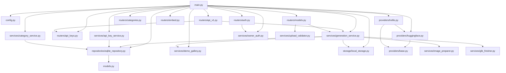

### 5.3 Qui importe qui — frontend

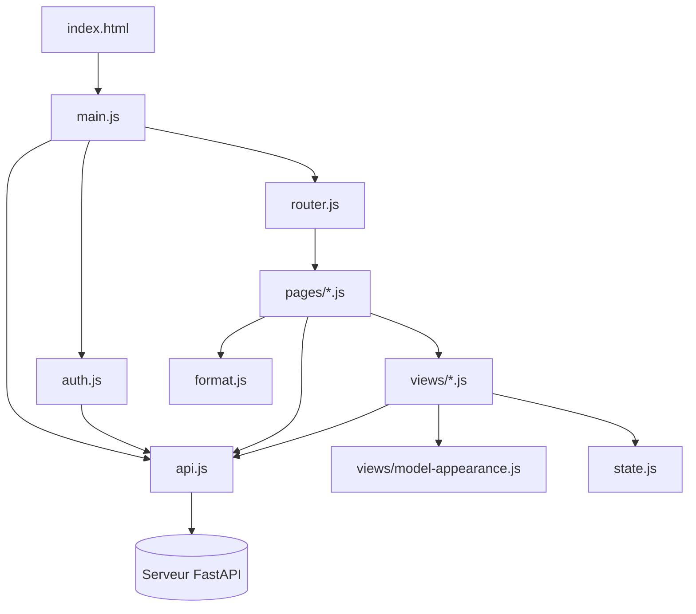

Règle vérifiée par un test (`test_frontend.py`) : **seul `api.js` contient `fetch(`**. ✅ 🔁 Comme un service Angular unique qui centralise tous les appels `HttpClient`.

### 5.4 La chaîne complète sur un exemple réel : « Créer le modèle 3D »

| # | Couche | Fichier et fonction | Ce qui se passe |
|---|---|---|---|
| 1 | Page | `frontend/js/views/uploader.js` → écouteur `submit` du formulaire `#upload-form` | Vérifie qu'une photo et une catégorie sont choisies, puis appelle `startGeneration` |
| 2 | Page | `frontend/js/pages/create.js` → `startGeneration()` | Passe en mode « occupé », lance le chronomètre |
| 3 | Appel HTTP | `frontend/js/api.js` → `createGeneration(photo, category)` | `POST /models` avec un `FormData` |
| 4 | Route | `backend/app/routers/models.py` → route `POST /models` | Protégée par `require_owner` ; valide le fichier avec `UploadValidator` |
| 5 | Service | `GenerationService.create_generation()` | Enregistre la photo, crée l'enregistrement `PENDING` |
| 6 | Dépôt | `SQLiteGenerationRepository.save_generation()` | Insère la ligne dans `generations` |
| 7 | Tâche de fond | `GenerationService.run()` | Passe en `RUNNING`, prépare la photo (`ImagePreparer`) |
| 8 | Fournisseur | `HuggingFaceSpaceProvider.generate()` ou `TrellisSpaceProvider.generate()` | Appelle le service IA et vérifie le GLB reçu |
| 9 | Service | `_finish_generated_model()` → `glb_finisher.finish_glb()` | Ajoute matériau mat et normales |
| 10 | Stockage | `LocalStorage.save_model()` | Écrit `backend/storage/models/{id}.glb` |
| 11 | Dépôt | `save_generation()` | Statut `DONE`, chemin du GLB, durée |
| 12 | Page | `create.js` → `refreshStatus()` toutes les 1,5 s | `GET /models/{id}` jusqu'à `DONE`, puis affiche le modèle dans le viewer |


---

## 6. Base de données

**En une phrase :** une base SQLite (un seul fichier, `backend/data/forma3d.sqlite3`) garde les catégories, l'historique des modèles et les clés API ; les fichiers eux-mêmes restent sur le disque.

### 6.1 Schéma entité-relation

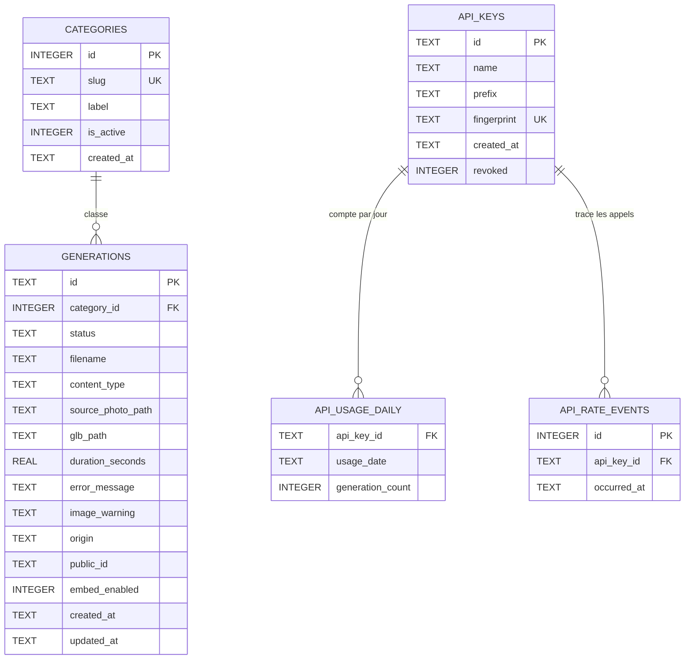

### 6.2 Les tables et leurs colonnes

**`categories`** — les catégories de produits.

| Colonne | Sens |
|---|---|
| `id` | Numéro automatique |
| `slug` | Identifiant technique unique (`chair`, `stool`, `side-table`) |
| `label` | Nom affiché (« Chaise », « Tabouret », « Table d'appoint ») |
| `is_active` | 1 = proposée pour les nouvelles créations ; 0 = désactivée |
| `created_at` | Date de création |

Au premier démarrage, les trois catégories initiales sont créées si elles n'existent pas. ✅

**`generations`** — chaque modèle : généré, importé ou copié depuis un exemple.

| Colonne | Sens |
|---|---|
| `id` | UUID (identifiant unique) interne, utilisé par le Studio |
| `category_id` | Lien vers `categories` (clé étrangère) |
| `status` | `PENDING`, `RUNNING`, `DONE` ou `FAILED` (contrôle `CHECK`) |
| `filename` | Nom affiché du fichier ou titre |
| `content_type` | Type de la photo (`image/jpeg`…) |
| `source_photo_path` | Chemin de la photo source sur le disque |
| `glb_path` | Chemin du GLB (vide tant que le modèle n'est pas terminé) |
| `duration_seconds` | Durée de génération mesurée |
| `error_message` | Cause d'un échec, sans secret |
| `image_warning` | Avertissement non bloquant (photo petite ou floue) |
| `origin` | `generated`, `imported` ou `example` |
| `public_id` | UUID **public**, utilisé par `/embed` et le widget (différent de `id`) |
| `embed_enabled` | 1 = intégration autorisée sur un site ; 0 par défaut |
| `created_at`, `updated_at` | Dates |

**`api_keys`** — les clés API. ⚠️ La clé complète n'est **jamais** enregistrée : seule son **empreinte** (`fingerprint`, un hachage SHA-256) l'est, plus un `prefix` lisible (`f3d_live_xxx…`).

**`api_usage_daily`** — nombre de créations par clé et par jour (quota quotidien).

**`api_rate_events`** — horodatage des appels récents de chaque clé (limite par minute ; les événements de plus de 60 s sont nettoyés).

Les exemples du catalogue ne sont **pas** dans la base : ils sont décrits par une liste fixe dans `demo_gallery.py`.

### 6.3 Pourquoi SQLite ?

- Un seul fichier, aucun serveur à installer : parfait pour un prototype local.
- SQL standard : 🔁 vous retrouvez `CREATE TABLE`, `REFERENCES`, `CHECK` comme dans Oracle.
- Limite : un seul écrivain à la fois, pas de comptes utilisateurs de base de données, pas adapté à plusieurs serveurs.

### 6.4 Migrations

**Une migration** est une modification de la structure d'une base existante sans perdre les données. Le projet utilise des migrations **simples et non destructives** dans `SQLiteGenerationRepository.initialize()` :

1. `CREATE TABLE IF NOT EXISTS …` crée les tables absentes.
2. Le code lit les colonnes existantes (`PRAGMA table_info(generations)`).
3. Il ajoute les colonnes manquantes avec `ALTER TABLE … ADD COLUMN` : `image_warning`, `origin`, `public_id`, `embed_enabled`.

🔁 C'est l'équivalent très simplifié de Flyway (Spring) ou des migrations Doctrine (Symfony), sans numéro de version. ⚠️ Il n'existe pas de retour arrière automatique.

### 6.5 Au redémarrage du serveur

Les générations restées `PENDING` ou `RUNNING` (le serveur s'est arrêté au milieu) passent à `FAILED` avec le message « Génération interrompue au redémarrage du serveur. » ✅ Une génération n'est donc jamais bloquée pour toujours en « en cours ».

### 6.6 Passer plus tard à PostgreSQL (sans le faire)

Les services ne parlent jamais à SQLite directement : ils utilisent le **contrat** `GenerationRepository` (`backend/app/repositories/base.py`). Ce contrat liste les opérations : `initialize`, `save_generation`, `get_generation`, `get_generation_by_public_id`, `set_embed_enabled`, `list_completed_generations`, `list_categories`, `create_category`, `update_category`, `delete_category`, `create_api_key`, `list_api_keys`, `find_api_keys_by_prefix`, `revoke_api_key`, `delete_revoked_api_key`, `consume_api_rate_limit`, `consume_api_daily_quota`…

🔁 C'est une **interface Java** : pour passer à PostgreSQL, il suffirait d'écrire une classe `PostgreSQLGenerationRepository` qui implémente les mêmes méthodes, puis de la choisir dans `main.py`. Les routes et services ne changeraient pas. Il faudrait aussi un script qui copie les données et des migrations versionnées. **Ce n'est pas fait.**

---

## 7. Fournisseurs 3D

**En une phrase :** un « fournisseur » est la classe qui envoie la photo à un service d'IA et rapporte un GLB ; le projet en contient deux, TripoSR (par défaut) et TRELLIS.

### 7.1 Le contrat commun

```python
class Image3DProvider(Protocol):
    def generate(self, image_path: Path) -> bytes: ...
```

Une image entre, des octets GLB sortent. 🔁 Comme une interface Spring avec deux implémentations, choisies au démarrage.

### 7.2 Les deux fournisseurs

| | TripoSR — `HuggingFaceSpaceProvider` | TRELLIS — `TrellisSpaceProvider` |
|---|---|---|
| Fichier | `backend/app/providers/huggingface.py` | `backend/app/providers/trellis.py` |
| Où tourne l'IA | Un Space Hugging Face **ou** un serveur Gradio temporaire sur Google Colab (`HF_SPACE_ID`) | Le Space public `trellis-community/TRELLIS` (`TRELLIS_SPACE_ID`) |
| Enchaînement | Lit le contrat (`view_api()`), choisit la fonction disponible, envoie la photo | `view_api()` → `/start_session` → `/preprocess_image` (détourage du fond) → `/generate_and_extract_glb` |
| Résultat | GLB à couleurs de sommets | GLB texturé |
| Relance | Oui si le Space démarre (`HF_MAX_ATTEMPTS`, 1 ou 2) | Non |
| Délai maximal | `HF_TIMEOUT_SECONDS` (300 s par défaut) | Même valeur |
| Compatibilité en plus | Sait aussi lire le contrat de Stable Fast 3D (`/run_button`) | — |

Après le fournisseur, **le même traitement** s'applique : vérification GLB 2.0, puis finition (`glb_finisher.py`) qui ajoute un matériau mat et des normales. ✅

### 7.3 Lequel est utilisé par défaut ?

**TripoSR**, car `IMAGE3D_PROVIDER` vaut `triposr` par défaut (`backend/app/config.py`). ✅

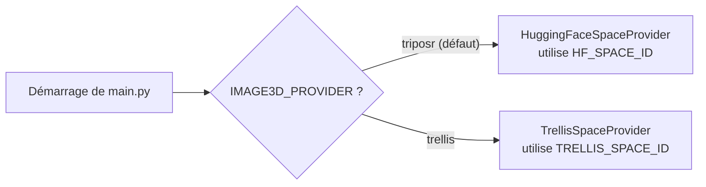

**Comment vérifier :** ouvrez `http://127.0.0.1:8000/health/provider`. Quand le service est hors ligne, le message parle de « Colab » pour TripoSR et de « Space TRELLIS » pour TRELLIS.

**Comment changer :** dans `backend/.env`, mettez `IMAGE3D_PROVIDER=trellis`, puis redémarrez le serveur. Ou lancez le serveur depuis un terminal où la variable est définie (elle a alors priorité sur `.env`).

### 7.4 Le jeton `HF_TOKEN`

- C'est un **mot de passe pour programme** fourni gratuitement par Hugging Face (*Settings → Access Tokens*, type « Read »).
- Il augmente le **quota GPU gratuit** de TRELLIS.
- Où le ranger : **uniquement** dans `backend/.env` (ignoré par Git) ou dans la variable d'un terminal. **Jamais** dans `.env.example`, dans le code ou dans une conversation.
- Sécurité : le code ne l'envoie qu'à Hugging Face. `TRELLIS_SPACE_ID` doit être un identifiant `propriétaire/nom`, jamais une URL, et le fournisseur TripoSR refuse d'envoyer le jeton à une URL Gradio externe. Il est masqué dans les messages d'erreur. ✅

### 7.5 Quotas, erreurs et mode hors ligne

| Situation | Ce que voit la propriétaire |
|---|---|
| `HF_SPACE_ID` vide (TripoSR) | Badge « Serveur 3D : hors ligne » ; bouton « Créer » désactivé ; statut `UNCONFIGURED` |
| Lien Colab expiré (72 h maximum) | Badge hors ligne ; message « Le serveur 3D (Colab) est arrêté ou son lien a expiré » |
| Quota TRELLIS épuisé | La création échoue avec « Quota GPU gratuit du Space TRELLIS atteint pour aujourd'hui… » |
| Space TRELLIS en veille | « Le Space TRELLIS est en veille, en panne ou indisponible » |
| Contrat du Space modifié | La génération s'arrête avant l'envoi de la photo (« Le contrat … a changé ») |

Quand le fournisseur est hors ligne, le reste du Studio fonctionne : exemples, import GLB, fiches, intégration.

### 7.6 Les notebooks Google Colab

- Le dépôt contient **un seul** notebook : `tools/colab/triposr_server.ipynb`. Il vérifie le GPU, installe TripoSR et documente le dépannage. Sa dernière cellule **empêche** de lancer un service web public sur un Colab gratuit géré (règle de la FAQ Colab).
- Vos notebooks de test **TRELLIS v1, SF3D et comparaison** ne sont **pas** dans le dépôt Git (**à vérifier** : probablement sur votre Google Drive).
- **Ils ne font pas partie de l'application** : le serveur ne les lit jamais.
- **Quand les garder** : comme preuves d'expérimentation pour la soutenance (captures, résultats). **Quand les supprimer** : quand leurs résultats sont recopiés dans `docs/QUALITE-3D.md` et qu'ils ne servent plus. N'y laissez jamais un jeton en clair.

### 7.7 Licences à vérifier

| Élément | Licence | À vérifier |
|---|---|---|
| TripoSR | MIT | Droits des photos utilisées |
| TRELLIS (code et poids) | MIT | Usage commercial des modèles générés via le Space (question ouverte) |
| Stable Fast 3D | Stability AI Community License | Gratuit sous un seuil de chiffre d'affaires |
| Hunyuan3D-2 | Licence Tencent | Exclut l'Union européenne, le Royaume-Uni et la Corée du Sud : non retenu |
| model-viewer | Apache 2.0 | — |

Détails et essais : `docs/ALTERNATIVES-3D.md` et `docs/QUALITE-3D.md`.

---

## 8. Cycle de vie d'un modèle

**En une phrase :** un modèle généré passe par quatre états, enregistrés dans SQLite et lus par la page toutes les 1,5 seconde.

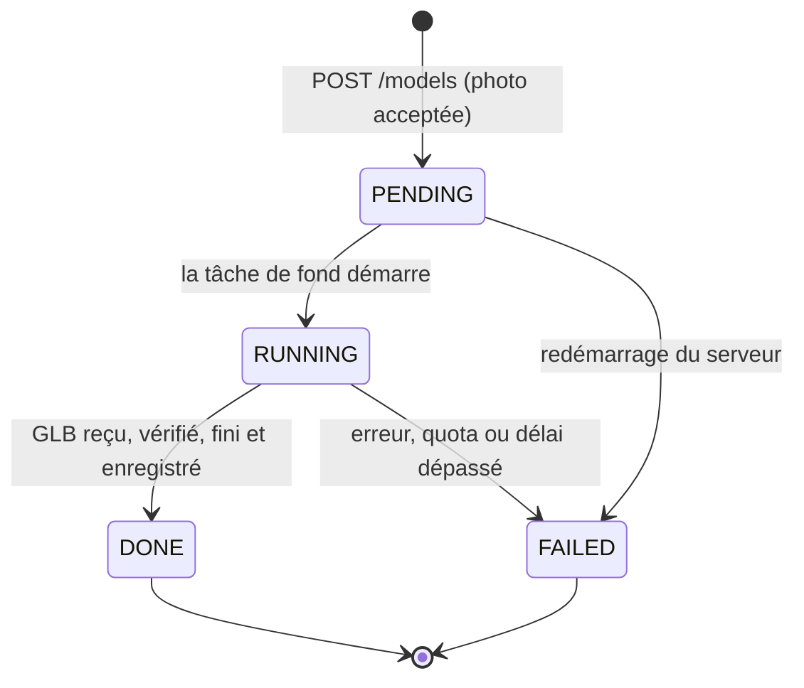

| État | Sens | Ce que montre la page Créer |
|---|---|---|
| `PENDING` | Photo reçue, en attente | Étape « En file » active |
| `RUNNING` | Le fournisseur travaille | Étape « Création du modèle » active, chronomètre |
| `DONE` | GLB prêt | Modèle affiché, lien « Ouvrir la fiche du modèle → » |
| `FAILED` | Échec | Message renvoyé par le serveur, bouton « Réessayer avec cette photo » |

- **Tâche de fond** : FastAPI répond tout de suite `202 Accepted`, puis exécute `GenerationService.run()` avec `BackgroundTasks`. 🔁 Comme une méthode `@Async` de Spring.
- **Aucun pourcentage inventé** : la page n'affiche que les états réellement renvoyés.
- **Reprise après redémarrage** : pas de reprise automatique ; une génération `PENDING` ou `RUNNING` passe en `FAILED` (section 6.5) et il faut la relancer.
- Les modèles **importés** ou **copiés** sont créés directement en `DONE`.

---

## 9. Variables d'environnement

**En une phrase :** les réglages et secrets sont lus dans des variables d'environnement, rangées dans un fichier `.env` local que Git ignore.

### 9.1 `.env` contre `.env.example`

| | `.env.example` | `backend/.env` (ou `.env` à la racine) |
|---|---|---|
| Contient | La **liste** des variables, avec des valeurs vides ou par défaut | Vos **vraies** valeurs (mot de passe, jeton) |
| Suivi par Git ? | ✅ oui | ❌ non (ignoré) |
| Qui le lit ? | Les humains | Le serveur, au démarrage |

Ordre de lecture (`config.py`) : `backend/.env` d'abord, puis `.env` à la racine, **sans écraser** une variable déjà définie dans le terminal. 🔁 Comme `application.properties` de Spring, avec les variables système prioritaires.

### 9.2 Toutes les variables

Les exemples de valeurs ci-dessous sont **faux** et servent seulement à montrer le format.

| Variable | Rôle | Défaut | Lue par | Effet si absente | Exemple (faux) |
|---|---|---|---|---|---|
| `HF_SPACE_ID` | Adresse du serveur TripoSR : identifiant de Space ou URL Gradio | vide | `config.py` → `huggingface.py` | TripoSR non configuré, statut `UNCONFIGURED` | `https://exemple-faux.gradio.live` |
| `HF_TOKEN` | Jeton Hugging Face (quota plus élevé, Space privé) | vide | `config.py`, outils `tools/trials/` | Accès anonyme, quota plus faible | `hf_EXEMPLEFAUX123` |
| `HF_TIMEOUT_SECONDS` | Délai maximal d'une génération | `300` | `config.py` | 300 s | `300` |
| `HF_MAX_ATTEMPTS` | Nombre de tentatives TripoSR (1 ou 2) | `2` | `config.py` | 2 | `2` |
| `HF_RETRY_DELAY_SECONDS` | Attente avant relance | `5` | `config.py` | 5 s | `5` |
| `FOREGROUND_RATIO` | Réglage TripoSR, utilisé seulement s'il existe dans le contrat du serveur | vide | `config.py` | Valeur du serveur | `0.85` |
| `MC_RESOLUTION` | Résolution TripoSR, même règle | vide | `config.py` | Valeur du serveur | `256` |
| `MAX_GLB_UPLOAD_MB` | Taille maximale d'un GLB importé (1 à 512) | `30` | `config.py` | 30 Mo | `30` |
| `API_DAILY_GENERATION_LIMIT` | Créations par clé et par jour | `20` | `config.py` | 20 | `20` |
| `API_RATE_LIMIT_PER_MINUTE` | Requêtes `/api/v1` par clé et par minute | `10` | `config.py` | 10 | `10` |
| `API_CORS_ORIGINS` | Sites autorisés à appeler l'API en JavaScript (`*` refusé) | vide | `config.py` → `main.py` | Aucun site tiers | `http://boutique-exemple.test` |
| `EMBED_ALLOWED_ORIGINS` | Sites autorisés à afficher `/embed` dans une iframe (`*` refusé) | vide | `config.py` → `embed.py` | Seul le Studio lui-même | `http://127.0.0.1:8081` |
| `FORMA3D_OWNER_PASSWORD` | Mot de passe unique de la propriétaire | vide | `services/owner_auth.py` | **Connexion refusée** (503) | `mot-de-passe-exemple-long` |
| `IMAGE3D_PROVIDER` | Fournisseur 3D : `triposr` ou `trellis` | `triposr` | `config.py` → `main.py` | TripoSR | `trellis` |
| `TRELLIS_SPACE_ID` | Space TRELLIS (`propriétaire/nom`, jamais une URL) | `trellis-community/TRELLIS` | `config.py` → `trellis.py` | Space communautaire par défaut | `trellis-community/TRELLIS` |

⚠️ Une valeur invalide (par exemple `IMAGE3D_PROVIDER=meshy` ou une origine `*`) empêche le serveur de démarrer, avec un message clair. ✅

---

## 10. Le site page par page

**En une phrase :** le Studio est une seule page HTML (`index.html`) dont le contenu change selon l'adresse après le `#` (exemple : `#/creer`), sans recharger la page.

🔁 **Angular** : c'est le principe d'une SPA (Single Page Application, application à page unique) avec un routeur, mais écrit à la main dans `router.js`.

### 10.0 La coque commune (présente sur toutes les pages après connexion)

```
┌──────────────────────────────────────────────────────────────────────────────┐
│ [cube] Forma3D Studio  Accueil  Créer  Mes modèles  Exemples  Administration ▾│
│                                        ● Serveur 3D : hors ligne  ⇥ Déconnexion│
├──────────────────────────────────────────────────────────────────────────────┤
│                         (contenu de la page, dans #app)                        │
├──────────────────────────────────────────────────────────────────────────────┤
│ Forma3D Studio v1.0   Documentation   Guide d'intégration   GitHub           │
│                                   Prototype de soutenance · Aucun entraînement │
└──────────────────────────────────────────────────────────────────────────────┘
```

| Élément | Emplacement | Au clic | Fichier |
|---|---|---|---|
| Logo « Forma3D Studio » | En haut à gauche | Va à `#/accueil` | `index.html` |
| « Accueil », « Créer », « Mes modèles », « Exemples » | Menu | Change la page ; le lien actif a un fond vert pâle | `router.js` → `updateNavigation()` |
| « Administration » ▾ | Menu | Ouvre un sous-menu : « Catégories », « Clés API », « Guide d'intégration » | `index.html` (élément `<details>`) |
| Badge « Serveur 3D : en ligne / hors ligne » | En haut à droite | Aucun clic ; mis à jour toutes les 30 s par `GET /health/provider` | `main.js` → `refreshProviderHealth()` |
| « Déconnexion » | En haut à droite | `POST /auth/logout`, efface le cookie, retour à `#/login` | `auth.js` → `logout()` |
| Bouton ☰ | Sur mobile seulement | Ouvre ou ferme le menu | `router.js` |
| « Documentation », « GitHub » | Pied de page | Ouvre le dépôt GitHub (privé : visible seulement par un compte autorisé) | `index.html` |
| « Guide d'intégration » | Pied de page | Va à `#/guide` | `index.html` |

Sur l'écran de connexion, le menu, le badge et le pied de page sont **masqués**.

### 10.1 Connexion — `#/login`

**But :** protéger le Studio par le mot de passe de la propriétaire.

```
┌───────────────────────────────────┐
│            [cube vert]            │
│          CONSOLE PRIVÉE           │
│          Forma3D Studio           │
│ Saisissez le mot de passe de la   │
│ propriétaire pour accéder au      │
│ Studio.                           │
│ Mot de passe                      │
│ [••••••••••••••••]   [Afficher]   │
│ [   Accéder au Studio →        ]  │
│ Session protégée par le serveur…  │
└───────────────────────────────────┘
```

| Élément | Ce qui se passe | Fichier, fonction, route |
|---|---|---|
| Champ « Mot de passe » | Saisie masquée | `pages/login.js` |
| « Afficher » / « Masquer » | Montre ou cache le texte saisi | `login.js` |
| « Accéder au Studio → » | Le bouton passe à « Vérification… » ; envoi du mot de passe | `auth.js` → `login()` → `api.js` → `loginOwner()` → `POST /auth/login` |

| État | Message affiché |
|---|---|
| Champ vide | « Saisissez le mot de passe. » |
| Mot de passe faux | « Mot de passe incorrect. » (réponse 401) |
| 6e tentative en moins d'une minute | « Trop de tentatives. Patientez une minute avant de réessayer. » (429) |
| Mot de passe non configuré sur le serveur | « Connexion impossible : définissez FORMA3D_OWNER_PASSWORD dans backend/.env, puis redémarrez le serveur. » |
| Succès | Cookie de session posé ; retour à la page demandée, sinon `#/accueil` |

⚠️ **Piège** : mettre le mot de passe dans `.env.example` ne marche pas ; le serveur lit seulement `backend/.env` (ou `.env` à la racine).

### 10.2 Accueil — `#/accueil`

**But :** une vue d'ensemble et des raccourcis.

```
┌────────────────────────────────────────────────────────────────┐
│ ● Serveur 3D hors ligne · exemples disponibles                  │
│ Transformez vos photos en modèles 3D            [chaise 3D qui  │
│ Créez, gérez et intégrez vos modèles 3D…         tourne]        │
│ [Créer un modèle 3D →]  [Voir les exemples]                     │
├──────────────────┬──────────────────┬──────────────────────────┤
│ 3 Modèles  Voir  │ 1 Clés API  Gérer│ 3 Catégories   Organiser │
├──────────────────┴──────────────────┴──────────────────────────┤
│ Vos modèles récents                                 Tout voir → │
│ [carte] [carte] [carte]   ou   « Votre bibliothèque est vide » │
│ Exemples du catalogue                               Explorer →  │
│ [carte] [carte] [carte] [carte] [carte]  (défilement horizontal)│
│ Raccourcis                                                      │
│ [Créer un modèle] [Importer un GLB] [Gérer les clés API] [Guide]│
└────────────────────────────────────────────────────────────────┘
```

| Élément | Au clic | Données |
|---|---|---|
| « Créer un modèle 3D → » | Va à `#/creer` | — |
| « Voir les exemples » | Va à `#/exemples` | — |
| Carte « Modèles enregistrés » → « Voir » | Va à `#/modeles` | Nombre lu par `GET /models/gallery` (modèles UUID seulement) |
| Carte « Clés API actives » → « Gérer » | Va à `#/cles-api` | `GET /api-keys`, clés non révoquées |
| Carte « Catégories disponibles » → « Organiser » | Va à `#/categories` | `GET /categories` |
| « Tout voir → » | Va à `#/modeles` | 3 derniers modèles par date |
| Une carte de modèle | Ouvre la fiche `#/modeles/{id}` | La miniature tourne au survol |
| « Créer mon premier modèle » (état vide) | Va à `#/creer` | — |
| « Explorer → » | Va à `#/exemples` | — |
| Raccourci « Importer un GLB » | Va à `#/modeles?import=1`, qui ouvre directement le formulaire d'import | — |
| Raccourci « Guide d'intégration » | Va à `#/guide` | — |

Fichier : `pages/dashboard.js`. États : cartes grises animées (« squelettes ») pendant le chargement ; message rouge si le serveur ne répond pas.

### 10.3 Créer — `#/creer`

**But :** transformer une photo en modèle 3D.

```
┌──────────────────────────────┬─────────────────────────────────────────┐
│ Photo et catégorie           │ ESPACE DE TRAVAIL       [Aperçu d'un    │
│ ┌──────────────────────────┐ │ Aperçu du modèle         fichier GLB…]  │
│ │  (+) Glissez une photo   │ │ ┌─────────────────────────────────────┐ │
│ │  ici ou [Choisir une     │ │ │                                     │ │
│ │  photo]                  │ │ │       Votre modèle apparaîtra ici   │ │
│ └──────────────────────────┘ │ │                                     │ │
│ Catégorie du produit [▼]     │ └─────────────────────────────────────┘ │
│ [   Créer le modèle 3D →   ] │ [↶][↷] [←][→][↑][↓] [−][+] Rotation auto │
│ Choisissez une photo…        │ Plein écran  Réinitialiser              │
│ + Conseils photo             │ ⓘ Aperçu 3D généré automatiquement…     │
│ + Détails techniques         │                                         │
├──────────────────────────────┴─────────────────────────────────────────┤
│ Suivi de création  ①Photo envoyée ②En file ③Création ④Validation ⑤Terminé│
└────────────────────────────────────────────────────────────────────────┘
```

| Élément | Ce qui se passe | Fichier, fonction, route |
|---|---|---|
| Zone « Glissez une photo ici » / « Choisir une photo » | Choix ou glisser-déposer ; aperçu de la photo dans la zone ; contrôle JPG, PNG ou WebP, 10 Mo maximum | `views/uploader.js` → `setSelectedPhoto()` |
| « Catégorie du produit » | Liste des catégories **actives** | `GET /categories?include_inactive=true` puis filtre |
| « Créer le modèle 3D → » | Désactivé tant que photo, catégorie ou serveur 3D manquent ; sinon `POST /models` | `uploader.js` → `create.js` → `startGeneration()` → `api.js` → `createGeneration()` |
| Texte sous le bouton | Explique pourquoi le bouton est désactivé (« Choisissez une photo pour activer la création. », « Le serveur 3D est hors ligne. Consultez les exemples en attendant. », « Tout est prêt pour créer le modèle. ») | `uploader.js` → `syncState()` |
| « Voir les exemples » (bandeau jaune) | Va à `#/exemples` ; visible si le serveur 3D est hors ligne | `create.js` |
| « Conseils photo » | Déplie 4 conseils (un objet, fond uni, lumière douce, 70 % de l'image) | `create.js` |
| « Détails techniques » | Déplie l'état du serveur et comment relancer Colab | `create.js` |
| « Aperçu d'un fichier GLB (sans enregistrer) » | Ouvre un GLB local **dans le navigateur seulement** (rien n'est envoyé) | `views/viewer.js` |
| « Vue 3D / Photo source / Comparer » | Change l'affichage (visible quand une photo source existe) ; en « Comparer », la rotation s'arrête et la caméra se recadre | `viewer.js` → `setView()` → `model-appearance.js` → `refitCamera()` |
| ↶ ↷ | Tourne de 15° | `viewer.js` → `rotateCamera()` |
| ← → ↑ ↓ | Déplace la vue | `viewer.js` → `panCamera()` |
| − + | Zoom | `viewer.js` |
| « Rotation auto » | Active ou arrête la rotation | `viewer.js` |
| « Plein écran » | Plein écran du viewer | `viewer.js` |
| « Réinitialiser » | Remet la caméra par défaut | `viewer.js` |
| « Télécharger » | Télécharge le GLB | lien vers `/models/{id}/glb` |
| Vignette « Agrandir » | Ouvre la photo source en grand | `viewer.js` |
| « Réessayer avec cette photo » | Relance après un échec | `create.js` |
| « Ouvrir la fiche du modèle → » | Va à la fiche après `DONE` | `create.js` |

| État | Ce qu'on voit |
|---|---|
| Vide | Cube dessiné, « Votre modèle apparaîtra ici » |
| Envoi / en file / création | Étapes du suivi colorées, chronomètre, roue de chargement |
| Avertissement photo | Bandeau jaune « La photo est petite… » ou « …floue… » (n'empêche pas la création) |
| Succès | Modèle affiché, « Votre modèle est prêt » |
| Échec | Cause réelle renvoyée par le serveur (exemple : quota TRELLIS) |

⚠️ **Pièges** : le bouton reste gris si le badge est « hors ligne » ; un échec dû au quota n'est pas un problème de photo.

### 10.4 Mes modèles — `#/modeles`

**But :** la bibliothèque des modèles enregistrés (générés, importés, copiés).

```
┌──────────────────────────────────────────────────────────────────┐
│ Mes modèles                          [Importer un modèle (.glb)] │
│ Modèles enregistrés                                  [3 modèles] │
│ [Tous 3] [Chaise 2] [Tabouret 1] [Table d'appoint 0]             │
│ ┌────────┐ ┌────────┐ ┌────────┐                                 │
│ │Généré  │ │Importé │ │Exemple │   badge d'origine                │
│ │ (3D)   │ │ (3D)   │ │ (3D)   │                                 │
│ │Titre   │ │Titre   │ │Titre   │                                 │
│ │Chaise · il y a 2 jours · 1,2 Mo                                │
│ └────────┘ └────────┘ └────────┘                                 │
└──────────────────────────────────────────────────────────────────┘
```

| Élément | Ce qui se passe | Route |
|---|---|---|
| « Importer un modèle (.glb) » | Ouvre le formulaire d'import | — |
| Champs « Fichier .glb », « Titre », « Catégorie » | Le titre se remplit avec le nom du fichier | — |
| « Importer dans Mes modèles » | Envoie le fichier ; message « Modèle importé… » et lien « Ouvrir sa fiche » | `POST /models/import` |
| « Annuler » | Ferme le formulaire | — |
| Filtres « Tous », catégories avec compteur | Filtrent les cartes | local (aucun appel) |
| Une carte | Ouvre la fiche | — |
| État vide : « Créer à partir d'une photo », « Importer un modèle » | Va à Créer / ouvre l'import | — |

Fichiers : `pages/models.js`, `views/gallery.js`. Le GLB importé est vérifié (format GLB 2.0, taille `MAX_GLB_UPLOAD_MB`) et marqué « Importé ».

### 10.5 Fiche du modèle — `#/modeles/{id}`

**But :** examiner un modèle, le télécharger et l'intégrer à un site.

```
┌───────────────────────────────────────────┬─────────────────────────┐
│ Aperçu 3D      [Vue 3D|Photo source|Comparer]│ Chaise en bois cintré   │
│ ┌───────────────────┬───────────────────┐ │ État        Prêt        │
│ │  modèle 3D        │  photo source     │ │ Catégorie   Chaise      │
│ │  (mode Comparer)  │                   │ │ Origine     Exemple · TRELLIS│
│ └───────────────────┴───────────────────┘ │ Date        …           │
│ ⓘ Aperçu 3D généré automatiquement…       │ Durée       1 min 16 s  │
│                                           │ [Télécharger le modèle] │
├───────────────────────────────────────────┴─────────────────────────┤
│ Afficher ce modèle sur un site                                      │
│ ① Activez l'intégration            [○—]  interrupteur               │
│ ② Choisissez votre méthode         [IFrame][Widget Forma3D]         │
│ ③ Copiez le code                   <iframe src=…>        [Copier]   │
│ ④ Aperçu                           [cadre de navigateur avec /embed]│
└─────────────────────────────────────────────────────────────────────┘
```

| Élément | Ce qui se passe | Route |
|---|---|---|
| « ← Retour à Mes modèles » / « ← Retour aux exemples » | Retour à la liste | — |
| « Vue 3D », « Photo source », « Comparer » | Changent l'affichage ; « Comparer » met le modèle et la photo côte à côte | local |
| « Télécharger le modèle (.glb) » | Télécharge le fichier | `/models/{id}/glb` ou `/models/gallery/{id}` |
| ① Interrupteur « Intégration publique de ce modèle » | Active ou désactive la publication (désactivée par défaut) | `PATCH /models/{id}/integration` |
| ② Onglets « IFrame » / « Widget Forma3D » | Choisissent le code affiché ; bloqués tant que l'étape 1 n'est pas faite | local |
| ③ « Copier » | Copie le code ; « Code copié. Collez-le dans la page produit de votre site. » | presse-papiers |
| ④ Aperçu | Affiche la vraie page `/embed/{public_id}` dans un cadre | `/embed/...` |

| État | Ce qu'on voit |
|---|---|
| Chargement | « Chargement des informations… », roue sur le modèle |
| Modèle en cours | « Le modèle est encore en cours de création. » ; la page se met à jour toutes les 2 s |
| Échec | « La création n'a pas abouti. Aucun fichier n'est disponible. » |
| Identifiant inconnu | « Ce modèle est introuvable. Il a peut-être été supprimé. » |

⚠️ Les **exemples du catalogue** n'ont pas de section d'intégration : il faut d'abord les copier dans « Mes modèles ». Fichier : `pages/model-detail.js`.

### 10.6 Exemples — `#/exemples`

**But :** montrer les 5 modèles de démonstration, réellement générés pendant les essais.

| Élément | Ce qui se passe | Route |
|---|---|---|
| Filtres par catégorie avec compteur | Filtrent | local |
| Une carte | Ouvre la fiche de l'exemple | — |
| Texte sous la carte | « Généré avec TRELLIS à partir d'une seule photo en 1 min 16 s. » (fournisseur et durée réellement mesurés) | `format.js` |
| « Ajouter à mes modèles » | Ouvre le panneau « Ajouter l'exemple à Mes modèles » | — |
| « Ajouter à Mes modèles » (panneau) | Copie l'exemple ; « Exemple ajouté à Mes modèles. » + « Ouvrir sa fiche » | `POST /models/examples/{id}/copy` |
| « Annuler » | Ferme le panneau | — |

Depuis le 11 novembre 2026, 3 exemples (chaise cintrée, tabouret, table d'appoint) viennent de **TRELLIS** et 2 (chaises métal) de **TripoSR**. Fichier : `pages/examples.js`.

### 10.7 Catégories — `#/categories` (menu Administration)

| Élément | Ce qui se passe | Route |
|---|---|---|
| « Nouvelle catégorie » + « Ajouter la catégorie » | Crée une catégorie (le slug est calculé à partir du nom) | `POST /categories` |
| Champ du nom + « Renommer » | Change le nom affiché | `PATCH /categories/{slug}` |
| Badge « Active » / « Désactivée » | État de la catégorie | — |
| Badge « N modèles » | Nombre de modèles enregistrés dans cette catégorie | calculé depuis `GET /models/gallery` |
| « Désactiver » / « Réactiver » | Fenêtre de confirmation, puis la catégorie n'est plus proposée à la création | `PATCH /categories/{slug}` |
| « Supprimer » | Grisé si la catégorie est utilisée ; sinon confirmation puis suppression | `DELETE /categories/{slug}` |

Message d'erreur si le nom existe déjà : « Ce nom de catégorie est déjà utilisé… ». Fichiers : `pages/categories.js`, `views/categories.js`.

### 10.8 Clés API — `#/cles-api` (menu Administration)

```
┌───────────────────────────────────────────────────────────────┐
│ Comment utiliser l'API                       Guide complet →  │
│ ①Créez une clé → ②Copiez le secret → ③Ajoutez l'en-tête → ④Testez│
│ [exemple curl]                                       [Copier] │
├───────────────────────────────────────────────────────────────┤
│ Créer une clé   Nom pour la reconnaître [______] [Créer une clé API]│
│ ⚠ Copiez votre clé maintenant  f3d_live_…      [Copier la clé]│
├───────────────────────────────────────────────────────────────┤
│ Clés existantes                          [1 active · 2 clés]  │
│ ┌ Boutique ● Active ┐  ┌ dd ○ Révoquée ───────────┐           │
│ │ f3d_live_abc…     │  │ f3d_live_xyz…            │           │
│ │ [Révoquer]        │  │ [Supprimer définitivement]│           │
└───────────────────────────────────────────────────────────────┘
```

| Élément | Ce qui se passe | Route |
|---|---|---|
| « Guide complet → » | Va à `#/guide` | — |
| « Copier » (exemple curl) | Copie la commande d'exemple | — |
| « Nom pour la reconnaître » + « Créer une clé API » | Crée la clé ; affiche le secret **une seule fois** | `POST /api-keys` |
| « Copier la clé » | Copie le secret | — |
| « Révoquer » (clé active) | Confirmation, puis la clé est refusée par l'API ; le secret affiché disparaît | `DELETE /api-keys/{id}` |
| « Supprimer définitivement » (clé révoquée) | Confirmation, puis la clé et ses compteurs sont effacés | `DELETE /api-keys/{id}/permanent` |

⚠️ Une clé active ne peut pas être supprimée directement (le serveur répond 409) : il faut d'abord la révoquer. Fichier : `pages/api-keys.js`.

### 10.9 Guide d'intégration — `#/guide` (menu Administration)

Page de lecture : sommaire (« Créer une clé », « Envoyer une photo », « Suivre le modèle », « Activer et intégrer », « Quotas et origines », « Sécurité »), 6 sections et des blocs de code avec un bouton « Copier ». Les adresses des exemples utilisent l'adresse réelle du serveur. Aucun appel au serveur. Fichier : `pages/guide.js`.

### 10.10 Page introuvable

Toute adresse inconnue affiche « Cette page n'existe pas » et un bouton « Retour à l'accueil ». Fichier : `router.js` → `makeNotFoundPage()`.

---

## 11. Utiliser le site de bout en bout

**En une phrase :** trois personnes utilisent Forma3D, chacune avec un chemin différent.

### 11 a. La propriétaire : de la connexion à un modèle intégré

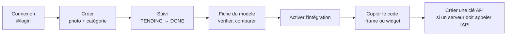

1. Lancer le serveur, ouvrir `http://127.0.0.1:8000`, se connecter.
2. Aller dans **Créer**, déposer une photo nette, choisir la catégorie, cliquer sur « Créer le modèle 3D → ».
3. Attendre l'étape « Terminé », puis cliquer sur « Ouvrir la fiche du modèle → ».
4. Vérifier le modèle avec « Comparer » ; le télécharger si besoin.
5. Activer l'interrupteur « Intégration publique de ce modèle ».
6. Choisir « IFrame » ou « Widget Forma3D », cliquer sur « Copier », envoyer le code au développeur de la boutique.
7. Si le développeur doit appeler l'API, créer une clé dans **Clés API** et la lui transmettre de façon sûre.

Sans serveur 3D en ligne : remplacer l'étape 2 par **Exemples → « Ajouter à mes modèles »** ou **Mes modèles → « Importer un modèle (.glb) »**.

### 11 b. Le développeur d'une boutique : de la clé API à l'affichage

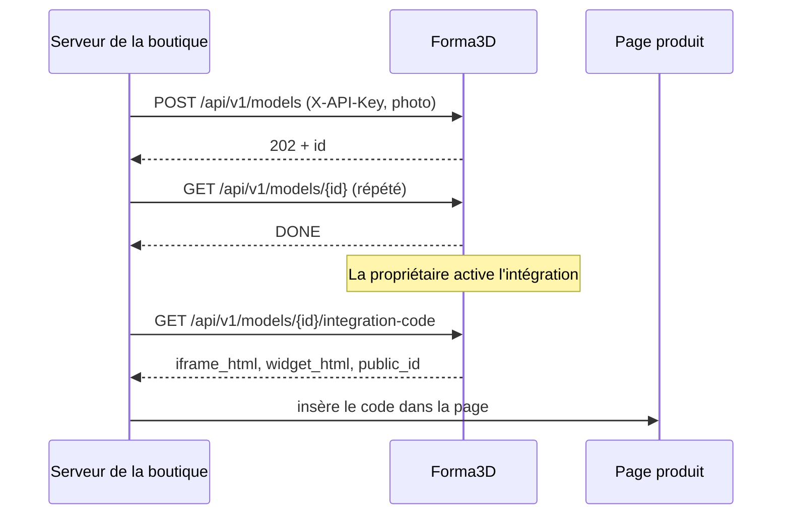

1. Recevoir une clé API de la propriétaire et la ranger **côté serveur** (jamais dans le JavaScript public).
2. Envoyer une photo : `POST /api/v1/models` avec l'en-tête `X-API-Key`.
3. Suivre l'état : `GET /api/v1/models/{id}` jusqu'à `DONE`.
4. Après activation par la propriétaire, récupérer le code : `GET /api/v1/models/{id}/integration-code`.
5. Insérer l'iframe ou le widget dans la page produit.
6. Faire autoriser l'adresse du site dans `EMBED_ALLOWED_ORIGINS`.

### 11 c. Le visiteur final

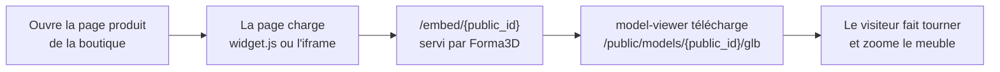

1. Le visiteur ouvre la page produit de la boutique.
2. Le navigateur charge l'iframe `/embed/{public_id}` depuis Forma3D.
3. Forma3D vérifie que le modèle existe, est terminé et que son intégration est activée ; sinon, il affiche « Ce modèle 3D n'est pas disponible… ».
4. Le visiteur fait tourner le modèle à la souris ou au doigt. Il ne voit **jamais** de clé API.
