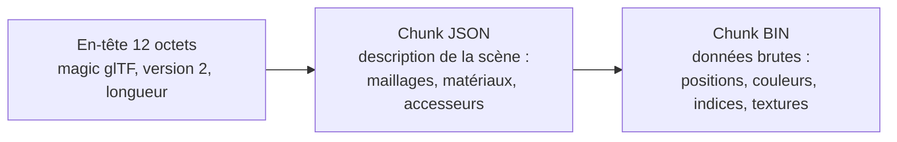
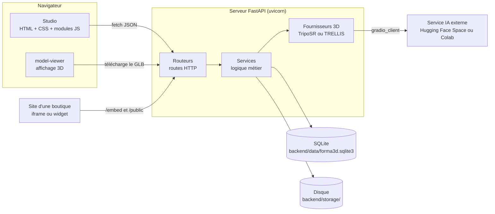
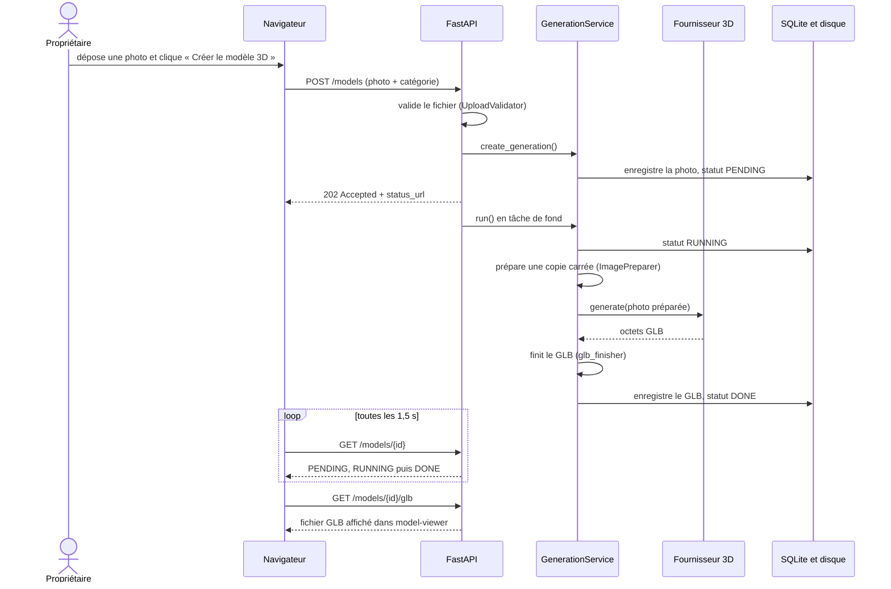
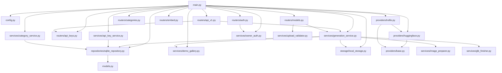
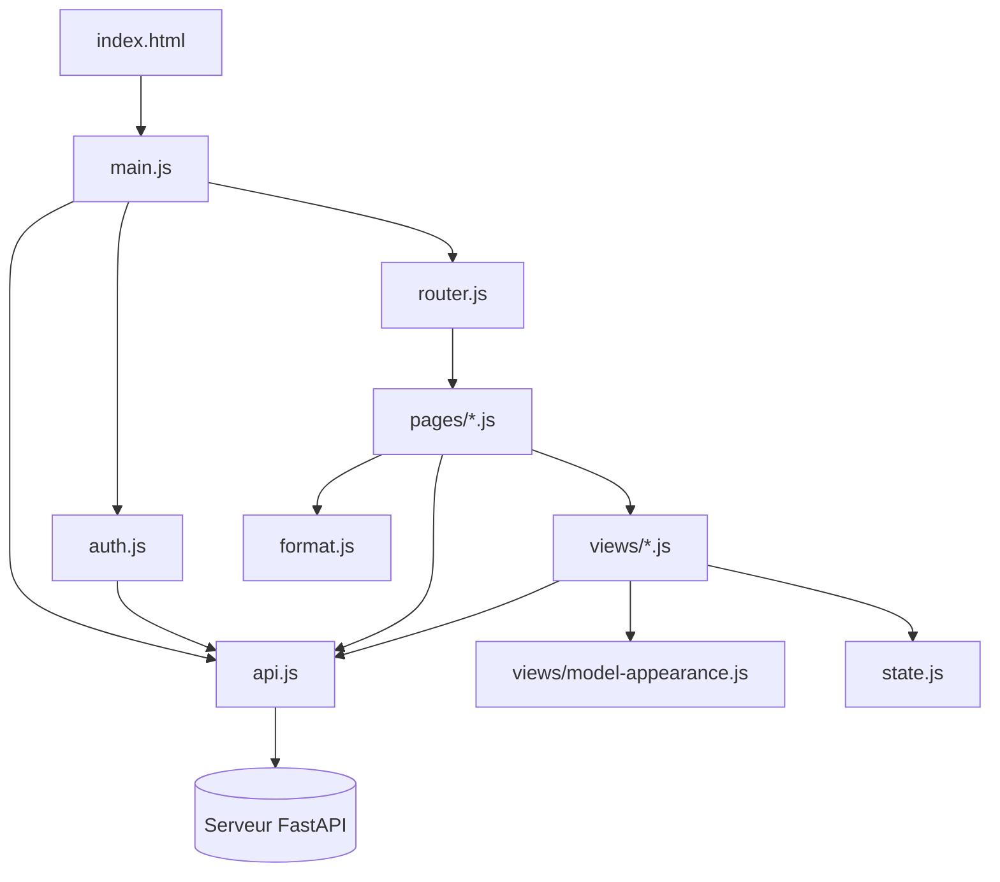

# Comprendre Forma3D Studio — le guide complet

> Document pédagogique pour comprendre **tout** le projet et l'expliquer à un jury.
> Il décrit uniquement ce qui existe dans le dépôt au 15 novembre 2026 (dernier commit lu : `3623e92`).
> Quand une information n'a pas pu être vérifiée dans le code, elle est marquée **« à vérifier »**.

---

## 0. Comment lire ce document

**En une phrase :** chaque section commence par un résumé « En une phrase », puis détaille avec des tableaux, des schémas et des exemples.

- **Si vous avez 10 minutes :** lisez les sections 1, 3 et 11 (le projet, l'architecture, les parcours).
- **Pour la soutenance :** ajoutez les sections 10 (le site page par page) et 12 (la sécurité).
- **Pour comprendre le code :** sections 4, 5, 6 et 8.
- Les schémas sont écrits en **Mermaid** (un langage texte que GitHub transforme en dessin). Sur GitHub, ils s'affichent automatiquement.
- Des **analogies** avec ce que vous connaissez déjà (Angular, Spring Boot, Keycloak, Oracle PL/SQL, Symfony) sont signalées par 🔁.

Légende :

| Symbole | Sens |
|---|---|
| 🔁 | Analogie avec une technologie que vous connaissez |
| ⚠️ | Piège, limite ou point temporaire |
| ✅ | Vérifié dans le code ou par un test |
| **à vérifier** | Information non confirmée par le code |

---

## 1. Le projet en 5 minutes

**En une phrase :** Forma3D Studio transforme une photo de petit meuble en modèle 3D, permet de le vérifier, puis de l'afficher sur le site d'une boutique en ligne.

### Le problème

Une boutique en ligne montre ses produits avec des photos plates. Un modèle 3D (que l'on fait tourner à la souris) aide l'acheteur, mais il coûte cher à fabriquer : il faut un logiciel 3D et une personne formée.

### La solution

1. La propriétaire du Studio envoie **une photo** d'un meuble (chaise, tabouret, table d'appoint).
2. Un **modèle d'intelligence artificielle déjà entraîné** (TripoSR ou TRELLIS) fabrique un fichier 3D `.glb`.
3. Le Studio affiche ce modèle, le compare à la photo et permet de le télécharger.
4. La propriétaire **active l'intégration** : un site partenaire peut alors afficher le modèle avec une simple balise HTML.
5. Un développeur partenaire peut aussi piloter Forma3D par une **API** protégée par une **clé API**.

### Pour qui ?

| Personne | Ce qu'elle fait |
|---|---|
| **La propriétaire** (vous) | Utilise le Studio : crée, importe, vérifie et publie les modèles. Seule personne qui se connecte. |
| **Le développeur d'une boutique** | Utilise une clé API et le code d'intégration (iframe ou widget). |
| **Le visiteur final** | Voit et fait tourner le modèle 3D sur la page produit de la boutique. |
| **Le jury** | Doit comprendre un prototype honnête sur ses limites. |

### Ce que le projet n'est PAS

- ❌ **Aucun entraînement de modèle** : le projet utilise uniquement des modèles **pré-entraînés** (déjà appris par d'autres équipes). Aucun réseau de neurones n'est entraîné ou ajusté.
- ❌ **Aucune API payante** : tout est gratuit. Les services gratuits ont des **quotas** (limites journalières) et peuvent être hors ligne.
- ❌ **Pas un service de production** : c'est un prototype de soutenance, à utiliser en local tant qu'il n'est pas déployé en HTTPS.
- ❌ **Pas de comptes multiples** : un seul mot de passe, celui de la propriétaire (les comptes vendeurs sont une perspective, voir section 16).
- ❌ **Pas une reconstruction exacte** : une seule photo ne montre pas l'arrière de l'objet ; le modèle est une **estimation**, pas un plan de fabrication.

---

## 2. Le format `.glb`

**En une phrase :** un fichier `.glb` est un objet 3D complet (forme, couleurs, matériaux) rangé dans un seul fichier binaire que les navigateurs savent afficher.

### Ce que c'est

- **glTF** (GL Transmission Format) est le format 3D standard du web, publié par le Khronos Group. On le surnomme « le JPEG de la 3D ».
- **GLB** est la version **binaire** de glTF : tout tient dans **un seul fichier**.
- Un fichier GLB contient deux parties appelées **chunks** (morceaux) :



| Partie | Contenu | 🔁 Analogie |
|---|---|---|
| En-tête | Le mot `glTF`, la version `2`, la longueur totale | La signature d'un fichier |
| Chunk JSON | La **description** : quels maillages, quels matériaux, où lire les nombres | Le schéma d'une table Oracle |
| Chunk BIN | Les **nombres** : coordonnées des sommets, triangles, image de texture | Les lignes de la table |

Le code du projet vérifie cette structure dans `DemoGallery.is_valid_glb_2()` (`backend/app/services/demo_gallery.py`) et `HuggingFaceSpaceProvider._read_glb()` (`backend/app/providers/huggingface.py`). ✅

### Vocabulaire de la 3D

| Terme | Définition simple |
|---|---|
| **Sommet** (vertex) | Un point dans l'espace (x, y, z) |
| **Triangle** | Trois sommets reliés ; la surface d'un objet est faite de milliers de triangles |
| **Maillage** (mesh) | L'ensemble des triangles d'un objet |
| **Normale** | Une flèche perpendiculaire à la surface ; elle sert à calculer la lumière |
| **Matériau** | Comment la surface réagit à la lumière : couleur, aspect **métallique**, **rugosité** |
| **Texture** | Une image collée sur la surface (comme un papier peint) |

### Couleurs de sommets contre textures

| | Couleurs de sommets (TripoSR) | Texture (TRELLIS) |
|---|---|---|
| Principe | Chaque sommet porte une couleur ; entre deux sommets, la couleur est mélangée | Une image PNG est plaquée sur la surface grâce à des coordonnées UV |
| Précision | Faible : les détails fins disparaissent | Bonne : motifs, cannage de l'assise visibles |
| Mesuré dans le projet | 20 000 à 65 000 sommets, aucun matériau, aucune normale | Texture PNG d'environ 1 Mo, un matériau, pas de normales |

⚠️ **Piège découvert dans le projet** : quand un GLB n'a pas de matériau, ou qu'il oublie la valeur `metallicFactor`, la norme glTF le considère **100 % métallique**. Le modèle paraît alors presque noir. Le projet corrige cela à deux endroits (voir section 7) : à l'affichage (`frontend/js/views/model-appearance.js`) et dans le fichier lui-même (`backend/app/services/glb_finisher.py`).

### Comment un navigateur l'affiche

Le navigateur utilise **WebGL** (la carte graphique depuis JavaScript). Le projet n'écrit pas de WebGL à la main : il utilise le composant **`<model-viewer>`** de Google, chargé depuis un CDN dans `frontend/index.html`. On écrit simplement :

```html
<model-viewer src="/models/gallery/chair-bentwood" camera-controls auto-rotate></model-viewer>
```

### Où les GLB sont stockés

| Dossier | Contenu | Suivi par Git ? |
|---|---|---|
| `backend/storage/models/` | GLB générés, importés ou copiés depuis les exemples (nommés par un UUID) | ❌ non (ignoré) |
| `backend/storage/images/` | Photos sources envoyées | ❌ non |
| `backend/data/feasibility-results/` | Les 5 GLB du catalogue d'exemples | ❌ non |
| `backend/data/feasibility-results-triposr/` | Sauvegarde des 3 anciens exemples TripoSR remplacés par TRELLIS | ❌ non |
| `backend/data/trials/` | GLB bruts des essais de fournisseurs | ❌ non |

Les fichiers 3D et la base sont **locaux** : ils ne partent jamais sur GitHub.

### Comment un GLB entre dans le projet

1. **Génération** : une photo est envoyée au fournisseur (TripoSR ou TRELLIS), qui renvoie un GLB ; le service le **finit** (matériau, normales) puis l'enregistre.
2. **Import** : la propriétaire importe un `.glb` existant depuis « Mes modèles ».
3. **Copie d'exemple** : un exemple du catalogue est copié dans « Mes modèles ».

### Ouvrir un GLB sur votre PC

- **Windows** : double-cliquez sur le fichier ; il s'ouvre dans la **Visionneuse 3D** de Windows (application « 3D Viewer », à installer depuis le Microsoft Store si elle n'est pas présente — **à vérifier** sur votre version de Windows).
- **Blender** (gratuit) : menu *File → Import → glTF 2.0 (.glb/.gltf)*.
- **Dans le Studio** : page Créer, bouton « Aperçu d'un fichier GLB (sans enregistrer) » ; le fichier est lu par le navigateur et n'est pas envoyé au serveur.

---

## 3. Architecture

**En une phrase :** un navigateur parle à un serveur FastAPI, qui range les informations dans SQLite, les fichiers sur le disque, et demande les modèles 3D à un service d'IA externe.

### 3.1 Les composants



🔁 **Analogie Spring Boot** : les **routeurs** sont les `@RestController`, les **services** sont les `@Service`, les **dépôts** (repositories) sont les `@Repository`. FastAPI joue le rôle de Spring Boot, uvicorn celui de Tomcat.

🔁 **Analogie Angular** : le frontend n'utilise **pas** Angular. C'est du JavaScript « vanille » organisé en modules : `router.js` joue le rôle du `RouterModule`, chaque fichier de `pages/` est comme un composant, `api.js` est comme un `HttpClient` centralisé dans un service.

### 3.2 Le parcours complet d'un modèle

```mermaid
flowchart LR
    A["1. Photo<br/>JPG, PNG ou WebP"] --> B["2. Validation<br/>format, 10 Mo max"]
    B --> C["3. Préparation<br/>carré, marges, 512 px min"]
    C --> D["4. Génération<br/>TripoSR ou TRELLIS"]
    D --> E["5. Finition GLB<br/>matériau mat + normales"]
    E --> F["6. Stockage<br/>disque + SQLite"]
    F --> G["7. Viewer<br/>fiche du modèle"]
    G --> H["8. Activation<br/>de l'intégration"]
    H --> I["9. Site client<br/>iframe ou widget"]
```



### 3.3 Séquence d'une génération



⚠️ Le statut terminé s'appelle **`DONE`** dans le code (pas `COMPLETED`). ✅

---

## 4. Technologies

**En une phrase :** le projet utilise volontairement peu de technologies, toutes gratuites, pour rester explicable.

### 4.1 Tableau récapitulatif

| Technologie | Rôle | Pourquoi ce choix | Alternative possible | Où dans le code |
|---|---|---|---|---|
| **Python 3** | Langage du serveur | Écosystème IA (gradio_client) | Java | `backend/` |
| **FastAPI** | Framework web | Simple, rapide, documentation automatique | Spring Boot, Symfony, Flask | `backend/app/main.py`, `routers/` |
| **uvicorn** | Serveur HTTP qui exécute FastAPI | Standard pour FastAPI | Tomcat (Java), gunicorn | commande de lancement |
| **Pydantic** | Validation des données JSON | Intégré à FastAPI | Bean Validation (Java) | `backend/app/schemas.py` |
| **python-multipart** | Lecture des formulaires avec fichier | Nécessaire pour l'upload | — | upload `POST /models` |
| **python-dotenv** | Lecture du fichier `.env` | Garde les secrets hors du code | variables système | `backend/app/config.py` |
| **SQLite** | Base de données | Un seul fichier, aucun serveur à installer | PostgreSQL, Oracle | `repositories/sqlite_repository.py` |
| **Pillow** | Traitement d'image | Léger, sans IA | OpenCV | `services/image_preparer.py` |
| **gradio_client** | Appel des services IA Gradio | Bibliothèque officielle | requêtes HTTP à la main | `providers/huggingface.py`, `providers/trellis.py` |
| **httpx2** | Requêtes HTTP (contrôle de santé du fournisseur) | Client HTTP moderne | requests | `providers/huggingface.py`, `providers/trellis.py` |
| **Hugging Face Spaces** | Hébergement gratuit de démonstrations IA | Gratuit avec quota | Replicate (payant) | configuration `TRELLIS_SPACE_ID` |
| **Google Colab** | GPU gratuit temporaire pour TripoSR | Gratuit, sans carte | serveur GPU payant | `tools/colab/triposr_server.ipynb` |
| **TripoSR** | Modèle image→3D (couleurs de sommets) | Premier modèle qui a fonctionné | — | fournisseur par défaut |
| **TRELLIS** | Modèle image→3D (texture) | Meilleures couleurs mesurées | Hunyuan3D (licence exclut l'UE) | `providers/trellis.py` |
| **model-viewer** | Composant web d'affichage 3D | Une balise HTML suffit | Three.js | `frontend/index.html`, `pages/` |
| **Modules ES** | Découpage du JavaScript en fichiers | Natif, sans outil de build | Angular, webpack | `frontend/js/` |
| **Web Components** | Balise HTML personnalisée `<forma3d-viewer>` | Fonctionne sur tout site | iframe seule | `frontend/widget.js` |
| **pytest** | Tests automatiques | Standard Python | JUnit | `backend/tests/` |
| **GitHub Actions** | Intégration continue | Gratuit pour un dépôt GitHub | GitLab CI, Jenkins | `.github/workflows/ci.yml` |

### 4.2 Explications simples

- **FastAPI** : on écrit une fonction Python et on la décore avec `@router.get("/chemin")`. FastAPI la transforme en route HTTP, vérifie les données et génère une documentation interactive sur `/docs`. 🔁 C'est un `@GetMapping` de Spring Boot.
- **uvicorn** : le programme qui écoute sur un port (ex. 8000) et transmet les requêtes à FastAPI. 🔁 Tomcat pour Spring Boot.
- **Pydantic** : des classes qui décrivent la forme d'un JSON (`class LoginRequest(BaseModel): password: str`). Si le JSON reçu ne correspond pas, FastAPI répond 422. 🔁 DTO + `@Valid`.
- **SQLite** : une base SQL complète dans **un seul fichier**. Pas de serveur à installer. 🔁 Comme Oracle, mais sans instance ni utilisateur.
- **Pillow** : ouvre une image, la redimensionne, ajoute des marges, mesure la netteté.
- **gradio_client** : **Gradio** est une bibliothèque qui crée une page web autour d'un modèle IA. `gradio_client` permet d'appeler cette page **depuis un programme**. Le projet appelle toujours `view_api()` d'abord pour lire les fonctions réellement disponibles (le « contrat »).
- **Hugging Face Spaces** : un site qui héberge gratuitement des démonstrations IA. Le GPU gratuit (**ZeroGPU**) a un **quota par jour**.
- **TripoSR** : modèle de Stability AI et Tripo AI, qui produit une forme fidèle mais des couleurs approximatives.
- **TRELLIS** : modèle de Microsoft, qui produit un maillage avec une **texture** (meilleures couleurs), mais qui peut inventer des parties cachées.
- **model-viewer** : une balise HTML fournie par Google qui affiche un GLB avec rotation, zoom et éclairage.
- **Modules ES** : `import { x } from "./api.js?v=..."`. Le navigateur charge les fichiers à la demande. Le paramètre `?v=20261112-d1` est une **clé de cache** : on la change quand le code change, pour que le navigateur ne garde pas l'ancienne version.
- **Web Components** : on définit une nouvelle balise (`customElements.define("forma3d-viewer", ...)`) utilisable dans n'importe quelle page HTML, même sans framework.
- **pytest** : chaque fonction `test_...` est exécutée ; si une ligne `assert` échoue, le test échoue.
- **GitHub Actions** : à chaque `git push`, GitHub lance les tests sur une machine virtuelle (voir section 14).

---

## 5. Arborescence et relations entre fichiers

**En une phrase :** le dépôt est découpé en `backend/` (serveur Python), `frontend/` (interface servie par le serveur), `docs/` (documentation) et quelques outils, chaque fichier ayant un seul rôle.

### 5.1 Tous les fichiers suivis par Git

#### Racine

| Fichier | Rôle |
|---|---|
| `.env.example` | Modèle des variables d'environnement, **sans secret** (voir section 9) |
| `.github/workflows/ci.yml` | Intégration continue : tests à chaque push |
| `.gitignore` | Liste de ce que Git ne doit pas suivre (`.env`, base, GLB, photos…) |
| `AGENTS.md` | Règles permanentes du projet pour les assistants IA |
| `DESIGN.md` | Règles visuelles : couleurs, typographie, composants |
| `PRODUCT.md` | Vision produit, utilisateurs, limites |
| `README.md` | Présentation et démarrage du dépôt |

#### Backend — application (`backend/app/`)

| Fichier | Rôle |
|---|---|
| `backend/README.md` | Explications du backend |
| `backend/requirements.txt` | Dépendances Python (FastAPI, uvicorn, Pillow…) |
| `backend/app/__init__.py` | Fait de `app` un paquet Python (vide) |
| `backend/app/main.py` | **Point d'entrée** : crée l'application, choisit le fournisseur, branche les routeurs, sert la page `/` |
| `backend/app/config.py` | Lit les variables d'environnement et les valide (`Settings`) |
| `backend/app/models.py` | Objets métier : `GenerationRecord`, `CategoryRecord`, `APIKeyRecord`, statuts, origines |
| `backend/app/schemas.py` | Formes des réponses et requêtes JSON (Pydantic) |
| `backend/app/providers/__init__.py` | Paquet des fournisseurs (vide) |
| `backend/app/providers/base.py` | Contrat `Image3DProvider` : « une image entre, des octets GLB sortent » |
| `backend/app/providers/huggingface.py` | Fournisseur **TripoSR** (Space Hugging Face ou URL Gradio Colab) |
| `backend/app/providers/trellis.py` | Fournisseur **TRELLIS** (Space public, détourage puis GLB texturé) |
| `backend/app/repositories/__init__.py` | Paquet des dépôts (vide) |
| `backend/app/repositories/base.py` | Contrat `GenerationRepository` : toutes les opérations de base de données |
| `backend/app/repositories/sqlite_repository.py` | Implémentation SQLite : tables, migrations, requêtes |
| `backend/app/routers/__init__.py` | Paquet des routeurs (vide) |
| `backend/app/routers/auth.py` | Connexion : `/auth/login`, `/auth/logout`, `/auth/me`, dépendance `require_owner` |
| `backend/app/routers/models.py` | Modèles du Studio : création, galerie, import, copie, intégration, fichiers ; routes `/public` |
| `backend/app/routers/categories.py` | CRUD des catégories |
| `backend/app/routers/api_keys.py` | Gestion des clés API et dépendance `require_api_key` |
| `backend/app/routers/api_v1.py` | API externe versionnée `/api/v1` (protégée par clé) |
| `backend/app/routers/embed.py` | Page publique `/embed/{public_id}` affichée dans une iframe |
| `backend/app/services/__init__.py` | Paquet des services (vide) |
| `backend/app/services/generation_service.py` | Orchestration : états, préparation, fournisseur, finition, stockage |
| `backend/app/services/upload_validator.py` | Vérifie format et taille de la photo |
| `backend/app/services/image_preparer.py` | Prépare une copie carrée de la photo et signale flou ou petite taille |
| `backend/app/services/glb_finisher.py` | Ajoute matériau mat et normales aux GLB générés |
| `backend/app/services/category_service.py` | Règles métier des catégories |
| `backend/app/services/api_key_service.py` | Création, empreinte, vérification, quotas des clés |
| `backend/app/services/demo_gallery.py` | Liste fixe des 5 exemples du catalogue |
| `backend/app/services/owner_auth.py` | Mot de passe, jetons de session signés, limite de tentatives |
| `backend/app/storage/__init__.py` | Paquet du stockage (vide) |
| `backend/app/storage/base.py` | Contrat `Storage` (enregistrer photo et GLB) |
| `backend/app/storage/local_storage.py` | Stockage sur le disque local, écriture atomique |

#### Backend — tests (`backend/tests/`)

| Fichier | Ce qu'il vérifie |
|---|---|
| `conftest.py` | Ouvre la session propriétaire pour les tests, sauf ceux marqués `real_auth` |
| `test_api_keys.py` | Empreinte seule, secret affiché une fois, révocation, suppression définitive, quotas |
| `test_api_settings.py` | Validation des quotas et des origines CORS/iframe |
| `test_api_v1.py` | API externe : clé, statuts, erreurs, quota |
| `test_auth.py` | Connexion : 401 sans cookie, mot de passe faux, limite, routes publiques ouvertes |
| `test_categories_api.py` | Routes des catégories |
| `test_category_repository.py` | Catégories dans SQLite |
| `test_category_service.py` | Règles des catégories |
| `test_demo_gallery.py` | Catalogue d'exemples : seuls les fichiers connus et valides |
| `test_embed.py` | Page `/embed` et politique de sécurité CSP |
| `test_frontend.py` | Fichiers du frontend : présence des éléments, `fetch` seulement dans `api.js` |
| `test_generation_repository.py` | Historique des générations dans SQLite, redémarrage |
| `test_generation_service.py` | États PENDING → DONE ou FAILED, photo préparée |
| `test_glb_finisher.py` | Finition des GLB sans modifier la géométrie |
| `test_health.py` | Routes `/health` et `/health/provider` |
| `test_huggingface_provider.py` | Fournisseur TripoSR avec client simulé |
| `test_image_preparer.py` | Préparation de la photo |
| `test_local_storage.py` | Écriture des fichiers |
| `test_model_library.py` | Import GLB et copie d'exemple |
| `test_models_api.py` | Routes `/models` |
| `test_trellis_provider.py` | Fournisseur TRELLIS avec client simulé |
| `test_trial_tools.py` | Outils d'essai de fournisseurs |
| `test_upload_validator.py` | Validation des photos |

#### Frontend (`frontend/`)

| Fichier | Rôle |
|---|---|
| `frontend/README.md` | Explications du frontend |
| `frontend/index.html` | **Coque** : en-tête, menu, pied de page, point de montage `#app` |
| `frontend/favicon.svg` | Icône d'onglet |
| `frontend/widget.js` | Balise `<forma3d-viewer>` pour les sites partenaires |
| `frontend/css/theme.css` | Couleurs, espacements, animations |
| `frontend/css/components.css` | Styles de tous les composants (14 sections) |
| `frontend/js/main.js` | Démarrage : vérifie la session, lance le routeur, surveille le serveur 3D |
| `frontend/js/router.js` | Routes `#/...`, protection par connexion, changement de page |
| `frontend/js/api.js` | **Seul fichier qui appelle le serveur** (`fetch`) |
| `frontend/js/auth.js` | État de connexion (lu sur `/auth/me`) |
| `frontend/js/state.js` | État temporaire d'une génération en cours |
| `frontend/js/format.js` | Dates relatives, tailles, durées, fournisseur des exemples |
| `frontend/js/pages/login.js` | Page Connexion |
| `frontend/js/pages/dashboard.js` | Page Accueil |
| `frontend/js/pages/create.js` | Page Créer |
| `frontend/js/pages/viewer-markup.js` | HTML du viewer de la page Créer |
| `frontend/js/pages/models.js` | Page Mes modèles |
| `frontend/js/pages/model-detail.js` | Fiche d'un modèle |
| `frontend/js/pages/examples.js` | Page Exemples |
| `frontend/js/pages/categories.js` | Page Catégories |
| `frontend/js/pages/api-keys.js` | Page Clés API |
| `frontend/js/pages/guide.js` | Page Guide d'intégration |
| `frontend/js/views/uploader.js` | Dépôt et validation de la photo |
| `frontend/js/views/progress.js` | Les 5 étapes du suivi de création |
| `frontend/js/views/viewer.js` | Viewer 3D de la page Créer |
| `frontend/js/views/gallery.js` | Cartes de modèles et filtres |
| `frontend/js/views/categories.js` | Gestion des catégories |
| `frontend/js/views/confirm-dialog.js` | Fenêtre de confirmation |
| `frontend/js/views/illustrations.js` | Dessin SVG du cube (états vides) |
| `frontend/js/views/model-appearance.js` | Correction du matériau et recadrage de la caméra |

#### Documentation (`docs/`)

| Fichier | Rôle |
|---|---|
| `docs/COMPRENDRE-FORMA3D.md` | Ce guide |
| `docs/ETAT.md` | État d'avancement, étape par étape |
| `docs/STRUCTURE.md` | Rôle de chaque fichier et dossier |
| `docs/STOCKAGE.md` | Base SQLite, fichiers, intégration |
| `docs/INTEGRATION.md` | Guide pour le développeur d'une boutique |
| `docs/ALTERNATIVES-3D.md` | Comparaison des fournisseurs 3D gratuits |
| `docs/QUALITE-3D.md` | Grille de qualité et résultats d'essais |
| `docs/etapes/.gitkeep` | Garde le dossier dans Git |
| `docs/etapes/etape-01.md` | Structure et contrôle de santé |
| `docs/etapes/etape-02.md` | Validation de l'upload |
| `docs/etapes/etape-03.md` | Contrat image→3D et fournisseur Hugging Face |
| `docs/etapes/etape-04.md` | Génération, états et stockage local |
| `docs/etapes/etape-05.md` | Interface modulaire et viewer |
| `docs/etapes/etape-06.md` | Essais TripoSR réels |
| `docs/etapes/etape-06-colab.md` | TripoSR, Colab et limites du serveur public |
| `docs/etapes/etape-07.md` | Fiabilité et qualité |
| `docs/etapes/etape-08.md` | SQLite et historique persistant |
| `docs/etapes/etape-09.md` | CRUD des catégories |
| `docs/etapes/etape-10.md` | Préparation locale de la photo |
| `docs/etapes/etape-11.md` | Refonte de la navigation |
| `docs/etapes/etape-11b.md` | Refonte de la page Créer |
| `docs/etapes/etape-12.md` | Import GLB et bibliothèque unifiée |
| `docs/etapes/etape-13.md` | Identifiant public et activation (Sprint 5a) |
| `docs/etapes/etape-14.md` | Clés API (Sprint 5b) |
| `docs/etapes/etape-15.md` | API versionnée (Sprint 5c) |
| `docs/etapes/etape-16.md` | Intégration dans une boutique (Sprint 5d) |
| `docs/etapes/etape-16b.md` | Refonte visuelle du Studio |
| `docs/etapes/etape-17.md` | Guide intégrateur et preuve sur un autre site (Sprint 5e) |
| `docs/etapes/etape-18.md` | Connexion côté serveur (Sprint 5f) |
| `docs/etapes/etape-19.md` | Rendu fidèle des GLB (sous-étape A) |
| `docs/etapes/etape-20.md` | Finition serveur des GLB (sous-étape B) |
| `docs/etapes/etape-21.md` | Grille de qualité et essais de fournisseurs (sous-étape C) |
| `docs/etapes/etape-22.md` | TRELLIS branché dans Forma3D (sous-étape C3) |
| `docs/archive/v1/AGENTS-ancien.md` | Ancienne version des règles (historique) |
| `docs/archive/v1/PROMPT-1-v1.md` | Ancienne consigne de démarrage (historique) |
| `docs/archive/v1/etapes/etape-01-v1.md` | Ancienne étape 1 (historique) |
| `docs/archive/v1/etapes/etape-02-v1.md` | Ancienne étape 2 (historique) |

#### Outils et exemples

| Fichier | Rôle |
|---|---|
| `examples/integration.html` | Faux « site de boutique » pour tester le widget |
| `scripts/dev.ps1` | Script Windows : crée l'environnement, lance les tests, démarre le serveur sur le port 8001 |
| `tools/colab/triposr_server.ipynb` | Notebook Colab historique de TripoSR (hors application) |
| `tools/trials/trial_trellis.py` | Essai TRELLIS reproductible (hors application) |
| `tools/trials/trial_models.py` | Essai de plusieurs modèles (hors application) |

### 5.2 Qui importe qui — backend



### 5.3 Qui importe qui — frontend



Règle vérifiée par un test (`test_frontend.py`) : **seul `api.js` contient `fetch(`**. ✅ 🔁 Comme un service Angular unique qui centralise tous les appels `HttpClient`.

### 5.4 La chaîne complète sur un exemple réel : « Créer le modèle 3D »

| # | Couche | Fichier et fonction | Ce qui se passe |
|---|---|---|---|
| 1 | Page | `frontend/js/views/uploader.js` → écouteur `submit` du formulaire `#upload-form` | Vérifie qu'une photo et une catégorie sont choisies, puis appelle `startGeneration` |
| 2 | Page | `frontend/js/pages/create.js` → `startGeneration()` | Passe en mode « occupé », lance le chronomètre |
| 3 | Appel HTTP | `frontend/js/api.js` → `createGeneration(photo, category)` | `POST /models` avec un `FormData` |
| 4 | Route | `backend/app/routers/models.py` → route `POST /models` | Protégée par `require_owner` ; valide le fichier avec `UploadValidator` |
| 5 | Service | `GenerationService.create_generation()` | Enregistre la photo, crée l'enregistrement `PENDING` |
| 6 | Dépôt | `SQLiteGenerationRepository.save_generation()` | Insère la ligne dans `generations` |
| 7 | Tâche de fond | `GenerationService.run()` | Passe en `RUNNING`, prépare la photo (`ImagePreparer`) |
| 8 | Fournisseur | `HuggingFaceSpaceProvider.generate()` ou `TrellisSpaceProvider.generate()` | Appelle le service IA et vérifie le GLB reçu |
| 9 | Service | `_finish_generated_model()` → `glb_finisher.finish_glb()` | Ajoute matériau mat et normales |
| 10 | Stockage | `LocalStorage.save_model()` | Écrit `backend/storage/models/{id}.glb` |
| 11 | Dépôt | `save_generation()` | Statut `DONE`, chemin du GLB, durée |
| 12 | Page | `create.js` → `refreshStatus()` toutes les 1,5 s | `GET /models/{id}` jusqu'à `DONE`, puis affiche le modèle dans le viewer |

