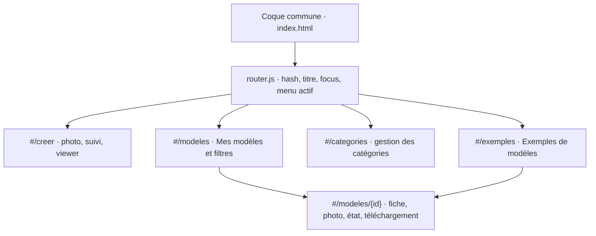

# Étape 11 — Refonte UX de la navigation

Cette étape est une amélioration frontend historique du Studio ; elle précède le Sprint 5.

## Routes et responsabilités

`frontend/index.html` conserve le menu et le badge santé ; `frontend/js/router.js` lit les routes sans framework. `hashchange` prend en charge les clics, Précédent et Suivant. À chaque page, le titre du document change, le lien courant reçoit `aria-current="page"` et le titre reçoit le focus. Les anciennes ancres `#studio`, `#gallery` et `#category-management` sont redirigées vers la page correspondante.

## Détails produit et données

- `models.js` et `examples.js` réutilisent `GET /models/gallery` et séparent les identifiants UUID de génération des identifiants fixes des exemples. Les filtres de catégorie viennent de `GET /categories`.
- `model-detail.js` réutilise les routes existantes d'état, galerie, téléchargement et photo source. Un identifiant absent affiche un message clair. Les exemples n'ont pas de date/durée ; le schéma actuel ne transmet pas la durée des générations. La page affiche donc « Non communiquée ».
- Aucun endpoint backend, fournisseur, modèle ou configuration n'a changé. La suppression de catégorie demande une confirmation native du navigateur. Les erreurs liées aux identifiants internes sont traduites en français simple pour la propriétaire.
- Sous 640 px, le menu est replié derrière un bouton burger ; les pages et cartes s'adaptent jusqu'à 360 px. La palette reste celle de `DESIGN.md`.

## Vérifications

- Tests ciblés frontend : 5 réussis. Suite complète : 75 tests réussis, sans appel au fournisseur et sans lecture de `backend/.env`.
- Syntaxe Node.js : 15 fichiers JavaScript vérifiés. Aucun navigateur n'a été piloté et aucune génération réelle n'a été lancée.

## Parcours à vérifier dans le navigateur

1. Ouvrir chaque URL hash et utiliser Précédent/Suivant ; vérifier le titre d'onglet, le focus du titre et le lien actif.
2. Sous 640 px, ouvrir/fermer le menu ; vérifier aussi les largeurs 360 px et 1440 px.
3. Vérifier que Mes modèles exclut les cinq exemples et que les filtres de Mes modèles/Exemples suivent les catégories.
4. Tester création, renommage, activation, suppression annulée puis confirmée, et le message API si une catégorie est déjà utilisée.
5. Ouvrir un exemple, une génération, puis un identifiant inconnu ; comparer la photo source et tester le téléchargement.
6. À l'arrêt du service, vérifier le message simple, les détails repliés et la pastille d'état. La durée reste « Non communiquée » car l'API actuelle ne la transmet pas.
